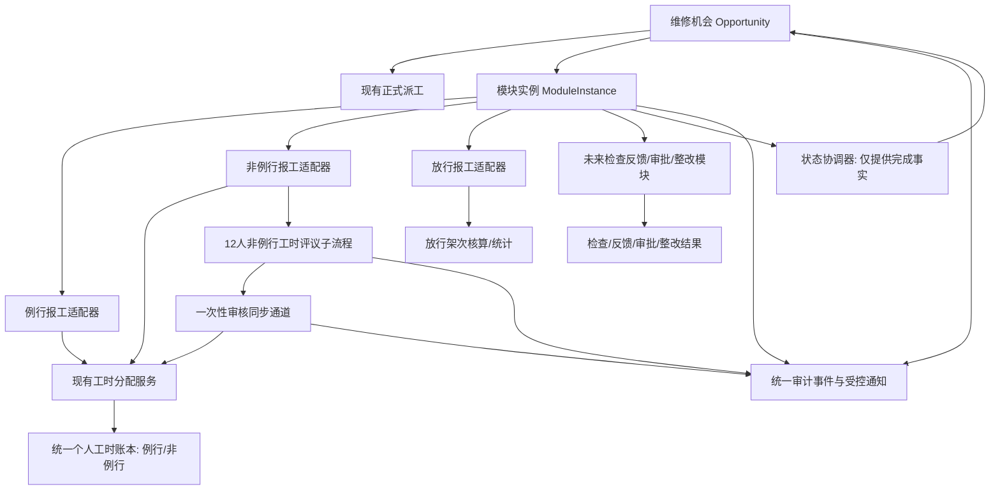
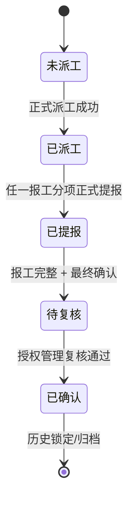
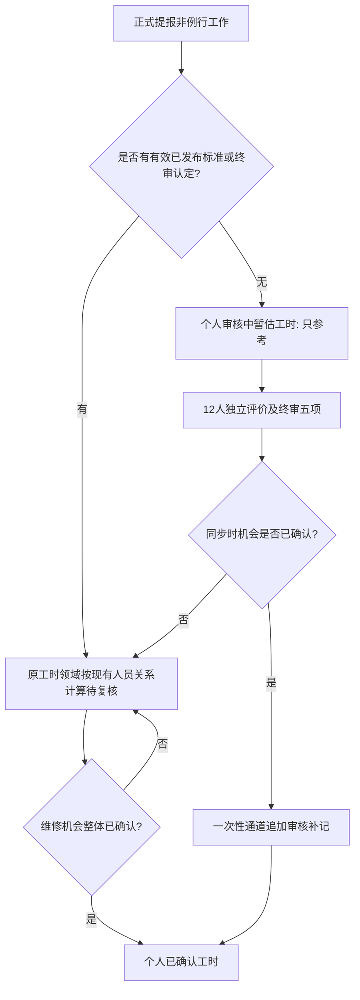
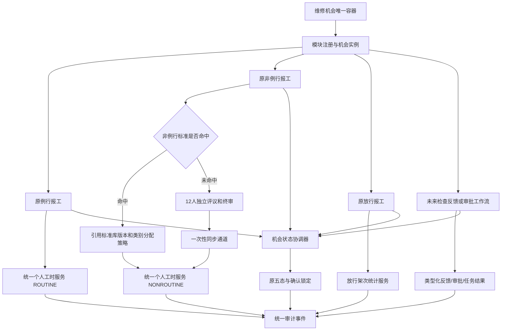
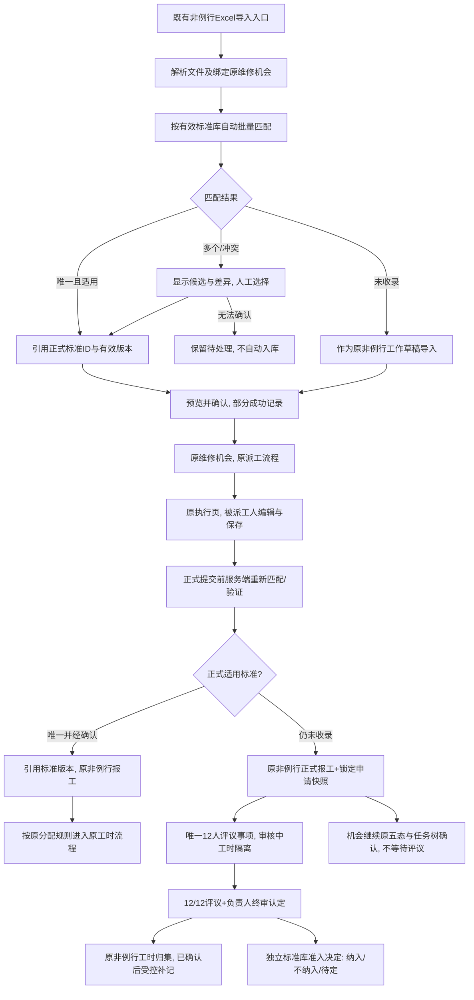
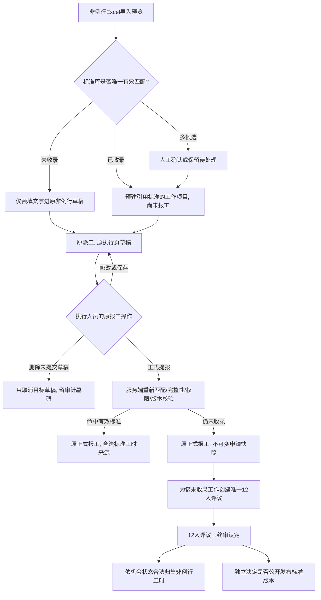

# 航线运行中心｜维修管控模块设计、工作流与编码规范

> **文档编号：** MUC-MAINT-DEV-001  
> **版本：** **V10.1 完整开发规范（继承V10.0完整主规范 + 未收录Excel文字草稿与多次导入安全修订 + 全风险闭环）**  
> **日期：** 2026-11-09  
> **适用场景：** 需求评审、模块扩展、Codex 开发、代码审查、数据库迁移、联调与上线验收  
> **系统：** 航线运行中心（https://www.ceairm.com）  
> **适用范围：** 维修管控（维修机会、派工、执行报工、放行报工、例行/非例行、复核、个人工时及非例行工时审核）  
> **版本属性：** 完整承接V10.0§0～38和P0-01～186全部设计基线（包括8条已确认的Excel导入规则），增补并修订§39～43与P0-187～210；V10.1修订明确：未收录Excel导入仅是文字草稿预录入、同机会多次导入不得覆盖/合并/无提示重复、三类待定策略仅留未来扩展口。新规则与早期论述冲突时以§39～42为准。**现状附录基准 `5e090b4`（2026-11-08）；并非目前代码/生产环境已实现声明。**
> **设计决策状态：** 5类已确定：`工卡指令/单项工作=现有7组角色组合比例`、`拖机/试车/三方附加=有效参与人平均分配`；3类`其他/人工除冰/联合除冰`只保留未来方案扩展口，暂不实现新分配策略，也不因此阻塞其他已确定功能的设计、开发及对应范围验收；现行“其他”旧合法行为继续兼容。新增策略必须另有业务方案和审批方可启用。
> **前版说明：** **完整承接 V9.7 已批准业务目标，并以《MAINTENANCE_CONTROL_STATE_MAP_2026-11-08.md》所记载的代码扫描结果校正“现有/拟议”界线**。源码核查基准为 `codex/maintenance-personnel @ 5e090b4`（2026-11-08），不是现场生产复核。**不能将8类独立规则、非例行标准库、12人评议、审核中工时、一次性专属通道或模块插件机制称为已实现。**
> **源码基准：** `server.mjs`（下文证据缩写 `S:行号`）、`public/app.js`（`A:行号`），以及 `maintenance-aircraft-hours.mjs`、`db.mjs`、现有迁移和测试；所附现状映射是本版的**已提供审查证据**，不是本次重新进入本机代码仓库的独立复核。

> **开发硬约束：** 原 V1.0 第1～4章的维修机会/派工/例行、非例行、放行报工状态及确认逻辑不变；原执行页面仍是唯一报工入口。禁止因接入工时评议新建第二套维修机会、派工、人员分配或工时账本。
> **V10.1修订性质：** 保留V10.0§0～38的业务与技术基线（历史材料不删除）；增补§39（新的优先业务规则与导入行为）、§40（R-01～R-22逐项风险处置）、§41（P0-187～210）、§42（Codex执行指令）、§43（交付边界）。同时校正旧章节中的前置条件、表述和标题编号。**冲突优先级：V10.1§39～42最新用户批准的规则 > V10.0§34～38已确认规则 > V9.9§33既定策略 > 其他历史提议。现状事实仍须以实施时真实源码/数据库检查为准。** 三类留口不是整体方案未定稿的阻断条件。

## 0. 如何使用本文档

本文件的目标是：**先统一业务事实与不变量，再改代码**。避免 Codex 或人工开发因理解不同而创造两套业务逻辑、混淆工时状态、破坏历史数据或绕过权限。

| 标识 | 含义 | 开发约束 |
|---|---|---|
| **【确定】** | 历次沟通中明确的业务规则和优先级 | 后续开发不得无批准改变 |
| **【推荐】** | 为兼容性、稳定性、安全性提出的实现标准 | 原则上执行；与现有代码不一致先作影响分析 |
| **【待核实】** | 尚未核对当前仓库/线上版本的事实 | 不得当成已实现能力，实施前先查源码/数据库/测试 |
| **【规划】** | 已讨论但尚未证实上线的未来功能 | 先设计、隔离、渐进启用，不得默认已经交付 |
| **【源码已核对（附录）】** | 附录提供了指定commit的文件/行号证据 | 只针对 `5e090b4` 与扫描范围有效；下次合并开发前仍应重新运行查验 |
| **【差异/需开发】** | 目标设计与附录代码已确认存在缺口 | 不得宣称已实现；实施时给出迁移、权限、测试和逐步发布方案 |

**事实优先级：** 已批准且更新的业务规则 > 实际上线行为与数据契约（先记录差异并评审） > 现有代码结构 > 本文推荐的技术实现。业务规则与既有线上行为冲突时，**不得擅自强制迁移**，需列出兼容方案、数据影响与验收点。

**V10.1阅读顺序（Codex必读）：** 先读§39最新确定规则、§40全部风险处理、§42最终执行Prompt → §34原Excel导入基线与§35历史风险 → §27源码事实 → §33角色比例与已定类别 → §29标准库/评议/工时入账 → §41最新P0及§37历史P0。§12/§32/§36中的旧版执行Prompt仅供历史追溯，**不得取代§42**。

**V9.9阅读顺序（历史基线）：** 优先阅读§33类别策略裁决与“最终定稿前提醒”，再查§27源码事实和§29落地要求；其余沿用V9.8原阅读顺序。

**V9.8原阅读顺序：** 先阅读第27章真实源码映射及其证据锚点，再回看第1～4章现有业务；阅读第28章冲突裁决和第29章数据与流程落地，然后参考第5、19、25章的目标业务契约；第30～32章为分期实施/测试/交付。**章节1～26中逻辑对象、伪代码、拟议API并非实际表名/路径；一旦与第27～32章的“源码现状”冲突，不得直接按旧示例写代码。**

### 0.1 V9.8的关键事实判定（以附录为依据）

| 目标能力 | `5e090b4` 源码状态 | 结论 |
|---|---|---|
| 维修机会五态、派工/执行/任务树复核 | **已实现**，但状态门槛分散，不存在统一门槛服务 | 增量抽取纯判断接口，不重写原流程 |
| 例行/非例行工时及放行架次 | **已实现**；分别保存于 `maintenance_hour_results` 与 `maintenance_sortie_results` | 沿用原统计；禁止新建平行总账 |
| 八类非例行策略 | **未完整实现**；现有4类，规则表4种 `rule_type` | **新业务决定为5类已定/3类待定**，两类共享现有7组组合比例，三类均分；不得写成“八类都已具备独立可编辑比例” |
| 非例行分配算法 | **已实现** `maintenanceCalculatedHours`，重复角色、空角色和尾差行为可确认 | 适配原算法，避免发明自动补齐/再分摊 |
| 非例行标准工时库、机型条目 | **未找到** | 独立新增标准库、版本和适用机型；复用机会机型字段 |
| 12人独立评议和审核中暂估 | **未找到**；现有`maintenance review`只是任务树复核 | 需新增独立评议域及统计隔离 |
| 一次性审核同步通道 | **未找到**；现有 `复核补录/归档补录` 非一事一通道 | 需显式幂等与追加式审计，不复用旧名冒充 |
| 维修机会动态模块及状态协调器 | **未找到**；目前有RBAC和直接路由门槛 | 先以适配器、灰度与功能开关渐进引入 |
| 首页按机会定位执行页面 | **未找到**；模块内 `data-maint-*` 跳转已存在 | 仍属开发项，不宣称已交付 |

**验证记录：** 随附现状映射记载 `npm run check` 通过、`npm test` 441/441 通过。**这仅为该提交当时的现有测试结果，不等于 V9.7/V9.8 新功能已验收；此前98项P0是方案用例，不能与441项现有自动测试混为一谈。**

---

## 1. 模块定位、边界与基本原则

### 1.1 模块目标

维修管控以**维修机会（Maintenance Opportunity）**作为唯一稳定的业务容器，将「创建机会 → 正式派工 → 执行 → 各类报工 → 放行人员核对 → 管理复核 → 已确认 → 专业结果归集与追溯」连接起来。**长期支持挂载不产生工时的检查、反馈、审批、整改及其他工作流模块；模块独立运行，但整体状态仅由维修机会核心服务依规则决定。**

**同一维修机会**包含以下并列业务记录，不得拆分成不同的维修机会：

- **放行相关报工**：特定放行任务、放行人员报工及业务确认，**产出是放行架次，不是放行人员工时**。
- **例行报工**：例行任务、工种、参与人员、共享草稿、正式批次。
- **非例行报工**：事前已知或现场新发现的单项、参与人员、工时来源与必要审核。
- **个人工时记录**：由例行及非例行正式报工与后续合法审核产生的按人分配、待复核、已确认及可追溯明细。**工时审核补记属于非例行工时同一类别，仅入账渠道不同。**
- **未来工作流/非工时模块【规划】**：例如非基地站过夜检查反馈、专项质量检查、问题整改；均关联维修机会，不默认产生工时或放行架次。

**业务边界：** 维修机会、派工、执行及工时业务的权威数据只在一处管理；首页与其他页面只能查询/导航/调用同一服务，不另建独立事实来源。**【源码纠偏】当前首页尚无带机会ID定位执行页的跳转；此处是目标规则，不是已上线能力（附录§1，A:4602-4615）。****系统内的电子报工不替代法规和公司维修程序要求的正式维修记录、签署、放行授权与放行操作。**

### 1.2 不可破坏的 12 条核心不变量

1. **【确定】一项维修机会只有一个稳定唯一 ID**；任何跨页面跳转、报工、状态或统计必须以该 ID 关联，不得以机号/航班号/日期文本代替主键。
2. **【确定】首页不可出现第二套执行系统**；首页维修机会点击后进入并定位**“维修管控 → 执行”**原有页面，继续沿用同一权限、数据和操作规则。
3. **【确定】正式派工与报工草稿是两类不同事实**；草稿不能自动改变正式派工名单，也不能算员工“收到的派工”。
4. **【确定】报工“保存”不等于“正式提报”**；未提报内容可在权限及状态允许下编辑，但不纳入正式个人工时。
5. **【确定】一个维修机会内的放行、例行、非例行分项状态必须独立**；整体「已提报」不代表所有分项已完成。
6. **【确定】已正式提报的普通工时按分配规则进入个人“待复核工时”**；**只有维修机会整体“已确认”**时才转入“已确认工时”。
7. **【确定】已确认维修机会的原始报工与已确认工时不得经普通执行入口修改**；补记或更正走独立授权、审计路径。
8. **【确定】未审结非例行工时不得阻塞维修机会的正常确认**；其尚未核定的数值不得提前计作个人已确认工时。
9. **【规划】审核完成晚于维修机会已确认时，只能通过一次性专属补记通道入账**；不改写原报工，事项与通道一对一，成功或取消后关闭。
10. **【确定】例行参与人员展示优先级：锁定批次 > 已保存的共享草稿 > 正式派工名单**；这仅用于执行界面取数，**派工页正式摘要始终以正式派工为准**。
11. **【确定】同一选人区域应支持“先选多个工种再选人员”和“先选人员再选工种”**；最终是同一组「人员 × 工种」关联，不是两个业务模式。
12. **【推荐】权限、状态迁移、工时入账必须由服务端验证并具备幂等性**；不能只靠前端禁用按钮避免越权或重复写入。

**V9.4已确定的五项扩展硬约束（在V9.5继续保留；附加于上述12条）：**

13. **【确定】非例行工时评议单与维修机会整体状态分离。** 评议中/待终审/已认定均不得参与机会整体状态计算；报工齐备并经正常复核后，机会允许确认。
14. **【确定】未收录工作申请值不等于有效认定工时。** 正式提报后可独立显示个人“审核中工时”，但不应同时被普通提报转待复核逻辑计入，更不能在机会已确认时被自动转正。
15. **【确定】每轮12名资格人员由授权管理员人工指定，须12条不同人员有效意见才能终审。** 达到12条的事务内立刻封闭评议；普通评议人互相不可读取工时数值、评价依据和统计结果，四项非工时字段建议可共享。
16. **【确定】终审一次完成五项正式认定及必要的工时分配角色核对；不得添加或删除原实际参与人员，不得修改后台比例。** 最终个人分配由原工时领域服务依据锁定/合法参与人和既有配置接口的实际适用策略计算。
17. **【确定】一项待审工作只拥有一次性同步关联。** 认定结果按机会确认状态进入原待复核体系或经独立流水补记已确认；合并/取消即永久关闭，不重用、不重写原已确认报工；后续更正另立审批及流水。

**V9.6 在原不变量基础上追加的六项硬约束：**

18. **【确定】非例行类别只是关联后台工时分配策略的索引，不代表硬编码的固定比例。** 八类的策略/比例由现有接口统一配置；终审时必须比较原报工与最终认定各自适用的真实策略内容、版本、角色定义及个人结果，类别不变也可能因规则版本变动产生差异。ATA/名称/内容范围本身不决定比例。
19. **【确定】非例行八类工时配置只在原工时管理体系及既有配置接口内维护。** 后台有权人员可按制度调整各类策略/比例并形成可追溯有效版本；正式报工、评议、终审、待复核、已确认补记均只读适用版本并调用同一个原分配器，不产生第二套配置或临时改比入口。
20. **【确定】拖机是非例行工作类别之一**，不再保留单独的“拖机设置工时”**认定工时维护**入口；拖机工时金额来自标准库有效项目或未收录评议认定，**个人分配仍执行拖机类在原接口中实际生效的配置策略**（如现有配置为均分则均分，不在新代码写死）；历史及旧API兼容。
21. **【确定】终审负责人有一次性最终裁定权**，可直接修改类别、ATA、工作名称、内容范围和认定工时，无因范围变化强制发起第二轮评议的节点；修改须附理由及不可变裁定快照。已发布标准的认定工时修订只有具备最终评审人权限者可发起，进入与新增标准项目相同的12人评议流程。
22. **【确定】标准库条目增加机型适配关系**，选择时优先以维修机会机型匹配；机型无法解析或无法关联时按要求显示全部并醒目提示，禁止无提示误匹配。
23. **【确定】非例行标准条目选择采用与上一级内容区同宽的底部弹层**，由页面内“新增非例行工作”入口进入；顶部留空可点击父页面关闭；在手机输入搜索时不得触发浏览器自动放大，且不得禁止正常无障碍缩放。


**V9.5 新增的长期基础架构硬约束（原文编号与V9.6重复，此处统一顺延）：**

24. **【确定】维修机会是可扩展的业务容器，而不是仅容纳三类工时报工的固定表单。** 每种未来业务模块均须通过稳定模块ID/版本和模块实例关联原 `opportunityId`；不能新建平行维修机会。
25. **【确定】工作流模块未必产生工时、架次或结算数据。** 业务流程、专业结果和结算口径分开建模。放行报工输出**放行架次**，不向个人工时账本记放行工时。
26. **【确定】工时正式类别只有原有例行、非例行两类；审核补记、跨期更正只是非例行工时的来源渠道和账务动作，不是第三种正式工时类别。** 现有非例行统计必须能合并所有合法渠道并按渠道下钻。
27. **【确定】业务模块不能直接修改维修机会主状态。** 只能报告版本化的适用性、完成事实及受控结果，由维修机会统一状态协调器按已批准规则判断能否流转；原五态主线及既有放行核对不可被通用规则覆盖。
28. **【推荐】规则、模块、权限及历史均须版本化且可审计。** 新模块默认不改变既有维修机会；不允许管理员通过任意表达式或上传代码绕过服务端规则、RBAC、已确认锁定和正式维修记录要求。


### 1.3 角色与职责（基线，实际授权以现有 RBAC 为准）

| 角色 | 业务职责 | 关键限制 |
|---|---|---|
| 派工人员 | 创建/调整维修机会、维护正式派工关联 | 不得覆盖已锁定报工批次；不得越权限指定人员 |
| 执行人员 | 查看本人接收或获准参与的维修机会；保存、提报本人可处理的工作 | 仅能处理有权范围的未锁定内容 |
| 放行人员 | 放行相关报工；按业务规则核对同一机会的报工完整性 | 应校验放行授权，不因出现在普通人员列表即自动获放行权限 |
| 管理复核人员 | 根据权限完成维修机会复核/确认 | 不能代替执行者随意改写历史工作记录 |
| 非例行工时受理/评议/审议/终审人员 | 受理未命中标准的工作；管理员指定12人独立评议；授权审议人员阅读完整意见；负责人终审五项数据 | 普通成员不可读取他人工时/依据；审议不取得派工或原维修机会复核权限 |
| 系统管理员/审计人员 | 权限配置、查询、审计、例外纠错 | 管理员不应天然免除状态锁定和审计要求 |

---

## 2. 统一业务对象与数据来源

### 2.1 概念模型



> 仅为逻辑对象关系示意；**不代表当前数据库已有同名表、字段或文件**，实施必须先映射已有 schema。

**V9.5继承的评议对象增量：** `WorkItem` 指向原非例行单项；标准库记录 `StandardVersion`；只有未收录或特殊争议事项建立 `ReviewCase`。`ReviewCase` 包含当前有效 `ReviewRound`（人工指定12名人员）、私有 `Opinion`、公开四项字段 `Suggestion`、正式 `Decision`，并绑定唯一一次性 `SyncChannel`。`SyncChannel` 只调用原 `WorkHourService`；绝不持有独立的参与人员/派工权威数据。原报工快照与“当前可核算工时来源”是不同对象。

**V9.5 修正：** 上图不是将所有报工都接至工时分配器。**只有例行、非例行工时进入个人工时账本；放行通过原放行服务形成架次；未来检查/审批/整改模块可以不进入任何结算系统。** `SyncChannel` 最终进入非例行工时来源，渠道类型只用于溯源。详细契约见第19章。


### 2.2 对象责任表

| 对象 | 唯一标识（建议） | 保存的业务事实 | 谁拥有修改权 |
|---|---|---|---|
| 维修机会 | `opportunityId` | 航班/机号/日期/任务关联、整体状态、版本 | 维修管控领域服务 |
| 正式派工关联 | `assignmentId` | 机会、人员、工种、任务、正式/撤销标记 | 派工服务（受状态约束） |
| 工作单项 | `workItemId` | 例行/非例行/放行类型及项目明细 | 执行服务或有权派工服务 |
| 草稿/共享草稿 | `draftId` | 未提报内容、共享成员、版本 | 具备权限的执行者 |
| 报工/批次 | `reportId` / `batchId` | 提报的工作内容、人员、工时快照、锁定标记 | 提报后只读；例外走独立流程 |
| 分配关系 | `allocationId` | 工时来源、参与人、比例、分配值 | 工时领域服务 |
| 个人工时明细 | `ledgerEntryId` | 对应源、个人、金额/时长、状态、入账事件 | 工时账本服务，不得由 UI 直接改合计 |
| 标准库版本 | `standardId` + `version` | 类别、ATA、名称、内容范围、参考工时、适用条件、生效时间、版本关系 | 标准库管理服务 |
| 非例行工时审核单 | `reviewCaseId` | 申请五项快照、评议轮次与12人意见、公开字段建议、终审五项、状态及关联 | 审核域服务（人员分配仍由原服务） |
| 一次性同步通道 | `channelId` | 审核事项与机会/单项绑定、批准版本、同步目标、幂等键、永久关闭及审计 | 仅协调调用原工时账本服务 |
| 审计事件 | `eventId` | 操作者、前后状态、时间、动作、结果、关联 ID | 只追加，不可从 UI 编辑 |
| 模块定义【规划】 | `moduleTypeCode + moduleVersion` | 模块能力、入口、适用条件ID、业务输出类型、允许的状态参与规则版本 | 模块注册及受控发布服务 |
| 机会模块实例【规划】 | `moduleInstanceId` | 机会ID、模块版本、适用结论、单项/任务引用、模块业务状态、规则快照 | 各模块受控服务 |
| 状态规则版本【规划】 | `gateRuleVersion` | 状态门槛、适用条件、模块完成谓词、来源与生效时间 | 受权规则发布服务 |
| 工作流实例/任务【规划】 | `workflowInstanceId / taskId` | 流程版本、任务、责任人、转交与审批事件 | 通用工作流基础设施（业务决策仍属对应模块） |
| 类型化结果【规划】 | `resultId + resultType` | `HOUR` / `RELEASE_COUNT` / `CHECK_RESULT` / `APPROVAL_RESULT` / `TASK_OUTCOME` 等 | 专业结果归集服务；不得跨类型混算 |
| 放行架次明细【既有目标/待核实实现】 | `releaseEntryId` | 放行报工来源、有效架次、放行人员、撤销/更正记录 | 放行架次服务；不接工时账本 |

### 2.3 数据边界与跨模块依赖

- **人员与能力模块**：提供人员 ID、行政班组归属、当前工作状态、资格/放行授权等（实际哪些字段已接入，待核实）。不复制独立“影子人员表”作为派工权威源。
- **RBAC**：支持本人、本行政班组、所属人员分组、所属部门、指定行政班组、指定人员分组、全部等作用范围；**角色能力**与**作用范围**必须同时核验。
- **考勤管理**：可能影响人员可用性提示，但**不应因考勤状态变化自动删除已存正式派工或历史报工**。是否限制派工须另行明确规则。
- **首页**：只读取已接收正式派工的维修机会摘要和数量，并根据机会 ID 深链接执行页。
- **人员工时统计/人员画像**：只消费工时服务的状态明确的结果，不应反向重算并覆盖报工原始事实。
- **通知及数据刷新**：复用现有 SSE / 轮询机制；展示订阅变化不代表获得写入权限。

---

## 3. 业务状态机：不能混用三种状态

### 3.1 维修机会整体状态【确定的业务主线】

| 业务状态 | 含义 | 进入条件（重要） |
|---|---|---|
| `未派工` | 已创建机会，尚无有效正式派工 | 创建成功 |
| `已派工` | 有效正式派工已完成 | 正式派工保存成功 |
| `已提报` | 存在已正式提报的报工分项 | 至少一项完成正式提报；**不代表全部完成** |
| `待复核` | 应报工分项齐备，并通过当前**报工最终确认**流程 | `maintenanceReportProgress`和`report_finalized_at`是实际门槛；放行人员锁定与放行架次报工属于既有子条件，而非独立“放行核对API” |
| `已确认` | 管理人员完成整项维修机会复核确认 | 授权复核通过并原子入账 |



**【源码校正】** 后端枚举确实是五态（S:2054-2057），但状态并非仅按上述示意图迁移：`reconcileMaintenanceTreeStatus`（S:3270-3295）按 `report_finalized_at` / assignments / `anySubmitted` 派生；报工最后确认 `finalizeMaintenanceReports`（S:5324-5326）、非航后场景 `autoConfirmMaintenanceRoutine`（S:5211-5222）均为实际特例，`preserveConfirmed` 防止已确认降级。当前**未找到独立“退回/撤销/重派”API**；等效路径是 `invalidateMaintenanceReportCategory`（S:4725-4746）、复核保存时 `reconcileMaintenanceReviewAssignments`（S:3522-3560）和重下派工。不能把概念图当成现有完整状态机，也不能因未来门槛规则删除这些特例。

### 3.2 工作分项与报工的状态【确定/推荐】

| 状态 | 用途 | 能否计入个人正式工时 |
|---|---|---|
| 未提报 | 任务存在，尚无正式提交 | 否 |
| 草稿已保存 | 内容已暂存，可继续按权限编辑 | 否 |
| 已提报 | 分项正式提交，产生不可随意更改的报工快照 | **目前结果可先为`已提报`，不自动等于`待复核`**；待报工最终确认/任务树处理后再进入待复核（源码映射§2/§14） |
| 无需报工 | 该分项合法豁免报工 | 否；需记录操作者、依据、原因 |
| 已锁定（属性） | 已提交批次/已确认历史受保护 | 不代表工时已确认；由机会状态决定 |

**重要：** 「无需报工」不是默认空值，不应在缺少记录时自动生成。应保留原系统既有的合法豁免入口、权限和理由。

### 3.3 个人工时状态【原确定规则 + V9.5 增量】

- **草稿工时：** 仅为未提报输入，不计入个人工时。
- **待复核工时：** **在当前实现中**，报工提报先可能产生 `maintenance_hour_results.status='已提报'`；提交齐备并执行现有最终报工确认流程后结果进入 `待复核`，整机会管理复核再转 `已确认`。未来新审核结果应按最新状态与该既有转正链条安全对接，不得将一次正式提报直接伪记为待复核（S:1209、S:5304-5313）。
- **已确认工时：** 正常待复核明细仅在整个维修机会已确认时转正；或通过已批准的审核补记流水合法追加。原确认快照始终不改。
- **审核中工时【V9.5继承/新增规划】：** 未收录工作提报后按原人员关系推算的**个人申请暂估值**，只供查询、不计入待复核/已确认/绩效正式合计；不能计算时显示“待分配”，不能填0冒充无工时。

**三个个人工时区必须互斥，不是一条业务记录同时计入三栏。** 同一工作单项在未认定时只属于审核中；终审后消除审核中暂估，按机会状态转入待复核或审核补记已确认；已确认或已结算的后续更正使用调整流水。一次性同步通道不是新增第四类工时。

**【源码校正】** 当前**不存在** `hourCategory=NONROUTINE` 或 `postingChannel` 字段；现有正式工时按 `maintenance_hour_results.owner_type`（`'flight'`例行 / `'subtask'`非例行）以及 `maintenance_subtasks.category`、`source` 标识（S:970、S:917、S:978，附录§15）。目标是**同类非例行工时合并口径**，而不是强制新增 `NONROUTINE` 枚举或平行账本。新12人审核同步需有明确 `source_kind`/不可变唯一业务键或外接映射表，并确保现有统计可合并新增追加流水与合法冲销净额。申请暂估不能进入现有正式结果表的有效统计口径。




**V1.0 第6项不变量不变：** 正式提报的普通工时仅进待复核；**整体机会确认**才让普通工时转已确认。未认定的非例行申请是明确排除项，不因机会确认自动入账。

### 3.4 V9.5：模块局部状态、整体状态与工作流状态必须分离【新增规划】

- **整体机会状态：** 继续严格使用原来的 `未派工/已派工/已提报/待复核/已确认`，并保留真实代码中已经批准的退回、撤销等分支；不为新模块增加新的整体状态枚举。
- **模块业务状态：** 独立表达该模块的草稿、已提交、处理中、完成、取消、异常等；由模块自身决定其业务含义。
- **工作流实例状态：** 任务、审批、整改、反馈流程的专有状态；不默认参加整体确认门槛。
- **核算结果状态：** 工时 `审核中/待复核/已确认`、放行架次有效性、反馈结果有效性，按专业服务单独管理。不能从一个模块状态直接推断另一类结算结果。
- **协调器门槛：** 模块只能提交经过授权的“完成事实”，不能自行执行整体状态 UPDATE；由核心服务对适用模块及门槛版本重新求值并在事务中决定状态迁移。
- **原三报工主线原样保留：** 任一适用例行/非例行/放行报工正式提报，按原规则影响“已提报”；未来非报工模块**默认不触发已提报**。放行核对及管理复核必须照旧完成。
- **非阻断事项：** 非例行工时12人评议属于非阻断子流程；未来检查反馈若被批准为确认后任务，也不得阻塞机会确认或解锁已确认快照。
- **规则冻结：** 已创建并进入业务处理的机会使用规则快照；新增模块默认仅影响新机会。已存在机会需挂载新模块、改适用条件或门槛，必须有单独授权、影响分析、变更留痕，已确认机会不得被自动重开。


---

## 4. 标准工作流（谁操作、何时写什么）

### 4.1 流程 A：建立维修机会

1. 具有创建权限的用户填写/关联航班、日期、飞机号、维修项目等信息。
2. 服务端确认业务唯一性策略（具体判重键按既有实际业务约束），生成稳定 `opportunityId`。
3. 初始化整体状态为「未派工」，记录创建人、创建时间、审计事件。
4. 返回机会 ID；首页、派工、执行、个人工时明细均沿用此 ID。

**【推荐】** 使用请求幂等键防止手机重复点击新建产生两条记录。机号+航班号不一定唯一，不得单独作为主键。

### 4.2 流程 B：正式派工

1. 打开目标维修机会。
2. 选择放行、接机、送机、绕机、例行检查等适用工种（工种字典以现有系统为准）。
3. 在**同一选择区域**勾选多个工种、多个人员；不区分「按人选择模式」和「按工种选择模式」。
4. 预览将新增的人员—工种关联，核对被派工人员的可用性、必要资质与作用范围。
5. 正式提交派工；服务端写入正式关联并记录版本，更新整体状态。
6. 通知/刷新相关执行者页面。

**【确定】统一选择交互细节：**

- 「工种多选 + 人员多选」最终为**关联集合**，例如勾选 2 工种 × 3 人员，待新增 6 个关联（只在这些组合确实符合业务时批量建立）。
- 顺序无关：先点工种、先点人员，提交语义完全相同。
- 重复已存在关联应**跳过/幂等处理**，不可生成重复正式派工。
- **取消勾选不等于删除历史关联**；删除要走独立操作，展示影响对象并明确确认。
- 正式派工操作修改正式关联；**执行报工选人只能修改当前可编辑草稿/工作单项**，不能暗中改写正式派工。
- 已锁定例行报工批次的人员快照不受后续派工修改影响。

**【推荐】移动端两步一屏设计：** 工种复选条 → 可搜索人员列表/人员复选 → 页面底部持续显示 `已选 X 人 · Y 工种 · 待新增 Z 关联` → 提交前校验。为放行工种提示缺失授权，但不允许前端自行认定资质。

### 4.3 流程 C：例行报工

1. 已接收派工或有权参与的执行人员进入**原“维修管控 → 执行”**，定位该维修机会。
2. 打开例行工作单项，按既有业务填写内容、参与人员/工种与工时分配。
3. 点击**保存**：保存共享/个人草稿，不进入正式报工统计；弹窗关闭并刷新当前维修机会（既有明确交互）。
4. 其他有权人员查看/继续编辑共享草稿时，应保证版本校验；防止互相覆盖。
5. 点击**正式提报**：服务端校验完整性、权限及版本，生成对应的已提交批次/报工快照并锁定。
6. 根据既有分配口径执行原报工结果生成逻辑，**现行正式结果先可标记`已提报`**，整体机会可进入「已提报」；待原报工最终确认阶段再转`待复核`。不得由新标准库或评议接口越过实际状态迁移。

**【确定】参与人员显示优先级（只在同一例行批次上下文比较）：**

`已锁定例行批次 > 已保存例行共享草稿 > 正式派工名单`

**【确定】派工页仍保留“正式派工摘要”，另开“草稿预览”，不得用草稿覆盖摘要。**

**【推荐】** 每条草稿带 `version` 与 `updatedAt`；共享编辑发生版本冲突时提示用户刷新/合并，不得默默以后写覆盖先写。

### 4.4 流程 D：非例行报工

**来源 1：事前已知**  
`预建非例行项目 → 正式派工 → 执行者选择已有项目 → 保存草稿/提报 → 正式报工记录`

**来源 2：现场新增**  
`执行页所属维修机会 → 新建非例行项目 → 填写单项、工作内容、人员及工时 → 保存草稿/正式提报 → 归属该机会`

**来源 3：Excel批量导入【V10.0新增，C-01～C-08已确认】**  
`保留原非例行Excel导入入口 → 服务端标准库批量匹配与预览 → 唯一标准引用/多候选人工确认/未收录作为原非例行草稿 → 关联原维修机会 → 原派工 → 原执行页非例行草稿编辑与多次保存 → 正式提报前重匹配 → 仍未收录才启动每工作单项唯一12人评议`。

**来源1～3共享同一个`maintenance_subtasks`工作项体系、同一原草稿/派工/执行/提报/工时服务。** 已收录Excel项目与人工所选标准均引用有效标准版本；未收录Excel工作导入时**只创建原工作项/未提交草稿事实，不启动评议、不写正式工时**。允许不完整工作资料导入，正式提交前必须补齐。允许部分成功导入和同批次安全重试。新增协议、页面与事务细节见**§34**。


**【确定】交互/状态规则：**

- 支持**保存**（不提交）和**正式提报**；早期「新增即提交」不是完整最新规则。
- 未提报单项可以按权限编辑、删除；已提报内容按锁定规则处理。
- 单项有可识别的序号或标题（如「单项1」「单项2」），删除须确保选中的确是当前未提报单项。
- 选中某单项后仅显示对应的报工入口，不能使其他单项报工按钮混入。
- 保存后，展开的维修机会应显示相应的未提报项/草稿并能再次进入编辑；若现有代码未实现，列入缺陷修复。
- 任务与工时、标准库匹配独立管理。不要把“修改标准库版本”当成“修改某项已提交工作”。

**V9.4 非例行新增入口（仅增量，不替换前述流程）：** 在原工作单项中先尝试搜索/引用标准版本。已收录工作按发布标准的五项字段形成只读引用；未收录工作由员工填写五项申请（类别/ATA/名称/内容范围/申请工时）。正式提报后原 `workItemId/reportId/opportunityId` 不变，创建唯一审核事项，并把申请值按可得的合法人员分配关系显示为“审核中工时”。这个审核事项本身不会改变维修机会状态或建立第二套执行单项。

**边界：** 当前原非例行报工可能允许在保存时填写工时，V9.4 只要求将“未认定申请工时”与“正式有效工时”区分；不得直接删除现有表单字段或擅自改变旧项目的提报规则。需要通过现有报工服务增加来源标识与入账过滤，兼容迁移历史数据。


### 4.5 流程 E：放行报工锁定、报工最终确认与任务树复核（源码校正版）

1. 各存在实际任务的分项完成**已提报**，或由有权人员按合法规则设置**无需报工**。
2. **当前并没有名为“放行人员核对”的独立操作。** 已实现的是放行人员**单选唯一、本人上报一次架次、提交后锁定**（S:2121-2125、S:4985-4994、S:5296-5298）；不能要求开发人员调用不存在的“放行核对API”。
3. 服务端按 `maintenanceReportProgress` 及 `saveMaintenanceReportConfirmation/finalizeMaintenanceReports`（S:2726-2753、S:5224-5326）检查应提报内容并执行最终报工确认；`report_finalized_at` 是整体进入待复核的重要实际依据，部分符合条件的机会还存在 `autoConfirmMaintenanceRoutine` 特例。
4. 管理复核人员通过**任务树复核** `GET/PUT /api/maintenance/flights/:id/review`（S:7982-7999）保存或确认，而非假想的通用复核接口；保存操作 `review_save` 不等于确认，确认操作写出 `review_confirm` 并生成正式工时/架次结果。
5. **整项维修机会变为已确认**；系统在同一个可靠业务事务中处理「状态确认」与「个人待复核工时转已确认」。
6. 记录审核操作者、时间、版本、相关事件并通知 UI 更新。

**【确定】** 报工项只提交一项，不足以宣称整项维修机会已全部报工完成。非例行工时本身仍在人工评议时，**该未定工时不得阻塞整体维修机会确认**；但是否所有业务工作项均已提报，仍必须满足既有报工条件。

**V9.8 放行口径校正：** 当前的放行人员唯一性、放行报工确认和报工最终确认是已实现的不同约束，**无独立的“放行人员核对”操作**；放行报工的统计结果是**放行架次**。放行报工提交或机会确认不得自动把放行架次转换成放行人员工时；架次归属、有效数量、多人重复报工及更正的现行规则必须先查实际源码，再通过放行专用核算服务处理。

**V9.4 复核注意：** 若非例行工时正在人工评议，仍应允许按上述业务完整性条件进入待复核、已确认。确认事务只转换**具有有效正式工时依据**的普通待复核明细，必须排除“审核中”申请暂估；原非例行的实际工作事实仍属于正常复核范围。

**复核修改与审核关联：** 原提报快照保留，复核人员的合法修改形成复核修订与最终确认快照。如修改影响了正在评议的实际工作范围、类别或参与人核算基础，应标记审核关联需核实；不可让旧审核依据在事实已经变化后静默入账。普通评议成员提出的**公开修改建议**则不改变原工作事实、不触发上述情况。


### 4.6 流程 F：个人工时查看【原功能 + V9.4 展示增量】

**V9.5 统一分类说明：** 个人有效工时按`routine/nonroutine`业务类别统计；非例行合法来源包括`standard_confirmed/review_approved_sync/authorized_adjustment`等来源渠道。来源渠道不是工时类别，也不是独立结算系统。放行架次不参与个人工时合计。

原个人工时页面继续是唯一查看入口，新增第三个分类：

| 查询分类 | 来源 | 能否参加正式合计 |
|---|---|---|
| `待复核` | 已正式报工且有合法工时依据，机会未确认 | 不计入已确认，沿用原待复核统计 |
| `审核中`【规划】 | 未收录非例行正式申请，按本人现有合法分配关系估算的申请值 | **不能**，只是暂估；缺比例显示“待分配” |
| `已确认` | 已确认机会的正常工时 + 合法审核补记 + 经批准更正/冲销 | 是，沿用原统一工时服务 |

个人明细至少可溯源：`opportunityId / workItemId / reportId或reviewCaseId / userId / 工时来源 / 申请值 / 正式认定值 / 比例及版本 / 个人分配值 / 分类 / 认定时间 / 入账事件`。前端不得拼接三个模块的数字重复累加；统一由原工时服务或其合规投影生成结果。

**展示示例：** 员工申请整项工时6h，其中本人申请暂估2h：显示`审核中 2.0h（申请暂估）`，已确认合计不变。最终批准后本人合法分配1.5h：审核中减去2h，机会未确认则待复核增加1.5h，机会已确认则经一次性通道已确认增加1.5h。

---

## 5. 非例行标准工时、12人评议与一次性工时同步（V9.5：在原 V1.0 基线上完善 V9.3）

> **状态：本章均属【规划】待开发；不是原系统已上线声明。** 第1～4章维修机会主状态机、原报工表单、工作单项、正式派工、核算服务和个人工时页面仍为权威业务事实。新增评审围绕原 `opportunityId + workItemId + reportId` 关联，不另建“非例行报工主系统”。

### 5.1 八类非例行类别、标准工时来源与分配策略【V9.9权威修订】

> **此节取代V9.7/V9.8中“8类均可任意自定义分配方式/比例”及“拖机是否均分取决于未来配置”的旧业务提议。** 以下为业务负责人本轮明确的**目标策略**，不是`5e090b4`源码现状。现状只有4类；`maintenanceCalculatedHours`内已有角色组合算法和拖机均分分支，其他新增类别尚待实现。

#### 5.1.1 八类策略总表——5类已确定，3类保留开放口

| 工作类别 | 目标分配策略 | 比例/算法来源 | 本次确认状态 | 开发与兼容要求 |
|---|---|---|---|---|
| **工卡指令** | **按现有非例行工种角色组合比例** | 原`非例行工种分配比例`7组；`nonroutineCombinationRatio` | **已确定** | 保持原API/配置读写、角色组合匹配、角色内均分、分角尾差，历史无损 |
| **单项工作** | **按现有非例行工种角色组合比例** | 与工卡指令**共用同一套7组配置** | **已确定** | 不复制一份独立可漂移的类别比例；两类别使用同一规则来源 |
| **拖机** | **有效参与人员平均分配** | 复用当前拖机均分分支/原统一分配服务 | **已确定** | 总工时改从标准库认定，不再从旧拖机金额设置新写；旧历史兼容 |
| **三方附加** | **有效参与人员平均分配** | 复用统一均分逻辑（需安全扩展类别映射） | **已确定** | 新类别尚未上线，须补枚举、输入校验、分配测试 |
| **试车** | **有效参与人员平均分配** | 同上 | **已确定** | 与拖机保持同样的数学语义，不复制新的均分算法 |
| **其他** | **待定** | 待负责人后续确定 | **开放项 A** | 已有旧类别/数据：严格保留现行规则，未经批准不替换旧算法 |
| **人工除冰** | **待定** | 待负责人后续确定 | **开放项 B** | 可建设字典、界面和配置骨架；禁止未配置时用均分或比例假定正式结算 |
| **联合除冰** | **待定** | 待负责人后续确定 | **开放项 C** | 同上，必须与人工除冰分别确认，不默认两类规则相同 |

**“8类”的含义是类别字典目标规模，不是8套分别可编辑的默认比例。** 后台在工时页保留现有`非例行工种分配比例`七组输入，与工卡指令、单项工作共享；在同页新增“非例行类别分配方式”只读/管理摘要，显示“角色组合比例/均分/待定”和状态。三项待定只保留类型化配置入口或待完善状态，**不创造一组临时比例或默认均分**。对已上线的“其他”，旧生产流程在过渡期保持其合法行为，不能因新方案标记待定而直接停用或改变既有历史。

**五项正式认定字段**：`类别 / ATA章节 / 工作名称 / 工作内容及范围 / 认定工时`。标准工时数值来自**非例行标准库的有效版本**，未收录项目来自12人评议后的负责人审定；工时数值来源和“如何将工时分配给人”完全分开。标准库条目不另存七组比例副本。

#### 5.1.2 七组角色组合如何选择与计算

现有页面截图显示七种组合：`主做+检验+辅助`、`主做+检验`、`主做+辅助`、`检验+辅助`、`主做`、`检验`、`辅助`。截图唯一清晰给出的实例是**三角色组合** `主做0.4 / 检验0.3 / 辅助0.3`；其余六组比例**必须通过现有接口读取**，不得以示意值填充或推断。

1. 取本次原报工/合法审核分配快照中的实际有效参与人员与角色；角色可重复，部分角色可无人。根据**实际出现的角色集合**找到七组中的匹配项。例如`主做、主做、检验、主做`匹配`主做+检验`，**不得误用三角色组合的0.4/0.3/0.3**。
2. 按匹配组合从现有`GET /api/maintenance/rules`及`maintenance_hour_rules(rule_type='nonroutineCombinationRatio')`取**本次应适用**的比例及历史引用；`工卡指令`和`单项工作`使用**同一套组合配置**。有权管理员调整七组比例后，须通过版本/快照机制保证历史可追溯。
3. 使用既有`maintenanceCalculatedHours`作为服务端唯一分配入口：组合角色份额按原整分/最大余数逻辑计算，同一角色内多人均分，尾差采用稳定顺序。不能因为某角色有三人，就给每人完整的角色份额；不能由终审重新编辑比例。
4. **“组合缺角色”与“选定组合内的异常空角色预算”不同。** 如仅主做+检验，应优先命中两角色有效组合；只有在适用配置不存在、数据损坏或算法自身返回未分配预算时，才按真实既有逻辑做异常/留痕处理；不得先套三角色组合后随意转赠空缺的辅助预算。附录S:3236“无人预算不捐赠”定位在**例行分配分支**，不可未经复查将其认定为非例行七组合的统一替代算法。
5. 需确认原代码里`combination`键的准确序列化、工种名称归一化、重复同人跨角色的业务合法性与去重边界；不通过校验时暂停本条工时入账，展示错误原因，不随机填补人员。

**均分类**：拖机、试车、三方附加按有效参与人员人数平均分配，总认定工时由标准库/合法评议提供；沿用原计算服务的整数分尾差、确定性排序与去重规则。其类别归属与`owner_type='subtask'`的非例行工时属性不变。均分不代表与例行报工或放行架次数量合并。

#### 5.1.3 终审类别变更与适用规则比较

终审负责人在12/12评议完成后可一次审定五项，并通过线下核实原参与人的角色；**没有第二个角色审批权限，不提供临时比例输入**。分类映射首先根据本次已批准表决定策略类型：工卡指令/单项工作→共同七组合；拖机/三方附加/试车→均分；其他/人工除冰/联合除冰→待定且不得擅自正式生效。

- **工卡指令 ↔ 单项工作**：虽然类别不同，但共同使用七组后台配置。若实际角色集合、适用版本、比例、去重/尾差语义和原参与快照兼容，直接计算，不因类别文字变化强制重新确认。
- **角色组合 ↔ 均分**：终审比较两套**真正生效的模式与计算结果**。均分需要核实有效参与人，比例策略需要有效角色；若缺少角色事实，显示终审页默认折叠的“人员分配核对”，由同一终审人线下核实并一次提交。
- **比例配置变更**：即使类别未变，也要比较原提报有效组合规则版本与终审**按批准生效政策**应使用的版本。现有`maintenance_hour_rules`尚无历史版本，因此必须增量提供不可变配置快照/审计；不能误把最新比例回推历史。
- **仅ATA、名称、内容及范围更改**：本身不触发改变分配方式或比例；但仍要校验适用的配置版本没有独立发生变化。
- **改入待定类别**：终审允许按业务制度保存必要审议事实/待决状态，但**未批准分配策略之前不得宣称已完成最终可入账的认定**，不能自动套均分或七组合。需要业务负责人确认后再启用其正式入账路径，不设绕过12人评议的捷径。

对已确认维修机会，参与人员及原报工快照继续只读。首次尚未正式入账的评议认定结果只在后续符合规则时经一事一通道**追加非例行工时**；已正式入账后更正必须新的授权差额流水，不重开已关闭通道。新评议域不能越权调用既有归档修改入口直接更新原记录。

#### 5.1.4 对待定类别的业务开口和上线门槛

三类待定不是开发遗漏，而是业务负责人明确保留的**未决策略**：其他、人工除冰、联合除冰。每类未来单独决定`ROLE_COMBINATION`（用现有7组还是独立规则）、`EQUAL`、或经批准的新合法方式；同时明确角色适用、人数要求、空角色、精度、规则生效时点、已提报/已确认历史影响及验收标准。在确认前不得将待定类别作为新规则正式核算上线的前置依赖；**现有其他类别的生产能力按原合法规则继续运行**。待定不阻塞已确定5类的设计与分阶段开发。

> **【业务负责人定稿前必提醒】** 正式发布最终规范或启用相关类别前，必须请用户逐项确认：①其他；②人工除冰；③联合除冰 的工时分配方式、角色/组合、比例来源及生效范围。未确认一律保留“待定”，Codex无权自行决定。

### 5.2 标准库机型关联、底部选择及未收录申请【V9.6修订】

- **标准库条目/版本必须记录机型适用关系**，推荐基于现有飞机机型字典的稳定`aircraftModelCode`关联，可支持一条标准关联多个机型和经批准的`通用机型`（如果业务允许）。不以自由文本`A320`直接覆盖历史机型代码。适用机型属于标准版本快照；需要修订时产生新版本并审计。
- **选择过滤：** 从当前`opportunityId`读取维修机会已确定的机型，精确匹配规范机型编码后显示相关标准项目；经批准的通用项目可同时展示。例：机会`A320`，优先显示适用`A320`的全部有效标准项目，不默认把`A319/A321`一并当成完全等价的机型。
- **关联失败回退：** 机会机型缺失、无法映射、或筛选结果为空时显示**全部可见有效标准项目**，顶部注明`未匹配到机型，当前显示全部，请核对适用性`，并允许手动选择机型或清除筛选；选择非匹配项目时提示确认适用范围。不得将回退误认为该条已通过机型适用性审批。
- **已收录：** 搜索与选择发生在原`维修管控→执行→非例行工作`内；选择当前有效标准版本，五项正式值锁定，保持原人员与分配流程；正式提报后按最终类别的分配策略产生待复核工时。
- **未收录：** 在同一非例行标准选择弹层中提供`+ 新增未收录非例行工作`入口，进入原非例行单项草稿/申请，不另建第二条报工流程；正式提报产生唯一审核事项和审核中暂估，不提前进入正式工时。
- **Excel导入并列入口【V10.0已确认】：** 保留原`POST /api/maintenance/subtasks/import`所承载的既有非例行项目导入入口，新增批量匹配/预览/候选单选确认。未收录**直接作为可继续修改的原非例行草稿**进入原机会；保存不触发12人评议，**只有原非例行正式提报成功且提交前再匹配仍未收录**才生成每项唯一评议事项。**上传与标准库发布不是同一动作**；具体遵守§34～37。
- **标准库准入：** 本次评议审批通过不等于自动发布到标准库。`纳入/不纳入/待定`与本次入账独立；不因标准库出现相似项而自动关闭在途评审。
- **已发布标准认定工时修订：** 只有具有**最终评审人权限**的人员可以发起；发起的是关联原`standardId/version`的**新标准版本评审申请**，采用与新增项目相同的12人独立评议、负责人终审、版本发布及生效规则，**不是再建立一条维修机会/施工报工单项**；原标准版本在新版本合法发布前保持有效，历史已确认工时不静默回写。

**手机端选择交互契约：** 底部抽屉自下而上弹出，宽度与上一级内容容器相同；顶部露出父页面一段可点击的留白/遮罩，可关闭并返回原报工上下文；手机显示区推荐占可用视口约80%～90%，列表独立滚动、主要操作触手可及、搜索与机型筛选始终可见。输入搜索框字体不小于`16px`以避免部分iOS浏览器聚焦自动缩放；不能通过禁止页面缩放破坏无障碍；考虑安全区、键盘弹出、滚动恢复与未保存内容的关闭确认。紧凑展示`类别·ATA·名称·适用机型·认定工时`，点击查看完整范围，不能因为紧凑而隐藏判断工作是否适用的必要信息。

**【现状映射，避免混淆】** 附录§8明确：现有`saveMaintenanceReview`是**任务树复核**，当前不存在12人独立评议单、各评议人意见隔离、12/12封闭、去极值均值及终审五项数据的落地实现；以下5.3～5.10均是**待开发目标工作流**，不得复用现有`maintenance.review.submit`权限自动代替新评议角色。现有`归档补录/复核补录`也不具备唯一一次性审核通道约束。

### 5.3 12名人工指定评议人员及评议封闭规则【确定的目标业务规则】

1. **由授权管理员在既有权限体系内人工指定本轮12名具备资格的评议人员**，不是系统随机选取；不设置自动候补。保存此轮人员及权限快照。
2. **有效门槛为12/12。** 12名不同且有效授权人员必须各自提交1条当前有效意见，才能自动封闭并开放终审。任何未满12人的轮次不可正常终审，也不得按10人或3人放行。
3. 评议在达到12人之前可以由本人按授权更新自己的意见并保留修订历史；第12份意见提交成功时，在事务内封闭，任何人不能再向该轮提交、修改或撤回意见。
4. 人员因离职/请假/无法参加导致不能达到12人时，只能由管理员以**人工替换尚未提交的席位**处理、留痕；不得自动补位、放宽人数、私自删除已提交有效意见。
5. 成员工时意见及理由互相保密，包括工时数值、工时评价依据、统计结果、工时修改历史。**普通评议员只读本人意见；授权审议人员可看12人全部；终审负责人在12/12封闭后才能终审。**
6. 对“类别、ATA、工作名称、内容及范围”的修改建议可以向其他评议人展示原值、建议值、理由和建议人；**仅展示与留痕，不修改申请、不改变其他意见、不自动重新评议**。第五项“工时”由个人正式评价输入承担，不重复设置公开的工时修改建议。
7. 共享建议的自由文本应明确禁止填入个人或他人的具体工时及工时评价依据；系统按角色过滤 API 响应和 SSE 摘要，前端隐藏并不构成权限保护。
8. **终审负责人在本轮12/12封闭后拥有最终裁定权。** 可直接裁定类别、ATA、工作名称、范围及认定工时，必要时通过线下核实在终审页确认既有参与人员的分配角色，**不增加第二轮评议、另一项角色确认权限或二次审批**。差异明显时写裁定依据；实际分配的比例/空角色算法完全调用原接口与适用规则版本，不能由终审临时调整。原12人意见永久保留。

### 5.4 终审五项字段、参考统计与操作权限

- **终审开放条件：** 存在已封闭的当前有效轮次，12条独立有效意见；人数及授权由后端重新校验。
- **V9.6裁定权边界：** 最终审批人有权在最终审定页修改五项正式字段，无新一轮评议节点。即便实质工作范围变化，也在本轮写明差异及裁定依据；若涉及对原维修记录的实际施工事实更正，必须另走原维修机会授权更正，不由工时审核反写原报工。
- **终审可见内容：** 原申请五项、12人完整工时及依据、各字段共享修改建议、人员修改历史、统计结果。可以采纳/不采纳/自行规范四项字段，工时由负责人裁定；操作及与原申请的差异完整留痕。
- **参考平均工时：** 排序后剔除恰好**1个最高值、1个最低值**，其余10条算术平均（不是删除意见；并列极值也只各剔除1条）。平均数旁用弱化注释“去最高、最低各1项”。**中位数：** 12条排序后第6、7个值的平均数。
- **统计只供参考**，不能自动作为正式工时；最终五项正式值由终审负责人确认，提交时整体锁定，带审核轮次及认定版本快照。校验工时单位、适用条件、工作事实一致性。
- **终审一次完成必要的分配输入核对，计算由原接口独占：** ATA/名称/范围本身不决定比例；类别相同或不同都要比较合法适用的**完整策略内容、比例与版本**。终审负责人在当前审定页可按需核实原参与人对应角色，且不能编辑原后台配置比例、虚构人员或修改已确认报工；不设置另一个确认审批。原分配器依据**有效比例、空角色规则及参与人员快照**确定性计算，必要时展示只读结果预览。无法执行则正式认定可保存，通道标记`待分配数据核对`，不得猜测算法或误写账。

### 5.5 维修机会主流程不受评审进度阻塞（与原4.5章保持一致）

- 维修机会仍为：`未派工 → 已派工（正式人员/工种关系） → 已提报（任一分项正式提报） → 待复核（应提报分项齐备并执行原报工最终确认） → 已确认（授权任务树管理复核完成）`；当前没有名为放行人员核对的独立接口。
- 例行/非例行/放行并列记录，缺少实际业务应报工分项不得因评审而豁免。非例行工作内容**正式提报**后即满足该项报工已提交条件，审核未结不阻挡整机会复核确认。
- `审核中 / 待终审 / 已认定 / 同步待处理 / 已同步` 等均属**审核事项状态**，不得加入维修机会整体状态枚举，也不得把工时终审人当作维修机会复核人。
- 维修机会已确认后原报工快照只读，管理员仅通过原有授权更正/审计路径修订原业务事实。终审产生的“工时工作定义”是独立审核事实，不能静默覆盖已确认的原工作内容或正式维修记录。

### 5.6 个人工时统计三口径，申请暂估不得双计

| 个人工时状态 | 何时产生 | 页面展示与核算 |
|---|---|---|
| `待复核工时` | 已正式提报并已有有效认定依据，维修机会尚未确认 | 沿用现有按人员/比例分配并待整体确认的入口 |
| `审核中工时` | 未收录项目已提报，终审尚未完成 | 以**个人申请暂估工时**单独展示，可见进度及“仅参考”；禁止混入待复核、已确认及月度正式合计 |
| `已确认工时` | 普通工时随维修机会确认转正，或已确认后合法审核补记成功 | 由原统一账本归集，禁止报工页面直接写总数 |

`审核中工时` 只有一个来源：申请总工时依据原参与人及当前合法比例形成的暂估值；如缺少比例，展示“待分配/暂无法估算”，不可默认平均分配。必要时附原申请总工时而不是虚构个人暂估值。

**审核完成时必须在事务内重新读取机会及结果状态（5.7）：** 将申请暂估从审核中口径移除；**如果机会处于`已提报`，接入原合法已提报→待复核流程；如果已处于`待复核`，建立唯一待复核有效来源；如果已`已确认`，经审核专用通道追加非例行已确认补记**。绝不允许自动跳过现有`finalizeMaintenanceReports`门槛，也不能“两边同时增加”。源工作项的正常入账与审核入账必须有互斥的合法工时来源。

**正常确认时必须排除待审事项：** 原4.5/9.4整体确认事务仅迁移该机会已提报且具有有效认定依据的待复核分配记录；“审核中”申请暂估不是正式待复核，不能偷偷在机会确认时转正。

### 5.7 一事一通道：关联建立、自动合并、关闭与更正

**【源码差异必须落实】** 当前 `saveMaintenanceReview` 的 `newSubtasks` 可在待复核/已确认阶段产生 `复核补录`/`归档补录`（S:3613-3650），但它由原任务树复核授权驱动，**并不是按`reviewCaseId`绑定的独立12人终审一次性通道**。当前`maintenance_hour_results`亦不提供追加不可变补记流水的完整契约。新审核路径须另建可审计的同步控制与必要的追加结果/冲销明细，并通过现有统计口径汇入非例行工时；不能把旧`归档补录`页面当成新评议终审系统。实施方案见第29.4节。


**关键修订：** 不新建另一套工时报工页面。未收录正式提报时先建立/关联**唯一审核事项及唯一一次性同步通道记录**，初始`审核中/待用`；第12人完成并终审后触发同步。原 V1.0 第5.4“仅在机会已确认且审核结束后才可创建通道”的限制，改为**通道先占位关联，只有合法终审后才能消费**。这让“审核中一事一关联、合并或取消即关闭”在机会确认前后均保持一致。

**同步路径：**

| 同步事务中维修机会最新状态 | 处理 | 通道如何关闭 |
|---|---|---|
| `已提报` | 使用 `maintenanceCalculatedHours` 所属原核算链路生成**当前阶段合法的唯一有效结果**，维持现有`已提报→待复核`最终报工确认门槛；申请暂估退出正式候选，不能直接伪写待复核 | 核算明细与唯一来源审计成功后`已合并关闭`；后续状态变更不重新消费通道 |
| `待复核` | 生成/合并唯一有效待复核明细，原任务树确认再转正，不额外开启终审复核权限 | 合法记录+审计成功后`已合并关闭` |
| `已确认` | 绝不 UPDATE 原已确认报工；通过 `WorkHourService/AdjustmentService` 追加独立的个人工时补记流水 | 补记原子成功后标记`已补记关闭` |
| 账期关闭 | 生成跨期调整任务，保留认定和原账期快照 | 按授权规则完成处理才标记合并关闭，不能假装已入账 |
| 已撤销/作废/无合法参与人或比例 | 转同步异常/人工核实 | 不允许静默关闭为成功，不编造人员或工时 |

**独占与并发：** 逻辑唯一键 = `reviewCaseId + approvedRevision`；对首次认定一个有效通道，重复请求/崩溃重试复用原通道ID，账本按 `源认定版本 + 参与人 + 合法动作` 建唯一业务键。先锁定机会、审核事项、通道；在事务中重新读取整体状态、人员/比例版本、账期状态，以免与机会确认同时发生双路径入账。

**生命周期：** `关联待审核 → 已认定待同步 → 已合并关闭 / 已补记关闭 / 已取消关闭`，另有`同步失败待重试/待人工处理`。完成或正式取消后不能再次用于写账。已成功合并的通道不可改为“取消”来抹账；需要更正时新建带关联原通道ID的**独立更正事项/更正流水**，不重新开放旧通道。允许失败后**在原通道重试同一操作**，防止重开多条重复入账。

**业务区别：** 通道只负责把合法认定交付原**非例行工时**核算入口，不新增工时类别或分配算法；`NONROUTINE/REVIEW_SYNC`是**逻辑业务分类/来源渠道代号（当前数据库不存在这两个独立字段）**，实际标识须兼容`maintenance_hour_results.owner_type='subtask'`、`source`与新审核来源唯一键。终审人在本次审定里可按需核对锁定参与人对应角色，但不改后台比例或原参与事实。同步必须使用终审正式类别的**已确定适用策略快照+原参与人+经核实角色**调用唯一原分配接口；已确认仅追加明细，不更新原机会、原报告、人员或累计数值。

### 5.8 标准库版本：原提报快照冻结、未确认有效值有条件更新

**本节明确修复 V1.0 第5.1“版本变更不反向影响已提报”的字面冲突：** 区分**不可变的提报快照**与**尚未确认的当前待复核有效引用**。V1.0要求保留历史和已确认锁定，全部保留；V9.4 仅允许适用条件已核实的新版标准影响未确认工作“有效工时引用”。

| 机会/报工实际状态 | 同一工作、同范围、仅工时调整 | 定义/类别/ATA/内容范围/适用条件实质变化 |
|---|---|---|
| 未派工、已派工、尚未提报 | 新标准生效且适用时自动刷新未锁定引用，保留必要版本事件 | 不自动重分类，需有权人员核实 |
| 已提报、正在执行、待复核，机会尚未确认 | **原提报快照不变**，当前有效标准版本与待复核个人工时按适用规则自动更新、重算原合法比例 | 不自动覆盖原提报；列版本适用性待核实 |
| 机会已确认（含审核尚未结束） | 已确认原报工与已认定工时均不得按新标准自动变化 | 不修改历史；有需要走独立更正 |
| 已结算/归档 | 不直接改历史，走授权跨期更正 | 同左 |

**防误用条件：** 要记录标准版本 `effectiveAt`、适用机型/工作范围及变更类型。新版本如果只是将5工时改为6工时，也要验证是否允许应用于这次尚未确认、但可能早已执行完成的工作。**已收录标准工作**使用此自动更新规则，但**发布标准已认定工时的修改必须由最终评审人发起并按新增项目评议流程进行**；**处于人工评议中的未收录工作**不因标准库相似项自动转换或中止评议。类别变化不得仅因名称或ATA变化自动推断，必须读取正式终审类别。

**禁止**在标准版本发布时直接 UPDATE 已提交或已确认的原快照；系统变更的是版本化“当前有效待复核工时”以及对应分配，保留差异、操作者与原因日志。已确认或已结算工时的追溯修正必须单独审批。

### 5.9 评议任务时间提醒（取消72小时）

- 受理完成 = `T0`，不是员工保存草稿；受理时通知人工指定的12名人员。
- `T+24h`：只提醒未评价的指定成员；结合倒班尽量避免休息时段频繁提醒。
- `T+36h`：提醒**最终审批/终审负责人**，展示已完成数、尚未完成名单、需协调事项；若已达12人则提示待终审。
- `T+48h`：再次提醒**最终审批/终审负责人**，根据当前进度提醒协调或终审。
- **无72小时提醒**，无超时自动通过/降低12人门槛；终审已完成则不再发送未完成提醒。
- 因不可抗原因无法凑足12人：仅管理员人工替换尚未评价席位并留痕，不启用系统选人/候补人员机制。

### 5.10 角色、保密与管理复核边界

- 评议角色必须由原 RBAC 的“功能操作许可 + 数据范围”双重约束；12人评议资格**不能直接获得**原维修机会复核或已确认更改权限。
- 有权审议人可以阅读完整工时数值/依据，最终审批人还可以在12/12后终审；普通评议人对他人意见的工时字段、依据、修改历史、汇总数字一律不可读，包含接口、导出、日志/SSE投影。
- 非工时字段建议共享仍是原申请上的“注释与建议”，不能偷偷改变工作单项的事实或评审统计。
- 维修机会复核人员在待复核阶段可以按原规则合法修订实际提报信息并留痕，不能改已经锁定的标准正式字段或通过复核跳过12人评议；已确认后原报工更正仍走管理员已有权限及审计路径。

### 5.11 逻辑数据契约（建议映射，不预设现有表名）

| 逻辑记录 | 必须具备的关联或约束 |
|---|---|
| `nonroutine_standard_version` | 标准ID、版本、8类之一、ATA、名称、内容及范围、正式工时、适用条件、生效/废止时间、变更类型 |
| `hour_review_case` | 原机会/单项/提报ID、申请五项快照、状态、最终五项与终审版本、合规关联、申请人 |
| `hour_review_round` | 审核任务、轮次ID、管理员指定12人、有效资格快照、封闭时间、必要补充轮次关联 |
| `hour_review_opinion` | 轮次ID、评议人ID、工时/依据、本人修订版本；当前有效意见一人一条，12条封闭 |
| `hour_field_suggestion` | 提议人、类别/ATA/名称/范围之一、原值、建议值、理由、共享范围、采纳结果 |
| `hour_review_final` | 终审五项、12人意见快照、去极值均值/中位数、终审人、时间、依据、版次 |
| `hour_sync_channel` | 唯一审核认定事项、机会ID、单项ID、批准版本、当前状态、关闭原因、入账请求/流水键、前一更正通道关联 |
| `hour_ledger` | 原工时领域既有明细；按来源+认定版本+个人+动作去重，追加审核补记或调整，不直接编辑个人累计列 |
| `audit_events/outbox` | 全部审批、资格调整、建议、终审、分配变化、同步、失败重试、关闭事件以及安全刷新摘要 |

### 5.12 变更归属与禁止修改的原模块

- **仅在原“非例行报工”入口增加**：标准搜索/引用、未收录申请、审核状态入口与五项正式值展示。不得新建第二套工作单项或报工/派工数据。
- **Excel导入【V10.0】**：现有非例行项目导入入口继续存在；添加服务端匹配预览/人工候选确认/未收录落原工作单项草稿/安全重试；新增的导入批次及行表只保存暂存和来源审计，**不是第二套非例行报工/人员派工/工时账本**。派工后原执行页显示并编辑，不创建专用报工页面。
- **仅在原“个人工时”查询增加**：审核中暂估及对应审核来源；待复核/已确认依然从统一工时服务出数，不由新审核页自算人员工时。
- **新增独立的“工时评议/终审/标准管理”工作台**：受理、人工指定12人、保密提交、建议共享、统计/终审、标准准入与修订、通道只读追溯。
- **后端薄层新增**：审核域、标准版本域、通道协调器；调用既有人员、RBAC、工作单项和工时域。不要复制整套 `ReportService/WorkHourService` 或强制改原 API 名称。
- **不得修改**：维修机会整体状态枚举、首页与执行唯一入口、正式派工与共享草稿边界、例行批次锁定、放行授权逻辑、普通待复核转正触发节点及已确认原报工保护逻辑。

---

### 5.13 V9.4 跨模块冲突的强制处理：必须与原 V1.0 区分

| 发现的冲突/易误解点 | 不可采用的做法 | 正确集成规则 |
|---|---|---|
| 原4.4非例行提报会分配待复核工时，但新申请尚未审核 | 先按申请工时入待复核，另建审核中再算一次 | 原分配器仍可用于**暂估**，但未认定事项的账本来源标识为`UNDER_REVIEW`，不得进入正常待复核/已确认；通过同一权威工时服务查询 |
| 原4.5机会已确认后全量转已确认 | 把所有已提报非例行申请数值一并转正 | 仅转换`POSTABLE`且来源有效的普通待复核；审核中项目继续独立流转，不阻止机会确认 |
| 原V1.0已提报快照只读，后续新版要求未确认自动更新 | 直接覆盖已提报行的类别、范围和工时 | 原提报快照不变；仅对同工作、同适用条件的新版工时，更新独立的**当前有效工时引用与个人待复核投影**；保留旧值与操作历史 |
| 原系统复核人员在待复核阶段可修订提报 | 评议建议一提交就改工作事实，或终审直接改原报工 | 普通成员建议只展示；复核修改由原业务权限处理并留原/新快照；如变更影响实际参与人员或有效分类，应标记分配数据待核实并交由终审及原有授权分配角色处理，不发起新评议轮次 |
| 原已确认机会不可修改，但工时审核可能晚于确认 | 重新开启机会、手动编辑个人合计、管理员后台直接改原记录 | 经已批准的审核单/一次性通道追加个人工时账本流水；原维修机会与报工快照不变 |
| 终审改变类别导致分配策略不同 | 使用员工原申请类别继续算，或评议人员在终审页重新选人 | 以正式终审类别驱动原分配器；取原合法参与人员快照，缺必需比例/资格则进入待核算异常，不推定人员 |
| 12人评价与原RBAC | 用页面按钮隐藏代替后端过滤 | 原RBAC双重校验功能能力+数据范围；尤其隔离他人的工时数值、依据、统计、导出和SSE |
| 一事一通道与正常确认事务并发 | 两边同时各记一次工时 | 在事务中重新读取机会状态和唯一工时来源，凭相同原始单项和认定版本幂等防双计 |

### 5.14 业务决策与原项目待核实的明确边界

1. **标准工时单位【待核实】**：已发布标准的工时究竟是整项可分配总人时、单人基准还是原系统其他口径？不得在未核对前默认`总工时÷人数`会得到正确的人均工时。**三方附加/试车/拖机本版已确定按有效人员均分**；其他/人工除冰/联合除冰的策略仍待负责人确认，不能默认除冰为比例分配。
2. **报工状态实现【待核实】**：原规范已明确业务语义，真实数据库可能用其他字段/事件/数值表达。不能直接以中文显示文案作为状态迁移条件。
3. **工时确认源与个人累计【待核实】**：先找到原唯一分配、待复核转正和个人统计服务，确定是实时汇总还是累加字段。禁止重建第二套累计表。
4. **分配规则【V9.9业务已定/源码需适配】**：工卡指令/单项工作只读取同一原7组`nonroutineCombinationRatio`，按实际角色集合匹配；拖机/三方附加/试车确定采用统一均分；其他/人工除冰/联合除冰待定。配置版本、多人同角色、缺角色组合匹配、工时精度和尾差须复用原服务及历史快照；缺策略或无法查证适用版本时不得猜测入账。
5. **审批已认定但机会未确认后发生撤回/人员变更【待核实】：** 应在原事务处理实际变更，审定工时可保持，个人分配投影按有权变更结果重新核对；如果工作事实变更则暂停后续转正、按第5.13条处理。
6. **0工时与未认定不同【确定/推荐】：** 合法最终值为0时按业务政策和依据保存，不可用`0`代表未审；如制度禁止0工时应另行审批规则。负数仅用于经批准更正/冲销流水，不是普通工时申请。
7. **审批人员权限【待核实】：** “审议人员可查看全部意见”与“终审负责人可最终确认”必须可分别授权；二者不自动获得维修机会管理复核、人员派工、放行或管理员改写权限。
8. **提醒策略【确定】：** 24小时提醒未评成员，36/48小时只提醒最终终审负责人；已完成则取消后续提醒，不设置72小时提醒。时间起点为正式受理，而非保存草稿。

### 5.15 非例行工时类型与入账渠道分离（V9.5明确约束）

- **工时业务类别只有`ROUTINE`、`NONROUTINE`两类**，此处不将放行架次或外站反馈转成工时。
- 非例行工时可经`STANDARD_REPORT`（标准库普通提报）、`REVIEW_SYNC`（12人终审一次性同步）、`AUTHORIZED_ADJUSTMENT`（授权更正）等渠道形成；渠道是**来源审计维度**而非结算科目。
- 原统一个人工时服务负责接收所有合法非例行工时，按状态与来源去重、净额汇总；评审工作台禁止另建“审核补记工时总账”。
- 明细查询允许按来源渠道筛选，**默认合计只按工时类别**；历史数据渠道为空按兼容规则映射，禁止无依据批量重新分类。
- 终审进入个人待复核时，不先加一次工时、整体确认再重复加一次；入账同一来源只能有一个当前有效投影，或由具有互斥语义的账本事件计算。

---

## 6. 派工与报工页面设计规范（优先手机）

### 6.1 页面职责拆分

| 页面 | 应该提供 | 不应该提供 |
|---|---|---|
| 首页 | 本人正式派工数量、摘要、提醒、跳转定位 | 第二套独立报工、另算工时、另写状态 |
| 维修管控·派工 | 正式派工、正式摘要、明确区分的草稿预览 | 以报工草稿代替正式派工 |
| 维修管控·执行 | 唯一执行入口、放行/例行/非例行报工、保存/提报 | 绕过权限修改历史已确认记录 |
| 个人工时 | 按状态与来源查看明细/合计 | 直接编辑报工已确认数值 |
| 审核工作台【规划】 | 未收录申请、12人独立评议、非工时字段建议共享、终审、独立准入、通道追溯 | 重写已确认原报工、再次派工或在审核页分配人员 |
| 未来业务模块【规划】 | 复用机会ID、容器详情/待办入口、独立模块数据与结果 | 在首页或执行页复制一套维修机会状态或不受控代码插件 |

**V9.4 UI增量：** 原执行页只增加标准库搜索/选择、未收录申请、审核状态跳转；原个人工时页增加“审核中”视图及来源明细。终审在独立管理工作台完成，但必须复用现有身份及权限服务，不能成为第二个维修机会执行系统。


### 6.2 首页导航协议【确定】

- 首页统计口径：**当前登录用户**收到**有效正式派工**的维修机会数量，按 `opportunityId` 去重；不计纯草稿派工和已撤销派工。
- 点击摘要传入该机会 ID，跳转既有执行路由并定位到对应记录（现有真实路由名称【待核实】）。
- 执行页负责鉴权、加载和高亮该机会。无权限、机会已撤销、记录不存在时给出明确状态，不默认跳到错误的相近机号记录。
- 浏览器后退后尽量保留原列表筛选/滚动位置；路由参数不得泄露敏感信息，也不能充当授权凭证。

### 6.3 人员—工种统一选择组件【推荐】

**展示与交互：**

1. 顶部搜索/筛选人员（班组、在岗/派驻/培训显示为辅助信息，**不能替代真实授权**）。
2. 同一区域顶部支持工种多选，人员列表支持多选。
3. 页面底部清晰显示选择集合与将新增关联预览；提交前可逐项移除本次新增预选。
4. 保存/提交按钮必须明确显示作用域：`保存当前报工草稿`、`正式派工`、`正式提报`，避免三个入口共用模糊“保存”。
5. 对不具资格、已锁定或无权限的目标，禁用并说明原因；服务端仍应重复校验。
6. 已有正式关联在 UI 上明确标识，不能因为取消预选而自动删除；删除操作二次确认。

**数据契约：** 选择控件只生成标准化 `selectedPairs`（例如 `{ userId, workTypeCode }` 的集合），**不直接写数据库**。由派工/执行各自的 service 决定合法保存目标和锁定约束。

### 6.4 V9.6：工时设置和非例行条目选择手机交互【增量】

**A. 原“工时管理”页面的策略设置入口【V9.9校正】：** 保留截图中的`非例行工种分配比例`**7组角色组合**配置（工卡指令、单项工作共用），通过原`GET/PUT /api/maintenance/rules`读取或受控维护。新增紧凑的`非例行类别分配方式`八类别摘要：工卡指令/单项工作=7组合比例；拖机/试车/三方附加=均分；其他/人工除冰/联合除冰=待定（只展示待完善/受控配置骨架）。三类待定不预填规则，终审、执行页面一律只读。类别映射与组合比例分层管理，不能建立比例第二数据源。

**B. 原“维修管控→执行→非例行报工”内配置：** 顶部保留当前单项和人员选择；`选择标准工作`点击后打开同宽底部抽屉，内含搜索、机型提示、类别/ATA筛选、紧凑列表、`+ 新增未收录非例行工作`入口。选中条目仍归属原单项。人员角色核对只在原接口判断输入缺失或不兼容时出现，**不能仅因类别名称变化就强制要求重选人员**。

**C. 底部抽屉的硬性移动端约束：** 自下而上弹出，宽度与父容器一致；顶部保留可点击的父页面露出区域，触摸外侧关闭；内部滚动、标题/搜索固定、列表紧凑且能展开工作范围全文；搜索`input`至少16 CSS px以避免iOS聚焦自动放大，`viewport`不得配置`user-scalable=no`；键盘弹出保持结果可操作，返回原页保留未提交的人员与工作草稿；必要时关闭前提示保存/放弃。

**D. 旧拖机入口：** 仅在非例行标准库及迁移对账完成后停用**拖机独立金额维护**；拖机、试车、三方附加的个人分配明确为**均分策略**，复用当前原核算服务/均分分支而非另外造比例配置。历史记录与旧API读取保留。

**E. 终审页面分配核对：** 默认只显示一行只读摘要：`最终类别 · 本次适用策略版本 · 配置比例/算法 · 参与人数 · 分配结果状态`；`查看`可随时展开明细。**仅当原接口检测到适用策略变化影响角色输入、角色事实缺失或计算失败**，才展示紧凑的`待核对`提示及默认折叠的角色确认入口。负责人可通过线下获取角色事实并在终审一次提交；**无比例编辑框、无第二审批人、无空角色手工处理规则**。已确认机会只产生审核分配认定快照。

### 6.5 视觉与状态反馈

- 统一“草稿 / 已提报 / 待复核 / 已确认 / 审核中（申请暂估） / 已认定待同步”文字，不仅用颜色区别。**“审核中”属于非例行工时，绝不是维修机会整体状态。**
- 已锁定批次显著标注“不可编辑”，禁止把只读内容画成可编辑表单。
- 手机端优先一列布局、较小边界和紧凑信息密度；可滚动区域内的主要操作保持可见，但不要遮挡内容。
- 新增、保存成功后只刷新**当前维修机会**相关内容；保留页面定位，避免整个页面重载造成上下文丢失。
- UI 自适应加载、失败、权限拒绝、网络中断和版本冲突；不应出现按钮按了无反馈。

---

## 7. 权限、锁定和安全边界

### 7.1 服务端授权四因素【推荐】

所有写请求均验证：

1. **身份**：会话中已认证的 `actorUserId`，不能信任前端提交的操作者 ID。
2. **功能能力**：是否有派工、报工、放行、复核、评议、补记等动作的角色许可。
3. **数据作用范围**：本人 / 行政班组 / 人员分组 / 部门 / 指定班组 / 指定分组 / 全部等，**按动作分别判断**。
4. **业务状态与关联**：相关机会、工作单项、批次是否允许更改；是否实际参与/被指派；是否具有有效放行授权。

**即使管理员可浏览全部机会，也不意味着能不经授权改写全部报工。**

### 7.2 操作矩阵（目标规则；细粒度角色映射待核对）

| 操作 | 合法状态/约束 | 原则 |
|---|---|---|
| 创建机会 | 有创建权限 | 防重复创建 |
| 正式派工 | 未锁定且满足派工权限 | 只改正式派工集合，不改历史批次 |
| 保存例行草稿 | 草稿可编辑、具相关参与或编辑权限 | 版本控制，不入账 |
| 提报例行/非例行 | 内容完整、有权限、可提报 | 原子生成报工快照与待复核工时 |
| 删除非例行单项 | 未正式提报、未锁定、有权限 | 显式确认；不能删除历史已提报项 |
| 放行核对 | 满足放行授权和分项完整性 | 不得靠仅前端按钮判断 |
| 整项复核确认 | 全部前置条件满足、复核人授权 | 同事务更新状态与工时 |
| 标准库一般管理 | 原标准库管理权限；已认定工时修改除外 | 类别/适用机型/元数据依合法流程管理版本，不得绕过最终评审人发起已认定工时修改 |
| 终审非例行工时 | 审核权限、合法审核状态 | 独立审核流程、日志 |
| 已确认后补记 | 审批通过 + 通道唯一可用 | 仅追加受控调整，不修改原报工 |

**V9.5继承/新增权限动作矩阵：**

| 操作 | 主体 | 必要保护 |
|---|---|---|
| 人工指定本轮12名人员 | 授权名单管理员 | 权限快照、冲突检查、逐次留痕、不自动选人或候补 |
| 提交或修订本人评价 | 被指定且当前轮次未封闭的成员 | 一人一条有效意见、只能修改本人意见、服务端检查12人上限 |
| 查看他人的工时及依据 | 有权审议人员 | 单独的敏感读取权限，包含API、导出、日志和SSE |
| 共享非工时修改建议 | 本轮指定评议成员 | 仅类别/ATA/名称/范围，不能更改正式原始记录或泄露他人工时 |
| 终审五项及必要角色核对 | 指定终审负责人（同一项终审权限） | 12/12已封闭；通过线下核实，仅核对原有效人员角色；**不得修改后台比例、增删已确认参与人或原报工**；保存终审及分配快照 |
| 自动同步或异常处理 | 原工时服务及有权处理人员 | 唯一来源、一次性通道、资格/状态/账期校验 |
| 标准库准入与非工时元数据维护 | 标准库管理角色 | 与本次工时入账脱钩；已认定工时版本修改由最终评审人发起，旧版本及已确认记录保留 |
| 已发布标准认定工时发起修改 | **最终评审人权限** | 生成待评议新标准版本；普通标准编辑员不得直接更改已认定小时数，12人评议与终审后才允许合法发布 |
| 配置非例行角色组合比例 | 原工时后台授权管理者 | **维护现有7组`nonroutineCombinationRatio`配置，工卡指令/单项工作共用；均分的三类不单独设角色比例；其他/人工除冰/联合除冰策略待定，尚未授权填值**；终审、执行和评议无权临时修改 |
| 终审页核对人员分配角色 | **同一最终审定人员** | 仅在规则及角色输入需要时展开；角色信息来自线下核实；无独立角色审批、无终审比例编辑；已确认只保存独立认定快照 |
| 设置标准适用机型 | 有标准库授权的编辑/发布角色 | 关联机型字典并生成发布版本；历史标准适用范围保留 |


### 7.3 不依赖前端的保护

- 前端隐藏按钮仅是体验优化；**API 级操作必须重复权限、状态和版本校验**。
- 普通报工接口遇到已确认/锁定数据时返回明确业务错误码，不能因为用户是管理员就默认写入。
- 对敏感读接口也要做行级过滤； SSE 只能推送权限内相关的事件/摘要。**普通评议成员读取其他评议意见时，后端响应不得出现他人的工时、依据、统计值及修改历史，不能仅靠前端隐藏。**
- 不把用户搜索关键词、工作备注等直接拼接 SQL；统一参数化查询与输入验证。
- 保留可追溯操作日志；日志不应写入令牌、密码、完整身份凭证或非必要个人信息。

---

## 8. 代码架构与编写规范

> **当前已知技术背景：** 项目曾采用 `Node.js / server.mjs + SQLite + SSE/轮询 + Nginx`，并讨论 PostgreSQL 迁移与多开发工作树。实际运行版本、包管理、路由、ORM、表结构及模块路径**必须以目标分支代码为准**。以下是兼容性优先的编码约束，而非要求立即重构全项目。

### 8.1 修改原则（必须先做）

- **先查再改：** 确认目标工作树、目标分支、入口文件、实际启动端口、数据库实例、相关 API、前端组件、核心数据表和现有自动化测试。
- **不得无理由全量重写**：保留当前前端/后端语言与部署入口；优先薄层抽离共用纯函数和领域服务。
- **不复制业务逻辑**：派工人员选择和报工人员选择可以共用 `selector` UI，**但写入 service 分开**；工时确认必须走**唯一领域入口**。
- **数据优先兼容**：历史字段与接口不得未经迁移/调用方核对直接删除、改名、换语义。
- **小步提交**：每次改动只聚焦一个业务闭环，配套对应测试和回滚说明；数据库结构变更独立迁移。
- **不碰生产环境**：未获明确授权，不修改线上数据库、不直接部署腾讯云、不擅自合并 `main`、不创建正式发布版。

### 8.2 推荐分层（可映射到现有文件而非强制目录迁移）

```text
UI / 路由层
   ├─ OpportunityList / ExecutionPage：列表、定位、显示
   ├─ AssignmentEditor：正式派工编辑
   ├─ ReportEditor：执行草稿/报工编辑
   └─ Shared WorkTypePersonSelector：只输出选择集合
           ↓
API 层：身份、请求验证、幂等键、错误码、响应契约
           ↓
领域服务层：
   OpportunityService（原五态迁移，规则协调器唯一写入口）
   ModuleRegistry / ModuleInstanceService（模块版本注册、适用条件与实例挂载：V9.5规划）
   OpportunityGateEvaluator（版本化门槛计算、只返回判定与依据：V9.5规划）
   WorkflowTaskService（通知/待办/审批/流转基础设施：V9.5规划）
   AssignmentService（正式派工）
   ReportService（草稿与正式提报）
   WorkHourService（例行/非例行统一个人工时账本，区分工时类别和入账渠道）
   ReleaseCountService（放行架次专用核算，不写工时账本：V9.5契约）
   TypedResultService（按工时/架次/检查/审批等结果类型分发：V9.5规划）
    ReviewService（非例行审核：名单/意见/终审，必要时收集锁定人员角色输入；不实现分配算法）
    ExistingAllocationAdapter（只读实际适用后台规则版本并调用原分配服务；不创建第二套策略表）
    StandardVersionService（标准库版本与准入，新增可映射已有模块）
    AdjustmentService（一次性工时同步/补记，调用原WorkHourService）
           ↓
Repository / 事务层：查询、数据写入、审计、事件 outbox
           ↓
数据库与 SSE/轮询投影
```

**【推荐】** 上述名称是职责划分示意，允许现有 `server.mjs` 逐步调用单独函数/模块，不必一次性转换技术栈。禁止把前端显示组件作为业务授权的唯一来源。

### 8.3 统一数据契约

- **ID**：全链路传不可变 ID；请求体对关联 ID 进行存在性、同属同一机会和权限校验。
- **状态枚举**：在同一位置定义，不要在各页面到处写中文状态比较（旧数据中的中文值需通过兼容映射，不得一刀切替换）。
- **人员 × 工种关联**：转换为去重后的集合；关联键应包含业务范围（机会、工作单项/批次、人员、工种、关联来源），不能全局只用 `userId` 判重。
- **金额/工时精度**：统一工时单位、精度、舍入和尾差分配策略；不要使用浮点累计后直接作为制度结算结果。具体精度按既有考核制度及当前实现确认。
- **空值与零值**：未审核、无法认定、实际为 0 工时在业务上不同；不要用 `0` 表示“未审”。
- **响应**：明确 `status`、`version`、`updatedAt`、`id` 和错误码；页面不靠文本包含“成功”判断结果。
- **兼容**：新字段默认可选或有明确后端兼容默认；老客户端能读取不破坏旧字段契约的响应。

**V9.5继承的开发契约：** `reviewCaseId`与原 `opportunityId/workItemId/reportId`必需建立不可变引用；`reviewRoundId`唯一标识本次完整评议；`approvedRevision`标识每次合法裁定；`channelId`一事一建并永久留痕。`0`工时和`null`未认定不同；对被撤销/作废的工作项不得继续入账。服务端对个人工时账本只能通过原唯一领域入口产生事件，不通过 UI 或新增服务直接修改累计值。

**V9.7非例行工时策略契约：** 每项正式认定必须带`sourceCategoryCode/finalCategoryCode`、`sourcePolicyRef/finalAppliedPolicyRef`（映射现有字段）、实际策略内容或安全可审计引用、参与人/角色快照、原分配器输出及确认人；策略相同与否按语义内容和生效版本比较，不只比较类别或字符串。

**V9.5 通用模块契约：** `moduleTypeCode/moduleVersion/moduleInstanceId/opportunityId/gateRuleVersion`分别标识业务模块定义、实例及规则版本；外部统一事件须有`eventId/sourceId/sourceVersion/resultType/idempotencyKey`。结果接口采用显式类型联合而非万能`hours`字段。放行结果`RELEASE_COUNT`数量单位为`架次`，不可写`hour_ledger`。已确认非例行工时按`hourCategory=NONROUTINE`合并、按`postingChannel`追溯。


### 8.4 状态迁移：集中校验示例

下面是**JavaScript 风格示意代码**，不是现有仓库可直接覆盖运行的实现：

```js
const OPPORTUNITY_TRANSITIONS = Object.freeze({
  UNASSIGNED: new Set(['ASSIGNED']),
  ASSIGNED: new Set(['SUBMITTED']),
  SUBMITTED: new Set(['PENDING_REVIEW']),
  PENDING_REVIEW: new Set(['CONFIRMED']),
  CONFIRMED: new Set(),
});

function assertTransition(from, to, context) {
  if (!OPPORTUNITY_TRANSITIONS[from]?.has(to)) {
    throw new DomainError('INVALID_STATE_TRANSITION');
  }
  if (to === 'PENDING_REVIEW' && !context.allRequiredItemsSatisfied) {
    throw new DomainError('INCOMPLETE_REPORT_ITEMS');
  }
  if (to === 'CONFIRMED' && !context.authorizedReviewer) {
    throw new DomainError('FORBIDDEN_REVIEW');
  }
}
```

**应用说明：** 此图只覆盖已确认的主链；应保留项目中经过批准的退回、撤销等额外迁移，而非用示例直接删掉既有合法操作。**检查条件放在后端事务内重新计算，不能信任前端 `context`。**

### 8.5 不允许的反模式

```text
错误 1：首页单独实现维修执行/报工并维护自己的状态。
错误 2：保存草稿时直接把派工人员列表覆盖成草稿人员。
错误 3：报工已提报时，把个人工时直接追加到已确认累计。
错误 4：通过修改已确认报工行处理审核补记，抹掉原始数据。
错误 5：一个人选多个工种后，用 userId 去重导致工种关联丢失。
错误 6：取消复选即删除数据库里的正式派工关联。
错误 7：前端阻止保存，但后端接口允许越权/重复提交。
错误 8：改标准库参考工时后回写历史非例行报工工时。
错误 9：SSE 收到消息便调用写入接口，造成循环或重复入账。
错误 10：定时/重试任务未使用唯一业务源键，重复产生个人工时。
错误 11：两个共享草稿编辑者后保存者无提示覆盖先保存者。
错误 12：直接在生产环境执行未演练、不可回退的表结构变更。
```

---

**V9.5继承/新增禁止反模式：**

13. 把审核中申请暂估工时和普通待复核工时同时记账，机会确认时双重转正。
14. 12人未完成就允许终审；将前10人统计结果当有效终审依据。
15. 评议人通过接口、导出或SSE读到他人工时及具体评价理由。
16. 把“修改建议”直接写回工作单项，导致其他人的评价依据被悄然改变。
17. 审核工作台重新选人/重做工时分配，绕过原核算服务。
18. 发布新版标准后直接`UPDATE`已提报快照或已确认个人工时。
19. 一次性通道入账后重新开启、物理删除审计或重复消费。
20. 把已确认机会的后续审核补记当作管理员直接改原报工数据。


## 9. 数据库与接口规范（以现有 schema/API 为准）

### 9.1 逻辑表/关系建议【推荐，不是实际现有表名】

| 逻辑数据 | 必要字段或关系 | 唯一性/一致性建议 |
|---|---|---|
| `opportunities` | id, status, version, created/updated | ID 唯一；状态版本校验 |
| `assignments` | opportunity_id, work_type, user_id, active, source | 活跃正式关联按业务复合键唯一 |
| `work_items` | opportunity_id, type, seq, status, work_description | 项目与机会外键，禁止孤立项目 |
| `report_drafts` | opportunity_id, work_item_id, data, version | 共享草稿并发版本号 |
| `report_batches` | opportunity_id, work_item_id, snapshot, submitted_at, locked | 已提交快照不可普通更新 |
| `participations` | report_id/work_item_id, user_id, work_type, allocation_ratio | 关联去重；比例规则校验 |
| `hour_allocations` | source_type, source_id, user_id, amount, status | 同一源+人员的合法分配去重 |
| `hour_ledger` | source_type, source_id, user_id, event_type, amount | **业务源键唯一**；审计型追加明细 |
| `nonroutine_standards` | standard_id, version, category, ATA, title, scope, hours, applicability, effective_at | 8类/五项标准字段版本化；历史发布版本保留 |
| `hour_review_cases` | opportunity_id, work_item_id, report_id, application_snapshot, status, approved_revision, approved_snapshot | 申请与终审五项分离，单项来源唯一关联 |
| `hour_adjustment_channels` | review_case_id, opportunity_id, work_item_id, approved_revision, state, idempotency_key | 一事一通道，一次合法消费；成功/取消永久关闭 |
| `audit_events` | aggregate_id, actor_id, event_type, before/after | 只追加，可追溯 |
| `outbox_events`（如引入） | event_id, aggregate_id, event_type, payload | 去重发布，允许重复投递但消费幂等 |
| `module_definitions`【规划】 | module_code, version, capabilities, result_types, entrypoint, enabled, schema_version | 发布版本只追加，模块代码稳定，禁止动态执行用户配置脚本 |
| `opportunity_module_instances`【规划】 | opportunity_id, module_code, module_version, instance_id, applicability, state, rule_version | 允许同类模块按业务实例多个；按经过批准的实例复合键去重 |
| `opportunity_gate_rules`【规划】 | rule_id, version, transition, applicability_predicates, required_completion, effective_at | 版本冻结、权限控制、发布审计；新规则不自动套旧机会 |
| `workflow_instances/tasks`【规划】 | module_instance_id, workflow_template_version, state, assignee, due_at, decisions | 任务状态独立；不能直接更改机会状态 |
| `module_result_records`【规划】 | source_module_instance_id, result_type, source_event_id, payload_schema_version, result_snapshot | 专业结果类型校验，单来源事件幂等 |
| `release_count_ledger`【待核实既有映射】 | release_report_id, opportunity_id, user_id, count, effective_status, correction_of | 放行架次结算口径独立；不与`hour_ledger`互转 |
| `nonroutine_category_alloc_policies`【V9.7契约映射】 | original_policy_ref, category_code, applied_version, mode, ratios, empty_role_rule_ref, effective_scope, audit_ref | **优先映射原后台配置接口及其持久化源，不再新增平行权威配置表**；若原接口缺少版本字段，仅补可审计引用/快照 |
| `nonroutine_item_role_allocations`【V9.7拟议】 | review_case_id, work_item_id, source_report_snapshot_id, user_id, allocation_role, final_policy_ref, attested_by_final_reviewer, evidence_summary | 终审一次核对原有效人员角色；**无独立审批链**；已确认仅产生只追加审核认定快照，不改原报工 |
| `aircraft_model_catalog`【映射现有】 | model_code, label, active, aliases | 优先复用现有机型主数据，不造第二套影子机型字典 |
| `nonroutine_standard_model_scope`【V9.6拟议】 | standard_id, version, model_code, is_generic | 标准适用机型版本化；多机型关联；失配回退显式提示 |
| `nonroutine_standard_change_reviews`【V9.6拟议】 | old_standard_version, requested_revision, initiator, review_case_id, publication_state | 已认定工时变更只能最终评审人发起，按新增项目评议流程、发布新版本 |


**【推荐】** 利用数据库外键、唯一索引、检查约束、事务从底层保护不变量；不只在页面 JS 判断。迁移 SQLite → PostgreSQL 时注意锁、事务隔离、时区、布尔型、SQL 方言差异；统一仓储接口，不让业务服务到处拼不同方言 SQL。

**V9.5继承/新增逻辑记录（若现有表已有同等含义字段应复用，不要求按以下名字建表）：**

| 逻辑对象 | 关键字段 | 后端一致性要求 |
|---|---|---|
| `hour_review_rounds` | caseId, roundId, 12个管理员指定评议人快照, state, sealed_at | 只允许12名有效不同人员，封闭后禁止写意见 |
| `hour_review_opinions` | roundId, reviewerId, hours, basis, version, submitted_at | 当前轮一人一条当前有效意见；历史修订只追加或保留版本 |
| `hour_field_suggestions` | roundId, authorId, field, old, proposal, reason, visibility | 仅四项非工时字段，公开与保密字段严格分离 |
| `hour_review_finalizations` | caseId, roundId, five_official_fields, trimmed_mean, median, approver, reason | 12/12封闭后终审；正式值及统计快照不可无痕改动 |
| `hour_sync_events` | channelId, sourceKey, personId, classification, amount, version | 同一来源/人员/合法动作唯一；未认定值不可转正式 |
| `hour_standard_admissions` | reviewCaseId, admission_decision, published_version | 入库与本次正式入账无依赖 |

**迁移策略：** 先新增兼容字段/表和索引，保持旧 API/旧数据可读，运行并行只读核对后再切换新来源。禁止无审批的批量重算历史已确认工时。


### 9.2 接口设计示例【拟议路径，不代表当前真实 API】

```text
GET    /api/maintenance/opportunities?assignedTo=me
GET    /api/maintenance/opportunities/:id
PUT    /api/maintenance/opportunities/:id/assignments
PUT    /api/maintenance/work-items/:id/draft
POST   /api/maintenance/work-items/:id/submit
POST   /api/maintenance/opportunities/:id/release-check
POST   /api/maintenance/opportunities/:id/confirm
GET    /api/maintenance/my-hours?status=pending|confirmed|under-review
POST   /api/maintenance/hour-reviews/:id/finalize
POST   /api/maintenance/hour-adjustments/:reviewCaseId/post
```

正式开发应建立**旧 API ↔ 新服务**兼容映射，优先延续现有 URL、字段、错误码；不得在未排查调用方的情况下强行切换为以上路由。

**V9.5审核拟新增审核接口，路径仅示意：**

```text
GET   /api/maintenance/nonroutine/standards?search=&ata=&category=
POST  /api/maintenance/hour-reviews/:id/roster          # 指定12人（管理员）
GET   /api/maintenance/hour-reviews/:id                # 角色过滤读取
POST  /api/maintenance/hour-reviews/:id/opinions       # 仅当前评议人写自己意见
POST  /api/maintenance/hour-reviews/:id/suggestions    # 仅非工时字段共享建议
POST  /api/maintenance/hour-reviews/:id/finalize       # 封闭12/12后终审
GET   /api/maintenance/my-hours?status=under-review    # 原个人工时入口扩展
GET   /api/maintenance/hour-sync-channels/:id          # 仅有权查看追溯
GET   /api/maintenance/nonroutine/standards?opportunityId=&model=&search=   # 机型优先，失配回退有说明
GET   /api/maintenance/nonroutine/category-allocation-policies            # **仅旧版拟议代理路径**；真正以原配置接口为权威，先映射源码
PUT   /api/maintenance/nonroutine/category-allocation-policies/:category  # **如已有原设置入口则复用，禁止创建平行写配置API**
POST  /api/maintenance/hour-reviews/:id/finalize                       # 终审提交五项及必要人员角色核对，同一次操作；比例只读
POST  /api/maintenance/nonroutine/standards/:id/submit-amendment          # 仅最终评审人发起已认定标准修改，走新增流程

```

API的业务主体仍为原维修机会/工作单项，严格使用RBAC和数据范围；不允许浏览器凭前端参数直接指定任意审核对象或操作人。


### 9.3 请求与错误规范【推荐】

- 写操作提交 `requestId/idempotencyKey` 和期望 `version`（或 HTTP `If-Match`）。
- 同一幂等键与同一业务参数重试，返回同一结果；相同幂等键但内容不同，返回冲突。
- 错误码建议：`FORBIDDEN_SCOPE`、`INVALID_STATE_TRANSITION`、`VERSION_CONFLICT`、`BATCH_LOCKED`、`ALREADY_SUBMITTED`、`DUPLICATE_ALLOCATION`、`REVIEW_NOT_FINALIZED`、`CHANNEL_CONSUMED`、`REVIEW_ROUND_NOT_FULL`、`REVIEW_ROUND_SEALED`、`REVIEW_PRIVATE_FIELD_FORBIDDEN`、`HOUR_SOURCE_NOT_APPROVED`、`HOUR_SYNC_PENDING` 等。**名称可按当前项目兼容处理**。
- 批量派工接口需明确原子性：全部有效则一次提交；部分不合法时返回详细冲突项，不得“成功一半但 UI 显示全成功”。
- 事务边界应涵盖 `写业务事实 + 对应工时明细或入账事件 + 审计/待发送事件`，避免一半写成功。

### 9.4 机会确认与个人普通工时转正事务【原路径最小增强】

**正常流程不可改变：** 必须满足原有全部应报工分项和放行核对、原权限后，维修机会才可由待复核进入已确认。V9.4 的唯一必要增强，是**普通工时待复核明细必须有已合法认定的来源**，不能将未收录申请暂估当作正式工时转正。

```text
BEGIN TRANSACTION
  读取并锁定维修机会；检查原业务状态版本/角色/作用范围/放行授权/应报工完整性
  读取此机会属于正常待复核的分配明细
  过滤出：已正式提报 + 已通过标准引用或正式终审 + 尚未确认 + 未撤销
  明确排除：审核中申请暂估、无来源、重复/作废/已确认条目
  以唯一来源键将符合条件的待复核工时迁移到个人已确认口径
  状态改为整项机会已确认，并写版本、审计事件/outbox
COMMIT
```

`UNDER_REVIEW`不进入此次迁移；维修机会仍完成已确认，未收录单项继续独立评议。不能为等待人工认定修改“全部业务报工齐备”的判断。正常待复核工时转换、机会状态确认必须同事务；重复执行结果恒定。

---

### 9.5 V9.4 一次性通道统一同步事务（替换原单一“确认后补记”示意）

通道在正式提报建立唯一关联，但只允许在合法终审之后执行同步。同步期间的机会可能尚未确认，也可能已经确认，因此使用**同一协调服务、两个合法目的地**，不是开发两套工时账本。

```text
BEGIN TRANSACTION
  锁定审议事项、原机会、工作单项、有效终审版本及一次性通道
  验证：评议轮次已封闭12/12、终审已批准、单项未撤销、通道未被消费
  重新读取机会当前状态、锁定/合法参与人快照、终审已引用的**真实业务适用分配策略版本**、空角色规则与账期
  对比终审引用策略与数据库合法适用版本；发现无授权版本漂移则拒绝/挂起，不静默用最新值代替
  由原WorkHourService/原策略接口唯一计算（包含重复/空缺角色）；终审人只确认必要角色事实，**不能写比例/自行重分配**
  核定工时业务类别=NONROUTINE，渠道=REVIEW_SYNC
  若机会已提报：唯一有效来源合并现有已提报阶段的合法结果，原finalize才能转待复核（清除审核中投影）
  若机会待复核：合并唯一有效待复核结果（清除审核中投影）
  若机会已确认且账期开放：通过原账本领域追加NONROUTINE类别的审核补记明细（不UPDATE原报工、不建独立工时总账）
  若账期关闭/人员不合法/来源冲突：保留认定与通道，记录待处理原因，不虚报成功
  在同一事务内记录相应同步成功状态、通道关闭或待办、审计、outbox
COMMIT
```

**并发限制：** 同一 `reviewCaseId + approvedRevision` 有唯一合法同步通道；同一工作单项+认定版本+人员+动作有唯一账本来源。机会确认与终审同步同时发生时，二者必须在事务内共享同一“当前状态/源工时”判定，不允许先各自读旧状态而双计。重试复用原通道，已关闭永不再次消费。

**复核更正注意：** 终审发现工作类别/内容范围与已确认报工不符，只能把最终认定结果作为独立工时依据；实际维修工作事实错误需管理员走原已确认更正流程，不能由一次性通道修改报工、已确认工作单项或正式维修记录。

---

## 10. SSE、跨页面同步与多环境兼容

**V9.5原则：** 模块事件、状态门槛判定和专业结算事件可以通过统一outbox/SSE传递，但**SSE只刷新只读投影**，不能驱动业务写入；事件须由服务端RBAC按人员可见范围过滤。

### 10.1 消息与刷新【推荐】

- 发布变更事件包含 `eventId`、`opportunityId`、`aggregateVersion`、`eventType`、时间；必要时只传最小事件摘要，客户端再通过受权 API 拉取最新内容。
- 执行页面在保存/提报/复核后刷新**当前机会**，不要清除其他页面编辑上下文。
- SSE 允许断连、重连、事件重复和事件乱序；客户端按 `eventId`/版本去重，必要时完整重新拉取。
- SSE 失败回退轮询；不允许把 SSE 当作唯一可靠入账机制，**所有业务事务先在后端落库**。
- 另一手机或网页修改后，本页面不得盲目提交旧版本覆盖新内容。

**V9.4 通知与最小数据原则：** 原维修机会SSE消息只包含机会版本及摘要。审核事件可推送`caseId/roundStatus/completedCount/syncStatus`，**不得向普通评议成员推送其他人的工时数值、评语、统计平均数、导出数据**。个人工时页接收合法同步完成事件后只读刷新原个人工时服务的明细，不能由SSE接收事件直接写入工时。


### 10.2 分支、端口、数据库隔离（当前开发管理约束）

- 曾采用独立工作树/分支与测试端口（如 8787 / 8788 / 8792）进行分线开发；**端口不是业务身份，也不保证当前正在监听**，须实际检查。
- 维修管控开发必须先查目标 worktree 是否与目标 `main` 基线一致、正在使用哪个数据库、当前迁移版本、测试数据是否独立。
- 开发、CI、生产**禁止共用同一写数据库**；本机和 CI 需独立测试数据库。
- GitHub 推送、PR/CI 通过、合并 `main` 和腾讯云生产部署是不同阶段；**未部署不等于正式网站已更新**。
- 数据库迁移应有备份、向前迁移测试、回滚/修复方案和不破坏历史已确认工时的校验查询。

### 10.3 兼容升级顺序【推荐】

1. 盘点现有数据表/字段/索引、旧 API、前端调用、SSE、状态码、测试。
2. 固化兼容测试（包括真实旧数据样例及各角色权限）。
3. 添加新字段/表/索引，优先**可加性迁移**；旧读取兼容。
4. 接入共用服务，先只读核对新旧计算结果。
5. 在功能开关下灰度新选人交互或审核服务，验证无副作用。
6. 实现旧流程调用新逻辑，进行双端/多用户回归；严禁双写导致重复账。
7. 验收后再切换写流量，监测冲突、工时差异、事件延迟。
8. 移除旧代码前确认所有调用方切换完成、回滚窗口结束；保留历史数据和审计。

---

**V9.5 增量上线顺序：** 原功能行为回归及字段/API映射 → 审核数据结构只增迁移 → 标准库只读校验 → 12人评议与权限隔离 → 审核中只读统计 → 一次性同步影子核对 → 小范围启用正式同步 → SSE联调/双端验收。每阶段不得假设新功能已线上可用；历史已确认记录不参与自动回写。


## 11. 测试矩阵与发布门槛

### 11.1 P0：上线阻断型场景（必须自动化 + 手工验证）

| ID | 场景 | 必须满足 |
|---|---|---|
| P0-01 | 同一机会多个分项，仅一个提报 | 整体可已提报，但不得误进待复核/已确认 |
| P0-02 | 例行保存草稿 | 不生成正式报工/个人待复核工时 |
| P0-03 | 例行正式提报 | 按当前分配规则生成待复核，已确认数保持不变 |
| P0-04 | 维修机会整体已确认 | 该机会合法待复核工时恰好一次转已确认 |
| P0-05 | 维修机会确认接口重复点击/网络重试 | 不重复计入个人已确认工时 |
| P0-06 | 普通入口修改已确认报工 | 服务端拒绝、历史不变、有必要审计 |
| P0-07 | 人员 A 多工种、多个人员同工种 | 关联完整且不重复，顺序无关 |
| P0-08 | 取消勾选既有派工关联 | 不产生隐式删除 |
| P0-09 | 草稿共享编辑并发 | 版本冲突有提示、无静默覆盖 |
| P0-10 | 已锁定例行批次后变更派工 | 历史人员/工时快照不变 |
| P0-11 | 非例行审核未完成但普通报工齐备 | 机会按正常规定可被复核确认，未定工时不入账 |
| P0-12 | 审核在机会未确认前完成 | 审定工时进入待复核，不直接已确认 |
| P0-13 | 审核在机会已确认后完成 | 通过一次性通道入账，不改写原报工 |
| P0-14 | 同一审核单双击补记或并发请求 | 最多一次有效补记，通道关闭 |
| P0-15 | 通道取消/已消费后重试 | 不能再次入账；已入账更正需新审批冲销 |
| P0-16 | 首页点击同机号不同机会 | 按 `opportunityId` 进入正确执行记录 |
| P0-17 | 首页本人机会统计 | 只计当前有效正式派工，按机会 ID 去重 |
| P0-18 | 无派工/无授权/超范围访问 | API 拒绝；前端提示；不泄露其他人数据 |
| P0-19 | 放行权限不足者提交/核对 | 服务端阻止越权 |
| P0-20 | 旧数据/旧客户端回归 | 历史已确认明细、现有操作与读取行为未遭破坏 |

### 11.1.1 V9.4已确定的新增 P0（V9.5沿用；叠加原 P0-01～20）

| ID | 场景 | 必须满足 |
|---|---|---|
| P0-21 | 8类别兼容旧数据 | 原4类历史不变；新增4类独立稳定编码，不将类别当派工工种 |
| P0-22 | 标准来源/五项锁定 | 标准五项不可被普通报工或复核直接修改；未收录只存申请五项 |
| P0-23 | 人工指定12名资格人员 | 不自动选人/候补；功能权限及作用范围由服务端验证 |
| P0-24 | 11人已提交时发起终审 | 服务端拒绝，不能通过前端绕过 |
| P0-25 | 12名不同评议人全部提交 | 同事务封闭；不可出现第13条有效意见，旧轮锁定 |
| P0-26 | 评议成员读取他人的工时及依据 | 所有API/导出/SSE均不泄露；自身意见可读 |
| P0-27 | 非工时字段修改建议 | 可共享、留痕，但不更改原申请/正式字段、不重置其他人评价 |
| P0-28 | 终审参考值 | 12人排序后去1高1低，均值分母10，中位数取第6/7；并列极值只各去1个 |
| P0-29 | 终审变更类别影响分配 | 重走原合法核算策略；无法分配则待处理，不猜比例/人员 |
| P0-30 | 未收录工作提报且工时未认定 | 只显示审核中暂估，不重复产生正式待复核及已确认工时 |
| P0-31 | 维修机会待复核/已确认且工时仍在评议 | 机会按原业务正常流转，工时审核不阻塞；待审值不转正 |
| P0-32 | 审核早于机会确认 | 认定结果产生唯一待复核来源；后续机会确认只转正一次 |
| P0-33 | 审核晚于机会确认 | 旧报工快照/机会状态不变，唯一通道追加已确认补记 |
| P0-34 | 最终审核与维修机会确认并发 | 只存在一条合法生效入账路径，不双计、不遗漏 |
| P0-35 | 同一通道成功后重复请求、断网重试 | 恒定返回原消费结果，不重复补记；历史完整 |
| P0-36 | 审核取消/补记后正式更正 | 关闭原通道，补记后的更正走新更正事项和冲销流水 |
| P0-37 | V1→V2相同工作仅工时变化，未确认 | 旧提报快照保留，当前待复核按明确适用条件重算 |
| P0-38 | V1→V2定义/适用范围改变或原工作已确认 | 不能静默更新已确认及不适用工作，产生核实或更正路径 |
| P0-39 | 三方附加/试车/两种除冰核算 | **V9.9覆盖：三方附加、试车确定按有效参与人员均分；两种除冰仍待定，未经批准不得启用其正式核算**；同时验证工时单位、精度、旧规则及尾差。 |
| P0-40 | 24h/36h/48h提醒 | 正确收件人，不发72h提醒，任务完成后停止提醒 |
| P0-41 | 审核期间维修机会复核改变工作事实 | 保留原快照并标记评议依据变更；不得静默按旧内容入账 |
| P0-42 | 未审/零工时/空值 | 不用0表示未审，合法零值与未审不同，查询不假计 |
| P0-43 | 账期已关闭 | 产生跨期调整待办，不直接改写历史结算累计 |
| P0-44 | 12人并发提交同一评议轮 | 唯一不同成员、轮次封闭事务正确；进度和终审快照一致 |


### 11.1.2 V9.5 新增 P0（在原 V1.0 + V9.4 P0 基础上追加）

| 编号 | 必验场景 | 阻断上线的判定 |
|---|---|---|
| P0-45 | 放行报工已提交 | 只生成合法**放行架次**结果；不能生成放行人员工时 |
| P0-46 | 放行架次统计与工时账本同时查询 | 单位独立、来源可追溯，架次不计入工时合计 |
| P0-47 | 非例行普通工时 + 评审补记工时 | 均计入`NONROUTINE`，按渠道下钻但非例行总计包含两者 |
| P0-48 | 审核补记重复提交、重试及并发 | 同一认定对同一人员最多有效一次；重复不增加非例行工时 |
| P0-49 | 新模块注册/禁用/版本升级 | 既有已确认机会状态不变；历史模块及规则快照可复核 |
| P0-50 | 新模块向整体状态服务发请求 | 模块自身不能写整体状态；只允许服务端协调器按已批准规则流转 |
| P0-51 | 非报工检查反馈模块提交 | 默认不能令维修机会从“已派工”变成“已提报” |
| P0-52 | 新模块阻断门槛作用于特定适用机会 | 适用性正确、规则版本固定；不适用机会不受阻断 |
| P0-53 | 原三报工完整性及放行核对 | 加入通用协调器后，原状态迁移及放行核对条件不退化 |
| P0-54 | 已确认机会后补录非阻断流程结果 | 只追加合规结果/事件，不能解锁或改写原报工 |
| P0-55 | 通用工作流任务跨角色/数据范围访问 | 后端RBAC严格限制，跨人员/跨班组不泄露任务或评议依据 |
| P0-56 | 模块事件重放/乱序/断网同步 | 只刷新最新投影、事件幂等，不重复写工时/放行架次 |
| P0-57 | 一次外站过夜检查关联多机会 | 记录唯一来源，通过关系表引用，不复制相互冲突的检查事实 |
| P0-58 | 模块输出无工时/架次的检查与审批结果 | 类型化API允许，不能虚构零工时或零架次入账 |
| P0-59 | 旧 V1.0/已发布报工与老客户端 | 无新增模块或规则时行为与原实现一致，数据可读且写接口兼容 |
| P0-60 | 新模块规则更改在进行中机会 | 默认冻结原规则；有权变更必须影响分析、版本审计并显式批准 |

**统计说明：** 原20项P0 + V9.4新增24项P0 + V9.5新增16项P0 = **60项P0设计验收用例**，这是设计测试清单，不代表已运行通过。实施时可按真实现有测试编号映射。

### 11.1.3 V9.6 新增 P0：整体改版与人员分配（承接原60项）

| 编号 | 场景 | 上线阻断要求 |
|---|---|---|
| P0-61 | 同一非例行类别配置比例 | 各类别策略独立版本化，后台改比例不无痕改变既有已确认记录 |
| P0-62 | 单项工作多人同角色/空角色 | 根据原接口有效策略计算；重复角色、空角色、精度及尾差与原结果一致，禁止新算法 |
| P0-63 | 拖机选择有效标准库工作 | 总工时来自有效标准库；个人分配依据拖机在原后台**实际生效策略**，当前如均分才均分；旧入口停新写但历史可追溯 |
| P0-64 | 拖机未收录新项目 | 进入未收录12人评议，不回到旧手动设置工时功能 |
| P0-65 | 拖机→单项工作，原/终审策略差异 | 不能只依据类别名判断；比较真实策略内容、比例及版本；需要角色时由终审人线下核实、同页按需确认 |
| P0-66 | 已确认机会终审类别/策略变化 | 不改原参与人及报工；终审一次形成独立认定快照，原接口计算后一次性补记，缺事实/规则暂停 |
| P0-67 | 仅ATA/名称/范围变化 | 字段变化自身不切换策略；仍核对后台合法适用策略版本，若发生独立版本变化不得仅凭类别相同忽略 |
| P0-68 | 最终审批人调整五项正式字段 | 12/12后同轮直接终审，无第二轮任务；差异依据和原12人意见完整留痕 |
| P0-69 | 原分配器输入不合法或规则版本缺失 | 按原接口的实际校验/错误处理挂起同步；空缺角色不是天然错误，禁止临时改比例或新算法 |
| P0-70 | 标准库已认定工时由普通管理员请求直接编辑 | 服务端拒绝；仅终审权限能发起新版本修改评议 |
| P0-71 | 终审权限发起标准库已认定工时变更 | 按新增项目12人评议；旧标准有效且旧确认工时不变；新版本单独发布 |
| P0-72 | 维修机会机型为A320 | 自动匹配适用A320的全部有效标准项目；不得误将所有A319/A321自动视为等价 |
| P0-73 | 机型缺失/解析失败/结果为空 | 显示全部并明确未匹配提示，允许手动核验，不悄悄认定适用性 |
| P0-74 | 标准条目适用多机型与通用条目 | 匹配规则、版本快照和适用性校验准确，旧机型标准记录可读 |
| P0-75 | iOS搜索框获取焦点 | 页面不自动缩放、不关闭系统无障碍缩放，键盘打开仍可操作列表 |
| P0-76 | 非例行标准条目底部抽屉 | 与父内容区同宽、从下弹出、顶部可点父页面关闭、滚动和返回草稿正确 |
| P0-77 | 弹层内新增未收录工作 | 仍属于当前原工作单项/机会，不产生第二套报工或重复审核单 |
| P0-78 | 角色/策略确认与机会确认并发 | 只有一个合法有效工时来源，缺角色不误入已确认；补记幂等 |
| P0-79 | 后端工时分类汇总 | 审核补记仍属于NONROUTINE，拖机只是NONROUTINE子类别；放行只产架次 |
| P0-80 | 可扩展模块与原系统回归 | 旧三报工、原五态、放行核对、已确认锁定、首页执行入口和历史工时保持一致 |

### 11.1.4 V9.7 新增 P0：接口策略、终审一次确认和空缺角色（承接原80项）

| 编号 | 场景 | 上线阻断要求 |
|---|---|---|
| P0-81 | 目标8类别策略映射 | 两类角色组合比例共用原7组配置；拖机/试车/三方附加复用原均分算法；其他/人工除冰/联合除冰标待定，不造第二个比例权威源 |
| P0-82 | 工卡指令与单项工作均为5:3:2 | 不因类别名不同而强制重新选角色，需比较策略语义和角色兼容性 |
| P0-83 | 单项工作同类别由5:3:2改4:3:3 | 即使类别不变也发现策略差异，按已发布版本适用性合法处理并留快照 |
| P0-84 | 原/最终类别不同但模式、角色、比例相同 | 输入兼容时自动复用原参与角色，不多做审批和不要求无效重选 |
| P0-85 | 多人同角色（主做×3检验×1） | 严格与原接口输出一致，不将角色数量误作角色种类，不重复计人 |
| P0-86 | 某角色无人（辅助×0） | **原接口确定性处理**；前端不得强制空角色改0或人工把剩余比例重新分配 |
| P0-87 | 空角色配置接口未实现/无适用策略 | 明确挂起并报警/记录，不偷偷猜测均分、比例重分配或伪造成功 |
| P0-88 | 终审页面比例展示 | 只读；没有调整比例输入框；有权后台通过原接口改配置且留生效版本 |
| P0-89 | 终审人线下确认必要人员角色 | 在同一终审动作确认、记录依据、无第二角色授权/审批，不能改原参与人 |
| P0-90 | 非类别字段修改但适用策略版本变化 | 不能仅凭类别同名跳过分配影响校验；按实际适用版本对比 |
| P0-91 | 已确认机会类别/策略变更，首次待审核未入账 | 原报工不变；终审独立快照 + 专属通道一次性补记 NONROUTINE |
| P0-92 | 已确认机会正式工时已经入账后更正 | 不重开一次性通道；独立授权更正事项与差额流水、原历史留存 |
| P0-93 | 终审与后台策略发布并发 | 有效版本在事务中重检，不能将新版无提示覆盖已审定旧版，重复重试不双计 |
| P0-94 | 已提报、待复核、已确认三时点 | 已提报/待复核按**当时实际状态**接入原合法转正链条，确认后仅受控补记；角色缺失保持审核已认定但未同步，机会照常流转 |
| P0-95 | 工时单位/重复/尾差与原服务 | 原分配计算输出对账一致，未授权的策略改动不产生历史重算 |
| P0-96 | 审核补记工时与正常非例行合并 | `NONROUTINE`同类别、`postingChannel`区分来源，不建立额外累计账本 |
| P0-97 | 非例行策略入口 | 原工时管理页保留7组组合比例及API，新增8类别摘要（5已定3待定）；改比例需后台授权与版本审计，终审只读 |
| P0-98 | 回归维修机会容器与放行架次 | 原三报工/五态/扩展模块/放行架次独立结果不受新的策略适配影响 |

**V9.7 P0口径：** 原V1.0 20项 + V9.4 24项 + V9.5 16项 + V9.6 20项 + V9.7 18项 = **98项设计验收用例**（非已运行通过），实施时按真实测试做映射。

### 11.2 P1：功能完整性与体验

| ID | 场景 | 验收点 |
|---|---|---|
| P1-01 | 非例行现场新增 → 保存 → 重新展开 | 能找回对应未提报单项及草稿 |
| P1-02 | 非例行多单项删除 | 只删除指定未提报单项，其他不受影响 |
| P1-03 | 单项展开 | 只显示该项报工按钮 |
| P1-04 | 例行人员显示优先级 | 锁定批次/草稿/正式派工切换正确 |
| P1-05 | 派工页正式摘要 | 草稿预览不覆盖正式派工 |
| P1-06 | 多工种多人员选择 | 单页面可完成，多选统计准确 |
| P1-07 | 手机浏览器交互 | iOS PWA 与 Android 浏览器按钮、滚动、刷新正确 |
| P1-08 | SSE 断连/重复/乱序 | 页面最终一致，无重复写入 |
| P1-09 | 审核标准库更新 | 不改变历史报工引用的标准快照 |
| P1-10 | 人员被转班/派驻/培训 | 行政属性和既有历史分配不被错误重写 |
| P1-11 | 批量派工部分数据无效 | 原子失败并返回明确原因，或按已批准方案反馈部分成功 |
| P1-12 | SQLite/PostgreSQL 同测试集（若处于迁移期） | 权限、状态、精度、幂等结果一致 |
| P1-13 | 两个用户同时确认同一机会 | 不重复迁移工时，版本冲突可预期 |
| P1-14 | 大量关联/反复打开机会 | 适合 150 人量级使用和手机端，关键查询无明显 N+1 回退 |

### 11.2.1 V9.5继承/新增 P1

| ID | 场景 | 验收点 |
|---|---|---|
| P1-15 | 手机端标准搜索与八类筛选 | 不复制执行页面；标准五项只读，未收录可申请 |
| P1-16 | 个人工时“审核中”视图 | 显示申请暂估、来源单项/评审进度；不混入已确认总额 |
| P1-17 | 审核建议共享与保密切换 | 普通成员只见四项字段建议和自己工时；终审可见完整意见 |
| P1-18 | 终审采纳/不采纳建议 | 五项确认、差异理由、审计可查；无需组内重复确认 |
| P1-19 | 标准库准入独立运行 | “不纳入标准”不撤销既有合法认定与入账 |
| P1-20 | 一次性通道只读追溯 | 合并/取消后关闭不复用，能回查人员、比例、认定和流水 |
| P1-21 | 多端工时状态刷新 | SSE/轮询最终一致，无其他人的工时评议数据泄露 |


### 11.3 回归核对方法

- **状态断言**：不只看按钮提示，还要查状态、报工快照、工时分配、账本明细与审计行数。
- **金额/工时守恒**：对每一条工作单项，按照已批准精度与尾差策略，核对「分配给人的总工时」与「最终可分配工时」一致；重复事件不改变结果。
- **权限矩阵**：至少测试本人、其他人、本班组、跨班组、全部、具放行授权与无放行授权。
- **旧数据抽样**：包括历史已确认维修机会、多个工种、多个非例行单项和老版本标准记录。
- **监控**：以业务机会 ID、请求 ID、事件 ID 建立错误日志关联，记录处理失败及重试，不输出敏感个人资料。

**发布门槛：** P0 全部通过；P1 的已批准范围通过；可回滚迁移演练完成；前后端与移动端验收一致；本地/CI 通过不代替正式环境人工验收。

---

## 12. 新需求开发前变更评估模板

> 对任何修改维修管控的 Codex 任务，开工前复制填写。即便修改只是一个按钮，也必须说明是否触及状态、派工与工时。

```markdown
### 变更名称
- 目标：
- 用户可见变化：
- 目标分支/worktree/端口/测试数据库：
- 现有实际入口/API/表/组件（已检查）：
- 影响的核心对象：维修机会 / 正式派工 / 草稿 / 报工批次 / 工时 / 审核 / RBAC / SSE
- V9.5额外影响：模块注册/模块实例/门槛规则版本/工作流任务/结果类型/放行架次/统一工时账本/审计投影
- 非例行评审触及：8类别 / 五项字段 / 12人名单 / 保密权限 / 审核中工时 / 同步通道 / 标准版本 / 入账或跨期
- 是否改变本文 12 条不变量：否 / 是（逐条说明）
- 是否影响已确认历史：否 / 是（必须另行评审）
- 旧 API/旧数据兼容方式：
- 幂等键、状态/版本校验与事务边界：
- 权限/作用范围/放行授权的检查位置：
- 移动端与首页跳转影响：
- 迁移、回滚和观测方案：
- P0/P1 测试新增或更新：
- 未核实项/需要业务确认项：
- 最终交付：变更文件、测试结果、风险、未部署事项
```

### 12.1 合并前必须做的五个问答

1. 此次修改会不会**改变正式派工与草稿的边界**？
2. 会不会使工时**绕过维修机会确认**而被直接算为已确认？
3. 会不会使首页或其他页面出现**第二套执行业务逻辑**？
4. 会不会改变**历史已确认记录或已锁定批次**？
5. 发生**重复点击、多人并发、SSE 重复通知或接口重试**时，业务最终是否仍只有一个正确结果？

**任何一个答案存在疑问，先补契约测试与设计说明，再写功能代码。**

---

## 13. 可直接提供给 Codex 的开发执行 Prompt

```text
你正在维护现有“航线运行中心”的维修管控模块。你的目标不是重写系统，而是在不破坏现有功能、历史数据、RBAC、SSE、部署入口的前提下，完成我明确指定的功能变更。

第一步（必须先做）：
1. 读取仓库当前目标分支/worktree，核对 git status、HEAD、启动入口、端口和数据库环境，禁止默认以 8787/8788 认定业务分支。
2. 检查维修机会、正式派工、执行页、例行/非例行/放行报工、个人工时、工时确认、权限、SSE、数据库迁移及现有测试，列出真实调用链和表/API 映射。
2a. 特别查清非例行未认定申请在已提报时是否已产生正式待复核明细、机会确认时如何过滤、已确认后工时是否独立记录、人员比例由谁核算。
3. 对照《航线运行中心｜维修管控模块设计、工作流与编码规范 V1.0》，标记：已实现 / 部分实现 / 未实现 / 与现有行为冲突。
4. 在改代码前输出简短影响分析、最小修改方案、风险和新增测试。不要擅自假设文档中的拟议表名、API 路由或审核功能已经上线。

硬约束：
- 维修机会是唯一主对象，跨页面使用稳定 opportunityId；首页必须跳转并定位现有“维修管控→执行”，禁止复制第二套报工逻辑。
- 正式派工、共享草稿、已提交批次相互隔离；例行显示优先级：锁定批次 > 共享草稿 > 正式派工。
- 保存不等于提报；**在真实代码中普通报工工时可能先是`已提报`，报工最终确认后进入`待复核`**；整项维修机会已确认后才进入个人已确认工时。
- 已确认原始报工不可通过普通执行入口改写；审核补记走经授权、可追溯、幂等的一次性专属通道。
- 工种+人员在同一界面支持双向多选；取消预选不自动删除既有正式关联；已锁定批次不受派工变更影响。
- 服务端进行角色、作用范围、业务状态、版本与关联合法性校验；涉及状态+工时的写入在事务中保证一致性，防重复入账。
- 标准库版本化，历史报工按快照留存；符合条件的同范围工时新版本可以更新未确认的当前有效工时，不覆盖原快照。
- 审核中的非例行工时不得阻塞整项维修机会正常确认，申请暂估只在审核中单独展示，不得作为正式待复核/已确认工时。
- 原非例行工作新增8类及五项标准字段；12名人工指定人员全部有效评价后才能终审；他人工时数值及依据保密，四项字段建议共享。
- 终审人员不新增或删除原参与人、不能手工设比例；若原配置算法需要角色输入，终审负责人线下核实后在**同一个终审动作**按需确认；终审仅采集事实，最终个人工时只通过原工时分配接口计算。一次性通道在未收录正式提报时唯一建立，终审后按机会状态待复核/补记，关闭不重用。
- **八类非例行的已批准分组（V9.9）：** 工卡指令/单项工作复用现有7组角色组合比例；拖机/三方附加/试车按有效参与人均分并复用原分配器；其他/人工除冰/联合除冰待定，禁止自作主张上线正式核算。核对原配置接口、角色集合键、精度、尾差与人员快照；不得在终审编辑比例。
- 提醒规则：24小时提醒未评成员，36小时和48小时提醒最终审批人，取消72小时提醒。
- 保留旧 API、数据库、前端入口和现有合法状态分支的兼容性；如必须调整，先明确迁移/回滚。
- V9.9：原工时管理页保留**7组非例行工种组合比例**，两类角色比例工作共用；增加8类别策略摘要（5确定3待定），比例独立于派工工种。拖机不再通过独立设置**金额**入口维护，新金额从标准库引用。
- V9.7：12/12完成后终审人一次裁定五项，并在原算法需要且输入缺失时按需核对原参与人角色；**不拆第二权限、不设置额外审核、不修改后台比例**。新旧分类比较同时验证策略实际生效版本和比例；类别不同可策略相同，类别相同也可策略变动。
- V9.6：标准机型匹配优先依据维修机会，失败显示全部并显式提示；已认定工时版本修订只允许终审权限发起并按新增项目评审。
- V9.6：非例行选择页面同宽底部弹层（顶部点击关闭、iOS搜索聚焦不自动放大），增项入口仍在原非例行选择页中。
- 不操作生产数据库/腾讯云、不擅自合并 main、不创建正式 Release；使用独立测试环境。

实施方式：
A. 先补现有行为的回归测试，再进行最小增量修改。
B. 核心业务判断尽量复用单一领域函数/服务，不复制到多个页面。
C. 每次提交需说明改动文件、业务规则对应关系、测试结果、兼容影响、未完成项目。
D. 若现有代码与上述规则冲突，不要掩盖或臆断，先列出冲突、可兼容的处理方案并明确哪些需要业务确认。
E. 至少落实与本次修改有关的 P0-01～P0-98；工时策略、角色空缺、有效版本比较、已确认锁定、补记与保密类P0全量验证。不得把设计P0当作已经运行通过。
F. 在源码审计确认真实数据模型前，不得用文档拟议表名/API路径全量替换原接口。先输出字段映射、影响分析、兼容迁移、回滚和测试计划。

现在请先完成“源码现状核对 + 影响评估 + 计划”，之后按批准的目标任务开展实现。

V9.5 追加开发硬约束：
- 将维修机会视作可挂载模块的业务容器；先做薄适配层，不改原五态及三种报工现有合法操作。
- 给模块定义和模块实例配置稳定ID/版本，模块只上报状态事实；整体状态由OpportunityService通过规则协调器的服务端校验决定，放行核对仍保留原前置条件。
- 模块不是都产生工时；例行/非例行输出HOUR，放行报工输出RELEASE_COUNT（架次，绝不是放行人员工时）；其他模块允许检查、审批、整改等非核算结果。
- 评议补记工时的hourCategory必须是NONROUTINE，与普通非例行工时同类；postingChannel单独标识来源。所有合法工时由同一原工时账本累加，禁止新增审核工时总账。
- 不提前实装通用脚本引擎或微服务；只增加可测试的数据契约/接口、工作流任务基础能力和版本化规则。
- 先盘点原项目的放行架次核算以及个人工时账本实际实现；查明后再开展最小可行兼容开发。未核对实际代码不得推断已实现。

```

---

## 14. 当前需要在真实仓库核对的事项

以下事项**尚不能从历史讨论推断成已经上线**，应由 Codex 首次扫描源码后补齐到规范的“现状映射附录”：

- [ ] 真实派工、执行路由、页面组件及首页跳转参数（不能照抄本文件拟议接口）。
- [ ] 维修机会各整体状态枚举值、退回/撤销/重派等既有合法分支与字段名称。
- [ ] 放行人员核对、管理复核谁有权限及具体按钮/状态前置条件。
- [ ] 工时实际单位、精度、比例分摊、尾差、工种重复人员与汇总计算口径。
- [ ] 例行共享草稿的保存路径、锁定批次机制及历史数据结构。
- [ ] 非例行“保存后展开可见”、单项删除、工种对应报工按钮是否已完整实现。
- [ ] 人员/工种同屏多选 UI 是否已落地；是否支持人员筛选、批量新增、去重与删除确认。
- [ ] 非例行标准库、人工审核、审核中工时、补记通道的上线状态。
- [ ] 原拖机单独工时设置入口及其数据来源、旧API调用、历史数据与迁移映射。
- [ ] **八类实际工时比例配置接口及其真正权威表/服务、实际入参/响应、空角色处理、多人同角色、策略版本/生效时间/适用范围及真实算法**；不能用历史文档示例替代源码。另核查工时管理页入口、角色是否混同法定检验资质。
- [ ] 维修机会机型的原始字段、机型字典和A320系列具体匹配口径；标准数据库是否已存机型映射。
- [ ] 原非例行选择 UI 结构、移动端搜索框CSS、iOS PWA键盘/弹层/父页面关闭行为。
- [ ] 现有放行报工如何生成**放行架次**：归属人、重复放行、架次口径与撤销/更正；确保不会进入工时账本。
- [ ] 三类报工状态写入与整体状态触发在哪里实现，是否适合抽出无副作用门槛判断适配器。
- [ ] 非例行普通入账与审核补记如何统一标识`hourCategory=NONROUTINE`并用来源渠道区分，老数据兼容方式。
- [ ] 今后模块启用条件与规则版本快照可如何兼容现有机会，不迁移/重开已确认历史。
- [ ] SQLite/PostgreSQL 的真实生产/本地版本与迁移兼容；SSE 事件类型和多端刷新行为。
- [ ] 目前主分支与 8787、8788 等开发线真实关系、CI 测试覆盖、正式部署状态。

**更新机制：** 初次核对后增加 `附录 A：现状映射（代码文件/接口/表/测试）`、`附录 B：差异与待办清单`；只有验收过的功能才可从“规划/待核实”改为“已实现”。

---

**V9.5继承/新增必须核查：**

- [ ] 8类非例行工作在现有字典/数据库中对应的真实字段，尤其原4类是否已经有业务含义。
- [ ] 原工作单项/参与人员/工种/比例/个人工时分配在保存、提报、复核、确认时的完整写入链路及唯一计算入口。
- [ ] 未收录项目是否在已提报时就被普通待复核口径计入；如何仅将其分类为`审核中`而不造成历史数据丢失。
- [ ] 个人工时统计是实时汇总还是持久累计；新的补记明细应该在哪里与原账本合并。
- [ ] 原复核人员在待复核阶段修改工作事实、人员与比例的现有接口及留痕方式。
- [ ] 原标准工时单位（总可分配人时或单人基准）、精度及尾差；**五个已定类别均通过原工时核算服务进行匹配/均分，三类待定暂不得正式核算**；验证实际角色集合七组合、多人同角色、类别相同但配置版本变化等真实样本。
- [ ] 真实RBAC能否分别授权12人名单维护、个人私有评议、审议查看、终审、标准库准入、一次性通道异常处理。
- [ ] 36/48小时提醒机制适用的通知通道与执行任务能力，需避免无可靠任务队列时仅前端定时。
- [ ] 标准新版本对未确认项目自动更新的适用条件、原提报快照及已确认保护的当前实现。


## 15. 核心结论：开发取舍优先级

**第一优先级：数据正确** —— 一项维修机会、一套执行入口，工时确认门槛不走样，不重复入账、不篡改历史。  
**第二优先级：权限与状态正确** —— 派工/草稿/报工/审核边界清楚，服务器端判断，锁定不可绕过。  
**第三优先级：兼容性与可追溯** —— 不破坏既有接口、历史记录、跨页面同步与开发环境隔离，所有例外工时有来源、有审批、有账本。  
**第四优先级：手机端效率** —— 同屏多工种多人选择、快速保存与提报、局部刷新、明确反馈，但不得以交互简化为由改变业务规则。

> **供开发团队记忆的一句话：** 「以维修机会为唯一主线，正式派工与执行草稿隔离；报工先待复核、机会确认才入已确认；历史只读、审核补记单独留痕；前后端只保留一套业务真相。」

---

## 16. V9.4 相对原 V1.0 及此前 V9.3 的变更对照（开发必读）

### 16.1 原 V1.0 不动的权威业务逻辑

| 原章节 | 保留事项 | 对 Codex 的要求 |
|---|---|---|
| 1.1 / 1.2 | 维修机会唯一主键、单一执行入口、三类并列报工 | 禁止建立第二套维修机会或另一个“非例行报工”独立主系统 |
| 3.1 / 4.5 | 整体未派工→已派工→已提报→待复核→已确认；放行核对与管理复核 | 工时评议状态不参与整体状态迁移和前置条件 |
| 3.2 / 4.3 / 4.4 | 保存草稿不等于正式提报；正式与草稿/已锁定批次隔离 | 增加字段引用时原功能行为不得变化 |
| 4.2 / 6.3 | 同屏工种/人员选择、正式派工与报工草稿区分 | 新评议不产生额外人员选择器或派工写入 |
| 3.3 / 4.6 / 9.4 | 普通待复核工时仅在整项机会确认时转已确认 | 只对“未认定申请”的来源增加排除，不改变普通入账时点 |
| 7 / 8 / 10 | RBAC权限和范围、状态校验、事务、SSE、环境隔离 | 继续复用原服务、原DB连接和原部署机制 |

### 16.2 V1.0 → V9.4 必须新增/调整的内容

| 优先级 | 原 V1.0 设计或缺口 | V9.4 增量 | 原功能受影响点 |
|---|---|---|---|
| P0 | 非例行标准类别未完整定义 | 扩展为8类；正式五项整体锁定 | 非例行表单、标准库引用/字段兼容 |
| P0 | 第5.2有早期“至少3人”的候选文字 | **替换为人工指定12人、12/12封闭后才终审** | 新审核域与权限，原维修机会状态不变 |
| P0 | 未定义他人工时评议私密范围 | 工时数值、依据、统计、修订历史在评议成员间保密；四项字段建议共享 | 新审核API读取过滤、SSE/导出 |
| P0 | 没有去极值参考平均公式 | 去1高1低，剩余10个平均；中位数12人第6/7值平均，弱化标注 | 终审页面、统计服务 |
| P0 | 未收录申请可能被普通待复核流程自动计入 | 增加审核中暂估口径，正式入账来源过滤 | 原工时服务及个人工时统计 |
| P0 | 第5.4通道原只在已确认且终审完成后创建 | 正式提报时建立一事一关联，终审后根据机会当前状态向原工时服务同步，合并/取消关闭 | 原工时域唯一写入口、审核事务 |
| P0 | 第5.1“已提报后不随标准版本变化”的笼统描述 | 原已提报快照不变，但符合适用条件的未确认当前有效工时允许同步新版 | 标准库版本服务与待复核投影 |
| P0 | 工作分类与分配方式缺少新增规则 | **V9.9覆盖：两类共享现有7组合比例、三类均分、三类待定**；既有历史行为与配置保留 | 原唯一人员分配服务与策略版本适配 |
| P1 | 审核人员参与分配的旧描述 | 审核不保存新人员分配方案，只引用原合法分配快照 | 移除冗余审核选人UI/数据 |
| P1 | 审核完成时点未与已确认锁定完整协调 | 机会未确认→待复核；已确认→独立审核补记；关闭账期→跨期待办 | 原复核、确认与账本事务 |
| P1 | 评议提醒未制度化 | 24小时未评人员；36/48小时终审负责人；**无72小时** | 通知任务与审计 |
| P1 | 未定义工作事实在评议期间变更风险 | 复核修改实际工作范围/参与人时校验旧审核依据是否失效 | 原复核API与审核域版本关联 |

### 16.3 对之前 V9.3 文稿的本次纠偏

1. **不是重写原 V1.0：** 将 V9.3 视为第5章及必要原接口的增量，不改变第1～4章原业务主线；其余章节保留原 V1.0 的规范约束。
2. **审核通道不是新的“工时报工”服务：** 它只作为原报工单项到原工时账本的有审计、一次性消费的同步关联；原人物关系和原报工状态不迁移到新模块。
3. **待复核人员可以按原权限修改真实报工事实，但不是自由改正式标准：** 原快照/复核修订/最终确认分别保留；审核评议建议不能直接改工作事实。
4. **“已确认锁定”锁定的是原维修机会与原报工快照：** 已完成审核的合法个人补记是独立追加，并非绕过管理员权限改原报工。
5. **“审核中工时”不能直接视为待复核工时：** 员工申请暂估不具备正式工时依据，只有终审才移入合法核算来源。
6. **标准自动改版不会自动改变工作定义：** 仅同一工作、同一适用范围的工时变化，按已确认边界选择可更新的当前有效工时；快照始终留存。

---

## 17. 业务联动演练与异常边界（开发测试输入）

### 17.1 审核时点 × 机会状态 × 个人工时显示

| 维修机会 | 非例行工时审核 | 个人显示 | 系统应做 | 原已确认快照 |
|---|---|---|---|---|
| 未派工/已派工 | 尚未正式提报 | 草稿/拟报，不计统计 | 原报工流程处理，不创建有效正式工时 | 不涉及 |
| 已提报 | 评议中(6/12) | 审核中申请暂估，个人可查 | 原维修机会继续流转，待审不计正式待复核 | 不涉及 |
| 待复核 | 已评议12/12，未终审 | 仍为审核中 | 可正常复核机会，终审不可由普通复核人代替 | 不涉及 |
| 待复核 | 已终审 | 审核中移除；认定分配进入待复核 | 通道成功同步后关闭，机会原状态不变 | 不涉及 |
| 已确认 | 评议中 | 审核中暂估，不计已确认 | 机会锁定，评议继续 | 必须不变 |
| 已确认 | 已终审 | 审核中移除；经合法补记进入已确认 | 一次性通道追加工时、关闭 | 必须不变 |
| 已确认且账期已关闭 | 已终审 | 已认定待跨期调整 | 按授权账期规则处理，不能伪装为成功入账 | 必须不变 |
| 已撤销/作废 | 评议中/已认定 | 异常待处理或取消 | 停止新入账，保留原审计与状态 | 历史保留 |

### 17.2 十个交叉异常演练

1. **普通例行报工先提报：** 整体已提报，非例行项目仍可合法正式提报；只有全部应报工项齐备并完成规定的放行核对才进待复核。
2. **只因工时评议未完成：** 不能阻止维修机会由待复核进入已确认；但“审核中申请暂估”绝不能乘机转成正式工时。
3. **第12名评议人双端并发提交：** 封闭12/12和最后一条意见在同一事务提交；其他请求返回封闭/版本冲突，不存在13条有效评价。
4. **普通评议成员伪造别人身份读取意见：** API必须以会话和名单校验，绝不返回他人工时/依据/统计。
5. **审核期间有成员建议增加功能测试：** 建议只共享展示，不重置其他已提交意见；终审负责人决定是否采纳。实质性工作定义变化由终审人在本轮直接裁定并强制说明差异，不再开第二轮；不允许以此修改已锁定的实际施工记录。
6. **终审将“单项工作”改为“试车”：** V9.9已确定最终“试车”按有效参与人**均分**，原单项工作来自7组比例；服务端切换到原均分算法，核对人员与历史分配后生成只读预览。终审不能改后台比例；原人员事实不合法时挂起同步。
7. **标准V1→V2仅工时变化，机会已提报未确认：** 原提报快照保留V1，当前有效待复核按V2条件更新，并留新旧版本及调整时间。
8. **标准V1→V2改变工作范围，机会已提报：** 不自动切换，不用新标准覆盖实际施工事实；列入适用性核实。
9. **终审同步与维修机会已确认同时发生：** 采用唯一工时来源/事务，确保只走待复核转正或确认后补记一个有效路径，不双计。
10. **一次性通道已消费后发现认定错误：** 不重新开放原通道；经批准建立独立更正事项并追加冲销/差额流水，原记录与审计全保留。

### 17.3 需要业务负责人确认的执行细节（不能凭设计填空）

- 工时单位和个人分配算法：标准的“认定工时”代表总可分配工时还是单人基础工时？具体以现行制度与实际原代码为准。
- 评议人员人工指定是全局固定12人名单还是每个评议轮次指定12人？**推荐通过RBAC维护可评议资格，受理时对每一轮明确锁定12人**，不可自动抽取。
- 复核人员合法更改实际参与事实或执行记录时，必须同步校验认定引用和分配快照；终审负责人可在本轮决定五项并按需线下核实角色、不重开评议。若实际参与人员名单本身有误，仍须走原有报工更正权限；若仅缺工时分配角色，终审人在同一审定环节核对即可，无第二角色审批。
- 账期已关闭后的补记何时计入哪一账期，属于绩效制度决定，不由代码自动猜测。

---

## 18. 推荐实施顺序与 Codex 交付验收

1. **只读源码审计（必须先做）：** 列真实工时来源与原3种工时口径、维修机会状态、已确认事务、原人员分配、8类映射、当前标准版本、权限与SSE。形成`V1.0条款 → 原代码位置 → V9.4变更点`对照表；不部署/不改生产。
2. **冻结原基线回归：** 保持P0-01～20原测试，通过后再引入新增功能；针对审核中工时排除项、确认事务加P0-30/31/34测试。
3. **新增兼容性数据结构：** 仅新增或扩展必要的类别字典、标准版本、审批轮次、私有意见、共享字段建议、裁定、通道索引；不重命名原表/API、不重建工时账本。
4. **UI增量：** 原执行页添加标准搜索/未收录申请；原个人工时加审核中；新审核工作台只承担评议与终审。手机端一屏快速录入，任何页面不再复制原执行入口。
5. **连接原统一工时服务：** 先影子计算与旧明细比对，确认未审核申请不会双计，再在独立测试数据启用一次性通道；模拟确认与审核并发、版本改版及跨期。
6. **完整验收与灰度：** 原P0-01～20加新增P0-21～44全部跑通，验证RBAC隐私、工时守恒、SSE、iOS/Android、多设备重试和可回退迁移。之后按授权流程再推进PR/CI/合并/部署。

**交付要求：** 代码提交需提供实际变更文件、真实表/API映射、迁移与回滚、全部相关测试（包括V9.7新增P0-81～98）、兼容风险、未实现项、是否合并main及是否部署腾讯云。未完成源码审计和测试，不得写“已上线”。

> **开发结论（V9.7修订）：** 以原V1.0机会、派工、执行、放行核对和工时服务为权威，继承12人保密评议与一次性通道，并将八类非例行策略统一到原配置接口，终审仅在必要时核实人员角色；可扩展业务模块、统一状态协调、放行架次独立统计、已确认锁定与审计规则保持不变。


---

## 19. V9.5新增：可扩展维修机会业务容器与模块化工作流底层契约（开发重点）

> **分级：** “维修机会是一条稳定业务主线、放行输出架次、审核补记属于非例行工时”为【确定】；模块注册、门槛协调器、工作流底座和下述表/接口为【规划/推荐】。这是建立长期扩展能力的**增量设计**，并非声明现有已发布代码已有这些表或接口。开发需先查原入口，再做兼容适配器。

### 19.1 总体设计：一机会、多模块、专业结果、统一协调

- **机会容器层**：已有稳定`opportunityId`、机会基础信息、正式派工、整体五态、角色/作用范围、审计与锁定仍为唯一权威来源。
- **业务模块层**：现有例行、非例行、放行三个模块成为第一批**内置模块适配器**；未来允许检查反馈、任务审批、整改流转、工具交接等不同模块挂载。模块不必是报工、不必产生核算数据。
- **工作流层**：为审核、审批、整改等提供通用任务分配、时限提醒、历史版本、通知和责任人权限；具体12人评议门槛、分配方法、放行规定仍属业务模块专有规则。
- **状态协调层**：仅由`OpportunityService`调用门槛规则，按原五态及已批准特殊分支改变整体状态。模块不允许写机会status。
- **结果输出层**：`HOUR`分例行/非例行、`RELEASE_COUNT`架次、`CHECK_RESULT`检查反馈、`APPROVAL_RESULT`审批结论、`TASK_OUTCOME`任务成果。仅拥有专业合法类型才流向对应统计或结算域。
- **统一审计与通知层**：记录机会、模块实例、工作流实例、审批决策、结果来源、唯一事件、规则版本、修改与撤销；SSE/轮询只做可见投影刷新。

**模块化不等于微服务拆分**：在现有Node.js服务和数据库结构中以小型业务适配器逐步实现，不因架构升级改端口、整体迁库、另起部署系统或重新开发已发布三种报工页面。

### 19.2 模块定义与实例契约

| 属性 | 定义 | 验证与约束 |
|---|---|---|
| `moduleTypeCode` | 稳定模块类型，如`routine_report`/`nonroutine_report`/`release_report`/`overnight_feedback` | 唯一稳定字典，不等同于非例行工作类别、工种 |
| `moduleVersion` | 该类型的功能/字段定义版本 | 已处理历史实例保持原版本引用 |
| `moduleInstanceId` | 当前机会中的具体业务模块实例ID | 必须关联真实机会，允许某些模块在一机会多实例 |
| `opportunityId` | 容器唯一ID | 外键及RBAC数据作用范围校验 |
| `applicability` | 本机会是否适用：`APPLICABLE/NOT_APPLICABLE/WAIVED`等 | 豁免必须有权人员、依据和审计；不得自动将缺失解释为豁免 |
| `moduleBusinessState` | 模块内部状态，如草稿/提交/处理中/完成/取消 | 由该模块负责，不能直接当作维修机会状态 |
| `gateRuleVersion` | 实例采用的整体状态影响规则版本 | 对在途机会冻结；新版本默认仅用于新机会 |
| `workflowInstanceId` | 选填，存在任务/审批/整改流时使用 | 工作流状态独立于机会和核算状态 |
| `resultType` | 类型化结果：工时/架次/检查/审批/无结果 | 专业服务验证，不允许将架次输出为工时 |
| `auditRefs` | 创建/完成/取消/变更事件 | 只追加，关联不可变的源ID及来源版本 |

**建议接口（仅为契约，不要求重建旧API）：**

```text
getApplicableModules(opportunityId, opportunityRuleSnapshot)
getModuleCompletionFacts(opportunityId, moduleInstanceIds)
evaluateOpportunityTransition(opportunityId, targetState, snapshotAndFacts)
submitModuleResult(moduleInstanceId, typedPayload, idempotencyKey)
getModuleAuditTrail(moduleInstanceId)
```

统一`ModuleResult`采用**有区别的类型联合**，示意：

```ts
// 仅为逻辑契约示意，不是当前项目源代码：
type ModuleResult =
  | {type: 'HOUR'; category: 'ROUTINE'|'NONROUTINE'; postingChannel: string; sourceId: string; amount: string}
  | {type: 'RELEASE_COUNT'; sourceId: string; count: number; unit: '架次'}
  | {type: 'CHECK_RESULT'; sourceId: string; outcome: string; evidenceIds?: string[]}
  | {type: 'APPROVAL_RESULT'; sourceId: string; decision: string; decisionVersion: number}
  | {type: 'TASK_OUTCOME'; sourceId: string; outcome: string}
  | {type: 'NO_SETTLEMENT_RESULT'; sourceId: string};
```

**类型边界：** `HOUR`可写原工时账本；`RELEASE_COUNT`只能经原放行架次服务；其它结果不必产生结算。`NO_SETTLEMENT_RESULT`不是“0小时”，不得写一条假工时流水。标准工时分配与复核仍走第4～5章；放行人员授权、架次去重仍走原放行规则。

### 19.3 机会状态协调器：模块完成事实 + 版本化门槛

**保持原主线**：`未派工 → 已派工 → 已提报 → 待复核 → 已确认`。

| 影响维度 | 规则推荐字段 | 约束 |
|---|---|---|
| 是否适用 | `applicabilityPredicateId` | 站点、业务类型等允许列举字段；不得提供未经审查的任意脚本表达式 |
| 是否触发已提报 | `countsAsFormalReportSubmission` | 原三个报工模块按现有规则；新增检查反馈默认false |
| 进入待复核前是否必须完成 | `requiredBeforePendingReview` | 只对已认定适用的模块实例生效，保留原放行核对条件 |
| 进入已确认前是否必须完成 | `requiredBeforeConfirmation` | 不应默认阻塞，按批准的具体模块与适用条件配置 |
| 机会确认后是否允许继续处理 | `allowedAfterOpportunityConfirmed` | 仅追加授权子流程事实，不得UPDATE原已确认报工 |
| 是否输出结算结果 | `resultType`及专业业务规则 | 与状态门槛分离；完成不等于可以入账 |
| 规则版本 | `gateRuleVersion` | 发布人/时间/有效范围/差异与历史规则快照完整留痕 |

**服务端求值顺序：** 先鉴权与机会版本→确定此机会规则快照及适用模块实例→读取所有适用的受控完成事实与合法豁免→检查原三报工/放行核对前置条件→追加执行已批准的扩展模块门槛→成功后在同一事务执行原机会状态迁移与相应核算事件→写审计/outbox。失败返回明确模块名、未完成条件及其权限范围内的原因。

**保证可解释性**：状态协调器结果应包含“使用规则版本、参与评估模块实例、每项谓词结论及拒绝理由”，但对无权限用户进行字段脱敏。不能从SSE消息直接驱动状态写入。

**默认规则建议：** 原三报工进入待复核条件不变；未来新模块默认不影响已提报、待复核、已确认。只有显式批准并发布了适用规则，才可以影响指定节点。模块退出/豁免必须授权记录原因，不能删除历史实例伪装满足条件。

### 19.4 工作流基础设施：复用机制，不混淆业务审批

工作流基础设施可共享以下能力：`templateVersion`、`workflowInstanceId`、`taskId`、指派/认领/提交/驳回/取消/改派、时限提醒、RBAC、乐观锁、审计事件、事件重试及只读进度查询。不同业务只复用机制，**各自管理自己的审批门槛和结果语义**。

**已知非例行评议特例：** 必须人工指定12名有效评议人员；第12人提交即关闭；保密工时和依据、共享非工时四字段建议；去最高最低后的10人参考平均数、12人中位数；负责人终审；T+24h提醒未评成员、T+36h/T+48h提醒最终审批人；取消72h。这些不应被硬编码成所有工作流的默认值。

**未来外站过夜检查反馈示例（规划，非已发布功能）：**

1. 对满足`非基地站 + 过夜保障`条件的机会建立`overnight_feedback`实例（适用条件应以真实业务规则核实，不能只凭机号/航班号推断）。
2. 启动独立反馈任务，填写检查项目、结果、异常描述和相关证据，必要时触发整改任务。
3. 若正式批准设置为`requiredBeforePendingReview=true`，在本机会满足该规则的情况下检查完成事实；否则不影响原五态。
4. 该模块默认输出`CHECK_RESULT`，不输出个人工时或放行架次；发现异常不自动等同于“未提交”，需区分**已完成填报但发现异常**和**未完成反馈**，异常处置是否阻断由单独规则决定。
5. 如一次外站检查确实覆盖多个机会，应建立**单一检查事实+多个机会关联**，而不是复制多份检查数据；不得将外站检查结果误认为法律/公司要求的正式维修签署。

### 19.5 统一审计追溯与结果合并

**统一审计最小字段**：`eventId`、`eventType`、`opportunityId`、`moduleInstanceId`、`businessItemId`、`workflowInstanceId`（可空）、`sourceId/sourceVersion`、`actorUserId`、`actorRoleScope`、`ruleVersion`、`before/after`（必要脱敏）、`occurredAt`、`requestId/idempotencyKey`、`ledgerEntryId/resultId`、`correctionOf`（可空）。敏感工时评议数值/依据不可随通用SSE、任务概览或普通审计查询泄露。

**非例行工时口径：** 例行与非例行工时进入原统一工时核算体系；非例行标准直接入账、人工评议一次性同步入账、更正冲销均归属`NONROUTINE`，仅按`postingChannel/sourceVersion`区分来源。一次性通道合并成功或取消后关闭，不能重复使用；渠道明细可追溯，但不建立渠道专属的个人工时累计总账。

**放行架次口径：** 放行报工产生`RELEASE_COUNT`，由放行核算器按已批准的架次认定和人员归属规则生成明细；放行架次与个人工时是**不同量纲、不同专业结果**，不得参与统一工时SUM。现有放行架次结算时点、多人计数、重复放行或取消情况须以真实源码/制度核实，不能在V9.5中自行发明。

### 19.6 扩展实施边界与技术取舍

- **推荐模块化单体而非微服务**：原Node.js/SQLite或PostgreSQL实现继续使用；优先开发轻量模块注册/完成事实接口、状态规则协调及版本快照、工作流任务基础和类型化结果分发。
- **不允许动态执行管理员提交的代码**：注册、规则、事件均经固定服务端能力和审批；可配置字段必须白名单验证，不能拼接SQL或调用任意脚本。
- **低风险渐进迁移**：已有三个报工模块通过只读适配器逐步接入，再将原状态校验迁移到统一协调器；迁移前后用同一机会样例比对结果。功能开关关闭时应保留原全部行为。
- **历史与并发**：已确认历史状态与原报工快照保持锁定；规则升级仅默认作用于新机会；终审/确认同步必须保证一个来源仅有一次有效核算，重试/断线不产生重复记录。
- **出错退化**：模块加载/工作流通知失败，不得错误标记机会已确认；按可观测待办、重试或受权人工处理，保留现场可追踪状态；不能自动跳过必要业务条件。

---

## 20. V9.5 开发阶段、验收门槛和验收示例

### 20.1 阶段A：核实现状并固化旧行为（必须先做）

- 核对目标工作树、分支、启动服务、真实数据库及生产隔离；核对既有三报工、放行架次、工时账本、SSE、RBAC与原状态机的源代码调用链。
- 抽取既有运行中的例行、非例行、放行维修机会样例，以原V1.0可观察行为建立契约/回归测试，尤其已确认锁定、原工时类别/渠道字段、放行架次认定；原制度未明确部分不得擅自补规则。
- 映射原表和API与V9.5拟议概念对象；输出“可复用/需扩展/与V9.5冲突/待业务确认”四栏差异。

### 20.2 阶段B：建立扩展容器最小底层，不改旧业务

- 先引入可选模块注册字典、机会模块关联、规则版本及统一事件关联字段；原三报工通过兼容适配器读取完成事实。先只读并行对比原状态判断，不直接切换状态写入。
- 引入类型化结果边界：工时`HOUR`、放行架次`RELEASE_COUNT`、检查/审批等非结算结果；让非例行审核同步指向原非例行核算入口。
- 设计状态协调器为纯服务端判定函数，再经功能开关逐步替代旧分散判断，不破坏现有退回/撤销、无需报工、放行核对等合法分支。

### 20.3 阶段C：完成当前急需的非例行工时评议业务闭环

- 在原非例行单项中接入标准库搜索、未收录申请、五项正式字段、12人独立评议、审批提醒、终审、审核中工时显示。
- 引入一事一审核同步通道；终审早于机会确认进入非例行待复核，晚于确认则在原非例行工时账本追加有来源的确认补记；统一总计含两种来源。
- 对最终类别调整后的分配重算、跨期更正、异常人工核实、权限保密、并发去重进行完整自动化/手工回归。

### 20.4 阶段D：以非工时工作流验证扩展能力（本期只设计）

- 采用“非基地站过夜检查反馈”模拟注册模块、挂载实例、独立任务、配置适用条件及状态门槛、输出检查结果，验证它**可以不产生工时或放行架次**。
- 未单独批准其业务字段、适用条件、阻断口径前，不部署为正式生产工作流，不改老机会适用条件。

### 20.5 发布门槛

- 第11章原V1.0 P0-01～20、V9.4新增P0-21～44、V9.5新增P0-45～60及V9.6新增P0-61～80均需在本次涉及范围进行自动化和手工联调，**合计80项设计P0**，未执行前不得声称通过。
- 必须有原既有接口/行为兼容报告、迁移前后各分类工时及放行架次数量核对、权限及保密矩阵、SSE并发测试、备份回滚演练和差异清单。
- 不允许因“底层升级”绕过原V1.0已确认保护、正式放行程序或生产环境发布审批。

---

## 21. V9.5 变更对照：哪些来自原V1.0/V9.4、哪些是本次新增

| 设计部分 | 原V1.0/已发布目标 | V9.4已设计 | V9.5最终方案 | 影响范围 |
|---|---|---|---|---|
| 维修机会主对象 | 唯一机会、原五态 | 不改状态 | 升级为可挂载业务模块的容器；原主线保留 | 轻量模型与门槛适配 |
| 例行报工 | 原例行批次、派工关系及待复核/已确认 | 原样沿用 | 内置业务模块适配，不重写 | 只读完成事实接口 |
| 非例行报工 | 原工作单项与工时分配 | 8类、标准库、12人评审 | 保留；审核同步工时归属`NONROUTINE` | 核算语义纠偏 |
| 放行报工 | 原放行报工/放行核对 | 主要当作报工分项 | **明确核算结果是放行架次而不是工时** | 单独架次结果接口 |
| 未来业务 | 原文未定义通用挂载机制 | 未完整设计 | 可支持检查/审批/整改/反馈，允许无结算结果 | 模块定义/实例 |
| 工作流基础 | 原3报工主流程 | 12人审批专用 | 任务/提醒/审计机制可复用，不共享专有门槛 | 工作流底座 |
| 状态协调 | 原三报工与放行核对 | 审核进度不阻塞 | 模块完成事实 + 版本化适用/阻断规则，唯一核心写入口 | 状态协调器 |
| 结算口径 | 待复核转已确认 | 有一次性审核补记 | **例行、非例行工时统一账本；审核补记同非例行类别；放行架次单独统计** | 类型化结果/来源渠道 |
| 审计 | 机会/报工/人员留痕 | 增评议与通道 | 再增加模块实例、规则版本、流程任务、专业结果关联 | 审计扩展 |
| 扩展部署 | 保留原服务器/数据库/入口 | 最小增量开发 | 模块化单体、灰度、可加性迁移，不预设微服务 | 兼容与回滚 |

**需继续核实、不得直接写死的现有事实：** 放行架次的实际认定规则及现有接口；工时单位与比例尾差；个人汇总账本是实时查询还是累计字段；当前机会状态迁移的数据库编码和特殊分支；是否具备统一事务/事件能力；现有标准库实际结构、SSE权限与数据库版本。此类事实未经代码核对不可标记“已实现”。

**最终一句话：** **维修机会是统一业务容器，内部模块可以是报工、审核、检查或其他工作流；每个模块独立处理并提供受控完成事实，机会核心负责统一状态，专业服务负责类型化结果；审核补记永远属于非例行工时，放行报工只核算放行架次；全过程统一追溯、兼容原项目。**


---

## 22. V9.6整体升级：维修机会容器、非例行分配、评审、标准库与手机端的统一执行约束

> **本章是跨模块升级，不是“新增非例行评审”单点功能。** 维修机会仍是唯一容器；现有例行、非例行、放行三个内置模块不重写；未来可挂载反馈、审批、整改、检查等工作流。V9.6只发布经确定的当前功能设计，其余模块提供统一适配契约，不擅自开发未批准业务。

### 22.1 全链路职责与数据流



**类型边界（V9.9修订）：** `非例行类别`按照§5.1映射角色组合比例、均分或待定状态；`工时类型`只有例行/非例行；`入账渠道`可为标准正常转正、终审同步、确认后补记或授权更正；`结算状态`可为审核中（暂估）、待复核、已确认；`放行`输出架次而非工时。不要新增“审核补记工时”类别，也不要把拖机写成第三种个人工时类别。

### 22.2 V9.7校准：终审不是按类别名称改固定比例

**情景一（跨类别，分配规则可能相同）：** 工卡指令与单项工作类别不同，但分别在对应历史适用时点实际配置为`5:3:2`，且模式、角色代码、空角色规则、去重规则兼容。**只改类别不必强制重新配置或确认角色**；经原接口校验可复用已有合法角色快照，重新读取终审适用策略后自动生成个人工时预览。

**情景二（同类别，配置比例变化）：** 单项工作在原提报适用版本为`5:3:2`，在终审适用的经批准版本为`4:3:3`。虽然类别名称没变，但**实际分配策略不同**；系统按版本适用性确定是否允许用新版本，不可将新设置无痕回溯到旧已确认记录。若版本合法改变，则用原接口计算差异，按需提示核对输入，比例只读。**示例数值不代表任何类的正式比例。**

**情景三（重复和空角色）：** 四名原有效参与人可为`主做、主做、检验、主做`，`辅助`为空。**先按实际角色集合匹配现有七组中的“主做+检验”组合**，读取该组当次适用比例，再由原算法将主做池分给3人、检验池分给1人；不得误套三角色组并让终审处理辅助份额。该组缺合法配置时暂停入账并记录缺口。

**情景四（已确认维修机会）：** 原已确认参与人员与报工快照只读。终审人在其同一个最终裁定页面核对原参与人必要角色，保存审定/分配事实快照，并通过原接口计算；原申请工时若从未入账，经一事一通道补记非例行工时。若同一来源工时此前已正式入账而今需更正，应新建授权差额调整事项；不得重复全额入账或重开已经关闭的一次性通道。

**共同规则：** 改ATA、工作名称或范围本身不切换配比；发生独立的适用策略版本变化时仍必须按真实版本比较。终审人通过线下核实角色输入，但无修改后台比例、原已确认参与人或绕过已关闭通道的权限。

### 22.3 单次终审与折叠式分配核对时序

| 步骤 | 操作者/服务 | 实施边界 |
|---|---|---|
| 1. 原非例行保存/正式提报 | 原执行页面和服务 | 固定原参与人员、申请类别、原实际策略快照/引用，生成审核事项 |
| 2. 12名评议人员完成 | 人工指定的12名成员 | 工时及依据隐私、建议展示、12/12封闭；不新增轮次 |
| 3. 终审选择最终类别及五项 | 最终审定人员 | 服务端读取原/最终各自适用的**真实后台策略**，比较模式/角色/比例/算法/版本 |
| 4. 校验参与角色 | 原分配接口 + 终审人员 | 数据完整可直接计算；缺必要角色时终审人员线下核实、同页按需展开并确认，不增加其他权限或审批 |
| 5. 提交最终审定 | 终审人员一次提交 | 冻结五项、策略及角色依据、分配结果；**不提供改比例控件** |
| 6. 工时同步 | 原工时服务 + 一事一通道 | 机会未确认入待复核，已确认做非例行补记；渠道关闭且不可重复写 |

**页面保持紧凑：** 默认一行`当前类别 / 适用策略摘要 / 分配状态 / 查看核对`。只有真实输入不完整或策略不兼容时提示核对；展开仍仅选择/确认原合法参与人的角色并展示原分配器只读结果，不自定义比例。缺合法规则或线下事实时允许将工时事项标为`终审已认定但待同步核对`，**不阻塞维修机会主状态**，不得伪造分配成功。

### 22.4 发布标准库的工时改版与机型适配

- 对已认定并发布的标准工时，**只有最终评审人权限可发起正式工时变更申请**，申请成为新的审核事项/标准版本草案；后续走新增项目的12人独立评议和终审。标准库管理员可以维护授权的其他元数据，但不能越过终审人直接改变已批准的工时。
- 标准库按机型代码多对多关联；发布项目显示类别、ATA、名称、范围、工时、适用机型和版本。维修机会有规范机型时默认过滤相应项目，不能解析时显示全部并明确提示。
- **拖机标准工时金额不再单独配置**：新工作认定金额来自标准库有效版本或经评议的未收录工作；拖机与三方附加、试车的**分配方式本版已定为均分**，复用原核算服务/均分实现。旧拖机金额配置值只读兼容，不再作为新项目新认定的来源。
- 变更旧标准不等于修改已确认维修机会；同工作仅工时变化、未确认状态下是否更新当前有效值，沿用第5.8节严格的版本适用条件和原快照保护。

### 22.5 手机端交互：非例行选择底部弹层

```text
维修管控 → 执行 → 某维修机会 → 非例行单项
┌──────────────────────────┐
│ 上一级执行页面露出区域   │  ← 点击外侧可关闭
├──────────────────────────┤
│ 选择非例行工作     ×      │  ← 自下而上、同宽抽屉
│ [搜索工作名称/ATA……]       │  ← 至少16px，不强制放大
│ [机型 A320] [类别] [ATA]    │  ← 机会机型自动过滤
│ ──────────────────────   │
│ 21 · 单项 · 更换某部件  5h  │
│ 内容范围：检查及功能测试…  │  ← 可展开完整内容
│ ──────────────────────   │
│ 09 · 拖机 · 机位调整  2h    │
│ 内容范围：……               │
│ ──────────────────────   │
│ + 新增未收录非例行工作    │  ← 不另建报工模块
└──────────────────────────┘
```

**展示要求：** 不依赖`placeholder`代替标签；长工作名称省略时可点击展开；底部抽屉不可覆盖手机导航手势安全区，背景点击关闭前先处理未保存输入；滚动不导致父页面跳动。面板宽度与父页面一致；在PC窄列布局也按父内容区宽度而非强制占满整个屏幕。触摸可操作区域不宜过小，紧凑性不能压倒可阅读性和误触安全。

### 22.6 扩展模块与规则版本

- 保留 V9.5 模块注册/机会实例/工作流实例/类型化结果/规则版本/统一审计机制。新模块可输出`HOUR`、`RELEASE_COUNT`、`CHECK_RESULT`、`APPROVAL_RESULT`、`TASK_OUTCOME`或`NO_SETTLEMENT_RESULT`。
- **影响机会主状态的门槛只能由固定的OpportunityService协调器判定**，各模块只提供经授权的“已提交/已完成/异常待处理”等事实；不允许直接UPDATE机会状态。新模块默认不影响原五态，必须有批准的规则版本才改变关口。
- 未来非基地站过夜检查反馈作为**工作流模块**而非非例行工时类别，可单独输出检查/整改结果且没有工时；与未来跨机会的记录共享需支持一条事实关联多个机会。
- 本轮实际实施范围是 V9.6 类别/标准库/评审/移动端和底层最小兼容能力，不把未审批的未来检查模块直接上线。

---

## 23. V9.6变更对照：相对V9.5和原V1.0的修订

| 范围 | V1.0 / V9.5设计 | V9.6正式目标 | 对既有项目的影响 |
|---|---|---|---|
| 核心机会容器 | 唯一机会五态，V9.5可挂载模块 | **保留**，继续支持不限于工时的工作流模块 | 模块化适配，不能重写原状态机 |
| 个人正式工时类别 | 例行/非例行；审核同步来源独立 | **不变**，审核补记仍是非例行工时 | 完全共用原NONROUTINE汇总 |
| 非例行类别比例 | 原类别沿用现有分配配置 | **八类全部通过原后台接口配置有效方式/比例，版本化并按适用时点使用** | 复用唯一原配置与计算源，新增版本/审计适配；不建影子表 |
| 单项工作 | 原有或未明示角色 | **根据后台单项工作类的实际适用规则分配**，主做/检验/辅助仅是示意可能角色 | 原参与人需要时关联角色快照；算法不在新模块重复实现 |
| 拖机 | 可能存在独立标准工时设置入口 | **取消拖机单独认定金额入口；分配模式仍只按原接口有效规则** | 旧入口兼容迁移；历史不删除 |
| 终审修改类别或策略发生变化 | 仅要求重核分配 | **对比适用的策略版本/内容；仅输入缺失时由同一终审人线下核实原参与人角色** | 无二次角色审批、无终审比例编辑；已确认仅追加认定快照 |
| ATA/名称/范围修改 | 可公开建议，可能被视为评议变化 | **不影响分配策略，不重置原角色比例** | 审核流程与分配策略解耦 |
| 实质范围变化 | 原要求新一轮补充评议 | **删除该节点，由最终审批人在本轮直接裁定并留痕** | 调整审核状态机，不再新建round |
| 已发布标准工时修改 | 原标准库管理员可管理版本 | **只有最终评审人权限发起修改，按新增项目评议流程** | RBAC权限、版本状态与审批流程修改 |
| 标准机型匹配 | 原标准库未明确机型字段 | **新增机型适用关系，机会自动过滤、失配显示全部** | 标准库迁移+机型字典兼容 |
| 标准选择UI | 原文仅要求手机友好 | **原非例行选择页同宽底部弹层、顶部可关、搜索不自动放大** | UI轻量改版、iOS专项测试 |
| 可扩展业务模块 | V9.5已有注册/协调/类型化输出方案 | **继续作为整个维修管控底层目标，不局限于非例行功能** | 模块化单体、增量接入 |

**设计仍待源码核实的事实：** 八类后台实际有效比例数值、空缺角色/多人同角色算法、配置生效时点/历史版本、检验工时角色与真实维修资质区分、认定工时单位与精度、旧拖机金额来源、机型匹配及工时管理页面真实权限。**终审角色输入已经明确由同一终审人线下核实并一次提交，不再留作第二审批权限待决。**

---

## 24. V9.6开发落地顺序及最终验收门槛

**A. 只读现状检查：** 找出 V1.0 源码映射、V9.5 已开发/未开发、旧拖机工时入口、现有4类/7组角色配置及拖机均分算法、工时管理入口、机型字典、标准库结构、现有移动选择弹层、已确认原报工保护与后端一处工时累计入口。记录代码位置、实际表/API、权限、测试及兼容风险，不得直接操作生产环境。

**B. 最小底层扩展：** **先映射现有7组组合比例与拖机均分代码**，新类别按§5.1的5已定3待定映射；缺少版本引用才增量补策略快照/审计；严禁新建第二套有效比例表或重写原算法。按需关联终审角色输入；标准库补机型适用关系及认定工时版本评议；机会模块底层保留类型化核算/审计契约。

**C. 前端增量：** 工时管理页保持现有7组配置，增加八类别策略状态摘要并明确三待定；原执行页非例行选择底部弹层、机型过滤和新增入口；终审页提供默认折叠、只读比例、按需核实原参与人角色的入口；旧拖机**单独工时金额**入口停新写并逐步撤下。

**D. 审核闭环：** 人工指定12人、工时及依据私密、四项字段公开建议、12/12封闭、负责人本轮直接终审、24/36/48h提醒、申请暂估单独查询、专属通道幂等同步，审核补记仍作为非例行工时汇总。

**E. 上线门槛：** 运行原V1.0 P0-01～20、V9.4 P0-21～44、V9.5 P0-45～60、V9.6 P0-61～80和V9.7 P0-81～98，**合计98项设计用例**（需与真实项目测试映射，均不代表已通过）。特别验证“拖机→单项工作”角色待确认、已确认后附加快照、标准新版本审批、机型失配回退、iOS搜索焦点、底部弹层关闭、重复入账与放行架次不混工时。提供备份/迁移/回滚方案及新旧报工/工时/架次对账报告；用户未授权前不合并main、不部署腾讯云、不改生产数据。

**最终架构一句话（V9.7修订）：** **一个维修机会容器、多种业务/工作流模块；八类非例行都按原后台接口的实际有效分配规则核算，不按类别名称写死比例；终审人在同一环节必要时线下核对原参与人角色而不改比例；非例行所有合法渠道工时汇入同一NONROUTINE账本，放行仅计架次；机会状态和审计统一协调。**

---

## 25. V9.7权威约束：八类工时原接口、策略版本比较、终审一次确认和已确认保护

> **本章为V9.7最高优先级的新增业务契约。** 与前几版演练中“拖机固定均分、空角色必须分配人工比例、分角色审批、终审可调整本次比例、仅按类别切换规则”等旧示例冲突的，均以本章、第5.1节及第22.2～22.3节为准。这不是证明源码已经有这些接口能力；必须经只读代码核查和实际数据验证。

### 25.1 五个互不混淆的维度

| 维度 | 业务示例 | 权威来源和变更边界 |
|---|---|---|
| 工作类别`categoryCode` | 工卡指令、单项工作、拖机等8类 | 标准库/终审最终类别，用于**查询**对应策略，不是算法本身 |
| 分配策略`appliedPolicyRef` | 比例/均分/其他已配置模式、角色比例、空角色处理、尾差 | **原后台工时设置API及原分配器**；终审和报工不能新设比例 |
| 人员事实`participantSnapshot` | 原正式报工的A、B、C、D | 原维修机会报工/参与人；已确认时锁定 |
| 工时角色`allocationRole` | A、B、D为主做，C为检验，辅助无人 | 若原接口需要角色，由终审人线下核实并一次性核对，不代表真实检验授权 |
| 正式结果`hourLedger` | NONROUTINE + REVIEW_SYNC | 经原核算服务计算；审核补记不是新的工时类别 |

### 25.2 策略比较判定表（均不得只依据类别名称）

| 原类别→最终类别 | 原适用策略→最终适用策略 | 处理方式 |
|---|---|---|
| 同类别 | 同语义规则同版本 | 输入完整则不必展开；按原接口生成结果 |
| 不同类别 | 相同且角色/模式/空角色算法兼容 | 原参与角色合法可沿用，无需因为类别名不同另加审批 |
| 同类别 | 比例5:3:2 → 4:3:3（示例） | **必须发现版本与比例变化**；确认新版本对本项合法适用，重新由原接口计算结果 |
| 不同类别 | 模式、比例或角色定义不同 | 使用最终类别的合法适用策略；输入不满足时终审人线下核对必要角色 |
| 任意组合 | 空角色或重复角色输入 | 一律调用原算法；算法支持则计算，无法取得明确原算法则挂起不入账 |
| 任意组合 | 类别/策略变化，原款已正式入账 | 不自动重写历史或再全额写一次；建立独立授权更正并按差额处理 |

**“新策略”不等于数据库最新一行。** 以原业务确定的有效规则为准：业务发生/提报/审定时间、适用范围、系统批准生效日期、在途适用政策及是否锁定。未核实前不擅自指定“终审都用最新版”或“永远按提报版”；必须找到真实业务现行适用逻辑并留审定引用快照。后台策略更新不得无痕改变已确认工时。

### 25.3 终审界面：默认折叠，仅确认输入，不编辑比例

```text
非例行最终审定（12/12已封闭）
  最终类别：单项工作
  终审工时：8.0h（示例）
  工时分配：原接口策略 版本P2 / 角色分配 / 已校验     [查看]
  ────────────────────────────────────
  仅当原接口发现所需角色输入不足时：
  分配待核对：原参与人员四人（快照只读）             [核对 ▾]
    A  [主做]   B  [主做]   C  [检验]   D  [主做]
    空角色：辅助无参与人（允许，原接口计算）
    规则：原接口P2比例与空角色算法（只读）
    人员工时预览：来自原分配器（只读）
  ────────────────────────────────────
  [提交最终审定]
```

- 可通过`查看`查询详情，但页面不常驻整张分配表；只在确有缺口时展示`待核对`。
- 无“修改比例”“调整空角色份额”“临时覆盖策略”“重新选择已确认人员”的输入控件。
- 角色支持重复和空缺；所需角色依据由最终审定人员**线下核实**。终审权即包含本次必要角色核对，不另设第二权限或增加管理员审批。
- 不得自作主张约束“主做/检验/辅助均须有人”，也不得在新代码写`sum=100%`代替原接口自身的合法性判断；若原接口按百分制要求100%，必须使用原接口校验结果。
- 提交前后端应冻结本次终审认定、策略引用、角色输入、原接口计算结果和审计版本；在界面核对时后台有人发布新版，应通过版本检测提示重新预览，不能静默替换。

### 25.4 三个机会状态、两种账务性质

| 机会状态 | 原报工处理 | 终审分配输入 | 账务落点 |
|---|---|---|---|
| 已提报 | 已提交事实保持原快照 | 终审一次核对必要角色、读取合法适用策略 | **接入当前结果`已提报`/后续`待复核`合法链条**，不能越过现有最终报工确认（未审暂估不能双计） |
| 待复核 | 原复核权限和报工状态照旧 | 同上，不要求机会等待评议 | 待复核；若机会确认抢先发生，则同一事务复核后补记路径 |
| 已确认 | 原参与人、类别、报工快照锁定，不恢复普通编辑 | 终审只追加独立审核分配认定快照 | **此前未正式入账**：一次性通道新增已确认NONROUTINE明细；**此前已正式入账**：另立合法更正事项做冲销/差额，不重复全额入账 |

没有有效策略版本、原接口无法对空角色计算、实际参与人信息不完整或工时账期关闭时，可将终审事项保持`已认定待同步/待核对`，不影响维修机会主状态。终审人不能改原人员；如果真实人员事实错误必须走原已确认记录更正程序。

### 25.5 原接口适配层最小契约（示意，非已存在API）

```ts
// 示意：适配原项目实际service/API，不是强制新增并行接口。
type AllocationPolicySnapshot = {
  originalPolicyRef: string;
  categoryCode: string;
  appliedVersion: string;
  mode: string;
  roleRuleRef?: string;
  emptyRoleRuleRef?: string;
  ratioPayload: unknown; // 精确结构按原接口，严禁另造比例语义
  effectiveScope: unknown;
};

type AllocationAuditInput = {
  opportunityId: string;
  workItemId: string;
  reportSnapshotId: string;
  reviewCaseId?: string;
  finalCategoryCode: string;
  appliedPolicyRef: string;
  actualParticipants: ReadonlyArray<{userId: string; roleCode?: string}>;
  recognizedHours: string;
};

// 只能调用原分配器，终审页不自己计算。
// resolveExistingPolicy(category, applicability) -> snapshot
// calculateWithExistingAllocator(policySnapshot, input) -> perUserAllocation
```

**决不能**将示例`AllocationPolicySnapshot`新建为可写的第二套规则表；它最多是原接口返回值的只读快照/映射。若原接口配置历史缺乏版本，开发应只补必要的历史引用和审计事件，并先明确迁移前后旧账可复算能力。

### 25.6 标准工时来源与分配规则来源绝对分离

- **标准工时金额：** 已收录项目从适用机型标准库有效版本取得；未收录项目经12人评议及终审认定。拖机原独立工时金额设置入口停新写，历史兼容。
- **工时如何分到人：** 总是原工时分配配置接口及既有计算服务，不因为标准库里某项目叫拖机/单项就开发不同的计算公式。
- **正式工时类型：** 例行与非例行；评议后的审核补记全部是`NONROUTINE`，仅渠道不同；放行上报的是`架次`，不产生放行工时。
- **未来维修机会模块：** 工作流/检查/反馈依模块注册、状态协调及类型化输出；这次策略修订不把任意新增模块强制接进个人工时账本。

---

## 26. V9.7相对V9.6的变更清单、源码核实要求与实施验收

### 26.1 本版确认的变更

| 变化点 | V9.6易误解/旧设计 | V9.7最终规则 | 主要修改位置 |
|---|---|---|---|
| 八类别分配 | 拖机/三方/试车等写成固定均分 | **八类一律从原后台接口的有效配置查询，不硬编码比例/方式** | 1.2、5.1、8.3、9.1、22.2、25.1 |
| 配置入口 | 倾向新建类别策略表 | 复用原管理设置接口；仅补审计/版本适配，不建立第二套权威配置 | 5.1、6.4、9.1、25.5 |
| 判断是否重分配 | 主要看类别是否改变 | **对比实际适用策略、版本、角色语义、空角色算法和人员结果** | 5.1、5.4、22.2、25.2 |
| 同类别改比 | 类别相同即通常沿用 | 同类别5:3:2→4:3:3也必须检测有效规则变化 | 5.1、22.2、25.2 |
| 异类别同比分配 | 类别变化强制重新映射 | 真正兼容的原角色快照可以沿用，终审无需无效操作 | 5.1、25.2 |
| 空缺角色 | 旧文要求空角色不得有正权重、可能人工重调 | **空缺允许，严格调用原接口既设算法**；接口不能算则挂起 | 5.1、25.3、P0-86/87 |
| 角色重叠 | 旧文主要按单角色池展示 | 同角色多人合法，是否跨多角色依据原接口，不额外造去重算法 | 5.1、25.3 |
| 终审职责 | 终审后交原分配人员二次确认/管理员审核 | **终审人线下了解角色，同一终审操作按需确认；无第二权限和审批** | 5.3、5.4、7.2、22.3 |
| 终审改比例 | 曾提出按当次实际情况人工调整 | **取消终审比例编辑**，仅后台原设置管理权限可改并发布版本 | 5.1、6.4、7.2、25.3 |
| 已确认处理 | 可能恢复原报工编辑/新增人工修改 | **原参与人/报工锁定**，独立认定快照 + 专属补记；已入账历史更正走差额渠道 | 5.1、9.5、25.4 |
| 拖机 | 原单独工时设置入口 | 取消**拖机认定金额**设置，工时金额标准库化；人员分配模式以原后台配置为准 | 5.1、22.4、25.6 |
| 工时类别 | 审核补记可能被误看成单独工时类型 | 同属`NONROUTINE`，仅`postingChannel`不同 | 5.7、19.5、25.6 |
| 维修机会底层 | 主要围绕报工工时扩展 | 保留“一个机会、多模块、类型化结果、统一状态协调与审计”，可扩展非工时工作流 | 1.1、19、22、25.6 |

### 26.2 Codex必须先核实的8项实际事实

1. **原策略设置接口**：8类类别代码如何映射到实际模式、比例、空角色算法？后端唯一可写源在哪里？需附代码文件、入口方法与真实示例响应。
2. **策略生效和历史版本**：后台改5:3:2→4:3:3的生效时点、在途业务适用规则、旧已确认快照和历史回放接口是否存在？不足则报告兼容补丁方案，禁止发明时间规则。
3. **原分配计算服务**：重复角色、某角色无人、人员重复、舍入和尾差如何算？提交真实单元测试作为基线，不另实现计算公式。
4. **工时单位**：标准库认定小时究竟为整项总人时还是单人基础工时？不得以文档演示算式替代制度与真实代码。
5. **角色来源**：当前报工是否已有实际分配角色/工种到角色映射？终审仅补充事实还是复用既有快照？有资格限制时由原授权系统核验。
6. **机会锁定和原账本**：已提报、待复核、已确认的写入与锁定事务在哪个服务；首次审核补记与已入账差额更正的合法路径是什么？
7. **业务UI**：原工时管理后台入口及移动终审页面组件，如何复用同宽底部抽屉、折叠行和iOS防缩放设置，而不复制执行报工页。
8. **整体模块化**：V9.5模块注册/状态协调/专业输出的实际完成程度，非基地站过夜检查仍仅为规划示例；放行仍只核算架次。

### 26.3 分阶段实施，不改原生产数据

**第一阶段（只读映射）：** 查代码/数据库/业务设置接口与历史口径；输出“字段→服务→UI→测试”对应表和V9.6冲突清单。原算法可能不支持空角色时，先报告真实行为，不能静默变更算法。

**第二阶段（最小适配）：** 原类别配置接口只读适配；新增必要`appliedPolicyRef`/版本快照/审计字段；终审页折叠角色核对和版本差异提示，服务端在同一次终审保存五项/角色/适用策略引用。

**第三阶段（核算联调）：** 原分配器算工时，按机会最新状态写待复核或已确认审核补记；账期已关闭/算法不可用时保留待同步，失败重试幂等，已入账差额更正独立审计。

**第四阶段（整体回归）：** 跑P0-01～P0-98及真实环境适用的历史接口/权限/SSE/放行架次/三报工/模块化回归；支持后台比例调整的前后对账和旧拖机数据迁移对账。未经业务审批，不改生产、不自动合并main、不部署云端。

**不在本版自动确定的事项：** 当前每类正式比例数值、空角色的实际重分配算法、原接口的时间版本规则、工时精度/单位、原系统表名/端点/权限映射。须由真实源码及现行制度确认，不在此文件虚构。

> **V9.7历史设计结论（以V9.8第27～32章源码校正为准）：** 非例行类别只是选取已配置工时分配策略的索引；**已定两类用原7组合比例、已定三类均分，其余三类待定；所有已经确定的策略均由原核算服务计算**，允许相同/空缺角色并由原算法处理；终审人在本轮最终认定中仅核实必要角色，不临时改比例、不重开12人评议；原已确认维修机会保持锁定，审核补记仍汇入原非例行工时；维修机会底层继续支持可扩展工作流、类型化结果与统一审计。

---

## 27. V9.8 源码事实基线：从“目标设计”落到真实数据与调用链

> **资料边界：** 本章根据用户提供的《MAINTENANCE_CONTROL_STATE_MAP_2026-11-08.md》编写，适用于 `codex/maintenance-personnel @ 5e090b4`。`S:n` 为 `server.mjs` 行号、`A:n` 为 `public/app.js` 行号，均是附录报告的取证位置，**不是本次直接重新读取仓库的结果**。分支后续变化应重新生成映射。具体源码实现若与附录矛盾，应以重新验证的代码、运行测试和经批准的业务规则校正。

### 27.1 权威现有对象、API、权限和UI（禁止以拟议名替代）

| 实际对象/入口 | 已确认的代码承载 | 实际行为及V9.8接入原则 |
|---|---|---|
| 维修机会 | `maintenance_flights`、`maintenance_subtasks`（S:882-920） | `maintenance_flights.id`作为已有机会标识，后续模块只能关联，不另外生成平行机会 |
| 正式派工 | `maintenance_assignments`；`POST /api/maintenance/(flights\|subtasks)/:id/dispatch`（S:8095） | `maintenance.assignment.manage`、`expectedUpdatedAt`乐观锁；已提报角色不能直接重派（S:4781-4848） |
| 三类报工批次 | `maintenance_report_batches`、`maintenance_report_entries`（S:1030-1059） | `unique(flight_id,report_type)`，三类分开锁定；旧综合 `/work-report` 返回410，不得复活旧入口 |
| 例行共享草稿 | `maintenance_report_drafts`、`PUT .../reports/routine/draft`（S:2455、2641、7682） | 版本乐观锁，正常保存不等于正式提报；已提报批次拒绝修改 |
| 非例行单项 | `maintenance_subtasks`，`submitMaintenanceNonroutine`（S:5184-5198） | 当前4类，临时工作和草稿已存在，未实现标准库匹配与12人评议 |
| 放行架次 | `maintenance_sortie_results`；`submitMaintenanceRelease`（S:4983-5003） | 单人单选、本人报1架次、提交锁定；**不是工时** |
| 工时结果 | `maintenance_hour_results`（S:970-983）；`maintenanceCalculatedHours`（S:3191-3242） | `owner_type='flight'`例行，`'subtask'`非例行；无`hourCategory`枚举、无独立`/api/hours`总账端点 |
| 工时规则 | `maintenance_hour_rules` + `maintenance_aircraft_hours_v1`；`GET/PUT /api/maintenance/rules`（S:8127-8188） | `maintenance.rules.view/manage`；真实`rule_type`不等于8个类别；**非例行比例缺独立规则版本** |
| 任务树复核 | `GET/PUT /api/maintenance/flights/:id/review`（S:7982-7999） | `maintenance.review.view/submit`，归档修改还需`maintenance.archive.modify`；只代表原有管理复核，非12人评议 |
| 复核补录 | `saveMaintenanceReview` 的 `newSubtasks`（S:3613-3650） | 产生`复核补录/归档补录`的`source`，不是审核事项唯一且消费后永久关闭的独立通道 |
| 执行/派工页面 | `maintenanceTabs`、`renderMaintenanceExecute/Dispatch`（A:3086、3507、3566） | 实际只有`派工/执行/数据/报表/工时`五个页签；扩展不可复制第二套执行系统 |
| 首页定位跳转 | **尚无**首页带机会ID直达执行页（附录§1） | 模块内 `data-maint-dispatch/review/report` 已有；首页定位仍是单独待实现项 |

**表名与字段名优先保留原实现。** V9.7中的 `WorkHourService`、`hour_ledger`、`SyncChannel`、`ModuleInstance`、`hourCategory=NONROUTINE` 等多为业务逻辑概念或新设计，并非已经存在的类/表/字段。应优先把真实 `maintenance_*` 接口适配到业务接口，而不是先全库重命名。

### 27.2 状态源、迁移边界与自动确认特例

- 枚举维持 `未派工/已派工/已提报/待复核/已确认`（S:2054-2057）。`maintenanceAssignmentsStatus`（S:3249-3256）和 `reconcileMaintenanceTreeStatus`（S:3270-3295）依据 assignment、批次和 `report_finalized_at` 派生状态；`preserveConfirmed`保护已确认不降级。
- 各报工提交：放行 `submitMaintenanceRelease`（S:4983-5003），例行 `submitMaintenanceRoutine`（S:5005-5029），非例行 `submitMaintenanceNonroutine`（S:5184-5198）。这些函数都可能先写 `已提报`，不能被新模块视作“待复核且已完成所有审核”。
- 最终报工确认：`saveMaintenanceReportConfirmation/finalizeMaintenanceReports`（S:5224-5326）可以绕过一般 reconcile 直接批量写 `待复核`（S:5304-5313）；`autoConfirmMaintenanceRoutine`（S:5211-5222）在符合特定条件时自动完成。状态协调器新增“插件门槛”时不得破坏这两条特例。
- 真实管理复核有 `save` 与 `confirm` 两动作：`save` 保持任务状态；`confirm` 更新任务树为`已确认`、`archived_at`及工时/架次结果（S:3560-3690）。**不存在独立“驳回”接口或独立“放行人员核对”API**。现有`invalidateMaintenanceReportCategory`会作废报工类别并重算，属于管理操作特例，不得擅自移除。
- `已确认`后的普通派工/执行受限，**但存在拥有 `maintenance.archive.modify` 权限的归档修改/复核保存路径**。这属于现行合法权限事实，不等于允许新12人评议绕开审计编辑原结果。应将新补记隔离，同时对遗留归档修改进行影响分析、留痕与回归。
- 执行列表仅包含符合条件的`已派工/已提报`机会，`待复核/已确认`的后续审核必须在专有审核工作台或复核界面完成，**不能假设还能从普通执行列表编辑原报工**（S:3044、2839-2870）。

### 27.3 工时算法的可验证真实口径（注意原附录“无人不捐赠”源码证据位于例行分支，不能替代非例行七组合匹配）

| 项目 | 源码映射结论 | 实施硬约束 |
|---|---|---|
| 单位/精度 | `hours/standard_hours/adjusted_hours`存小时(real)；非例行及拖机录入0.1h步长；算法转整数分（S:3195） | 新标准库和终审的录入精度必须与对应原业务规则对齐；统一返回以分为单位的核算结果可审计，避免浮点漂移 |
| 非例行角色 | `主做/检验/辅助`，按当前组合比例及角色人数分摊（S:1368、3200-3217） | 同角色多人均分；按照 `assigned_at/id`确定稳定尾差顺序，不二次自写计算器 |
| 例行工时 | 原机型组、例行比例及 `routine_hours_snapshot`（migrations/017、S:3175-3186） | 首次例行报工冻结版本，**后台新规则不应反算旧批次** |
| 拖机 | 单独分支均分（S:3193-3198）+ 原金额规则默认3h（S:1362-1366） | 停金额设置需迁移；现行拖机算法不可仅靠把类别改名就自动变为八类策略之一 |
| 空缺角色 | **S:3236是例行分配分支的无人角色跳过逻辑**；非例行应先按实际存在的角色集合选七组合，再由 S:3200-3217 计算 | 不能把例行“无人角色预算不捐赠”解释为非例行始终有未分配预算；需要用`主做×3+检验×1`等真实用例和接口响应确定结果 |
| 角色重复 | `personId+role`去重，同角色分得角色池预算（S:2118-2119、3200-3217） | 不把“主做三人”当3份完整主做比例；跨角色同一人员须按真实旧行为验证，禁止擅自改变 |
| 尾差 | 最大余数法，稳定顺序分配“分”（S:3226-3239） | 前后端预览须逐人逐分一致，现有`tests/maintenance-hours-rounding.test.mjs`应继续通过 |
| 正式工时状态 | `maintenance_hour_results.status`已有`已提报/待复核/已确认`，`adjusted_hours`优先（S:979-983、1209、4407） | **审核中是待新增的独立暂估投影**；不能拿`已提报`结果直接改标签冒充未认定态 |

**V9.9纠偏：** 对非例行7组，先由本次实际有效角色集合命中对应组合（如无辅助就匹配“主做+检验”），再按该组合已配置比例分配；**不得直接套用含辅助的三角色组合**。S:3236的无人不捐赠源码证据属于例行分支，不能未经验证直接作为七组合的空缺算法。若使用正确组合后仍有真实未分配预算，应据原服务输出记录并排查，不能由终审临时摊派。

### 27.4 原有工时后台配置不是八类版本化策略库

- 实际 `maintenance_hour_rules`：`id,rule_type,name,value,created_at,updated_at`，`unique(rule_type,name)`（S:958-966），未设计 `policy_version/effective_at/category_code` 作为规则历史引用。
- `rule_type` **仅4种**：`roleRatio`、`routineRatio`、`nonroutineCategoryHours`、`nonroutineCombinationRatio`（S:8173），并非“非例行8类即8条策略记录”。规则读取/解析由 `maintenanceRulesResponse`、`maintenanceRatioForOwner/RuleForOwner`，非例行校验由 `validateMaintenanceNonroutineCombinationRules`（S:1346、S:3123-3142、S:1405-1426）。
- 机型组配置存 settings 的 `maintenance_aircraft_hours_v1`，保存 `version` 且前端携带乐观锁（S:8158-8167）；仅例行通过 `routine_hours_snapshot` 有明确冻结机制。**非例行比例规则保存后即时生效，尚无同等历史快照**。
- **因此V9.9的新业务目标是“2类共享原7组可编辑组合比例、3类复用均分、3类待定”，需要复用现有权限、原接口、规则服务与分配器兼容扩展，而不是声称已有8类独立版本控制。** 如扩展计算器必须先保存现有4类与所有历史组合规则的原输出、输入和精度基线；新增类别按同一配置管理链路登记，不另起平行的比例事实源。
- 变更比例时保存不可变历史版本与生效策略，**不要覆盖旧行后再从新值推断以前报工比例**。对既有未保存非例行策略快照的历史数据只能标记 `legacy_policy_unknown` 或依可验证的既有信息推断并记录证据，不能捏造准确版本。

### 27.5 标准库、机型、移动端现状及未来接入位置

- **非例行标准库不存在**，只有4类别代码、拖机默认3h规则和非例行Excel导入；标准库、标准版本、机型关联、终审发布均为新建能力。原非例行`maintenance_subtasks.standard_hours`等字段应按真实代码映射，不应创建脱离工作单项的新报工对象。
- **V10.0现有导入路径补充事实：** 原 `POST /api/maintenance/subtasks/import` 位于 S:7815–7868；**未找到既有“标准库匹配预览→确认/批次幂等”功能**。`maintenance_report_drafts`是按`flight_id×report_type`唯一的**整份报工草稿**；`maintenance_subtasks`是**工作单项**；两者不可简单按Excel每行逐条PUT整份草稿，否则可能后写覆盖其他行。导入时务必在真实工作项和共享草稿存储之间建立**按机会有版本的合并/初始化适配器**，详见§35风险R-03。
- 机会已有 `maintenance_flights.aircraft_type`（S:882-883）；前端 `aircraftTypes` 是常量，不是后端机型字典表。`maintenance-aircraft-hours.mjs` 使用**精确机型代码匹配**，`A320≠320`，不能悄悄自动扩展为A319/A321族。拟新增标准库选择采用 `aircraft_type`精确过滤，无法匹配才提示显示全部并要求人工核实适用性。
- 现有报工弹窗使用原生 `<dialog>`、`showModal()`，SSE编辑时暂缓刷新、关闭后执行挂起刷新（A:5493、A:5606-5632）；移动端键盘调整使用 `visualViewport`（A:5742-5758）。**输入框当前 `<520px` CSS 字号13px（index.html:28），易触发iOS自动缩放。** 新“非例行标准条目底部弹层”必须局部设置可编辑输入控件至少16px，不影响全站缩放/无障碍；顶部留空点击关闭需要新弹层安全实现，不能指望已存在父页面关闭机制。
- 现有派工与报工的同屏工种/人员选择器已存在（A:5940-6041），支持多选及放行radio、搜索防抖；不要为了“新人选色体验”重做已上线组件。非例行新条目选择底部弹层是**新增界面**，不等于当前所有报工弹窗都已经是底部抽屉。

### 27.6 权限、同步、开发环境与验证基准

- 真实权限：`maintenance.assignment.manage`、`maintenance.review.view/submit`、`maintenance.archive.modify`、`maintenance.rules.view/manage`、`maintenance.hours.confirm` 以及现有执行/报工权限（附录§3、§10）。不能把未来12人评议权限直接映射为任务树复核或归档修改；需在当前 RBAC 数据作用域与权限体系中新定义受控动作。
- 现有维护 SSE：`bumpMaintenanceVersion(flightId,eventType)`及 `maintenance` 事件（S:205-213、S:7583-7588），客户端 `refreshMaintenanceFromSync` 有编辑器保护和版本检查（A:5610-5632）。新评审更新只发布经授权过滤的任务状态提示；**不得经通用SSE广播他人的工时、理由、评议私有信息**。
- SQLite 使用 Node24 内置 `node:sqlite`/`DatabaseSync`；PostgreSQL使用`pg`，`db.mjs`有SQL转换。迁移 `migrations/001…029` 为PG既有历史，**已存在文件不可编辑，只能增量追加**；SQLite侧需同步兼容补列。新事务/唯一索引/约束在双运行时和PostgreSQL发布包中均需测试。
- 附录的当前 Git 对照：维修8788工作树在本地已快进`origin/main @5e090b4`，本地`main`分支落后50提交，旧远端同名分支落后；8787仍存在未合入提交，8792已合主线。**这些仅是附录时点快照，不能替代实施前 `git status/branch -vv/log` 复查。** 推荐新特性分支，保护三工作树；不自行合并main/发布/部署。
- 已有 `npm run check` 及当时 `npm test 441/441` 通过，CI有完整迁移及PG Linux发布包检查；正式发布另需main最新版、已成功CI、手动触发与生产环境审批。**任何一项通过都不代表12人评议或云端验收已完成**。

---

## 28. V9.8 差异裁决：对V9.7关键误区逐项纠正

| 序号 | V9.7曾经容易产生的理解 | 附录证据与本版裁决 | 开发行动 |
|---|---|---|---|
| 01 | “八类非例行已经有统一配置接口与版本” | 只有4类别、4种`rule_type`，无非例行规则版本（附录§8/§10） | 先做4类→8类兼容映射，扩展原配置链路及历史快照 |
| 02 | “拖机/三方附加/试车已确定均分、需适配原计算函数” | 拖机当前独立均分分支，金额独立默认3h（附录§4/§9） | 先保持旧拖机核算输出，标准库上线且迁移对账后再逐步撤金额入口 |
| 03 | “空角色份额必须按100%全额分到人” | 角色组合匹配正确且无人工转赠预算，角色内均分，可能产生未分配预算（附录§4） | 保存原计算结果和未分配差额；不发明再分摊算法 |
| 04 | “所有新提报工时直接是待复核” | 当前结果存在`已提报`状态，最终报工确认才转`待复核`（附录§3/§14） | 审核支线必须接入真实三态，不准提前转正 |
| 05 | “已有放行人员核对功能可复用” | 仅放行人员唯一性、本人上报及锁定，没有独立核对API（附录§3） | 沿用真实校验/报工最终确认，不强制新流程步骤 |
| 06 | “已有12人评议和审核中工时” | 现有复核是任务树复核，正式hour_results无审核中状态（附录§8） | 独立建评议任务/保密数据和申请暂估投影，不污染已有工时 |
| 07 | “现有归档补录就是一次性通道” | 现有补录发生在`saveMaintenanceReview`，缺reviewCase+唯一通道+关闭语义（附录§8/§15） | 独立同步控制与追加调整凭证，归入原统计 |
| 08 | “已有统一`hourCategory=NONROUTINE`工时账本” | 当前`owner_type='subtask'`+`source`，结果表与架次表物理分开（附录§0/§15） | 在原查询口径下兼容汇总与来源标识，不盲建第三类工时 |
| 09 | “确认后只能追加，实际系统已经完全不可改” | 普通写入确实锁定，但拥有`maintenance.archive.modify`仍有合法归档修改（附录§3） | 对新评议入口实施不可变快照和更正流水，同时保留并审计既有管理路径 |
| 10 | “模块注册、状态协调、首页定位都已上线” | 三者均未找到（附录§1/§16）；当前状态仍分散函数派生 | 增量状态判断适配器，初期只旁路比较，不直接替代全站状态机 |
| 11 | “可以随意新建PG迁移或只测SQLite” | PG `001…029`迁移不可改；CI检验PG发布包（附录§17/18） | 新迁移只追加并兼容SQLite，双运行时测试 |
| 12 | “个人工时统计是独立新增总账” | `maintenance_hour_results`已是权威统计结果表，个人月度明细读该表（附录§4/§15） | 用可审计的追加调整层叠加在同一统计出口，禁止平行累计和重复入账 |

### 28.1 不改变的核心业务决定

1. **维修机会唯一容器**；三类报工仍分别提交/锁定，放行输出架次，例行/非例行输出工时，未来可挂载不产生工时的检查/审批工作流。
2. **原五态与真实提报/最终确认/任务树复核三段逻辑不重写**，审核未结束不阻断维修机会确认。
3. 12人评议、终审五项、去最高最低各一项得十人均值、普通评议隐私隔离、手动指定12人、24/36/48小时提醒保留为新业务目标；**不是现有`maintenance review`的一次页面更名**。
4. 终审人可在最后裁定阶段修改五项字段，范围变化不发起新评议轮次；必要时通过线下事实核实原参与人角色，**不设第二审批和临时修改比例权限**。
5. 已确定的5类应复用**同一权限/工时核算体系**（两类共享7组角色配置，三类复用均分算法）；不是强制所有类别共享同一比例或同一种模式。重复角色/空缺角色完全服从原算法，绝不随机分配。
6. **审核补记仍是非例行工时**，审核中申请只是暂估；已确认后原报工不被新评议程序修改。已入账合法更正必须独立差额/冲销留痕。

### 28.2 空角色计算的产品与审计解释

若原策略主做50%/检验30%/辅助20%，本项只有主做和检验两类人员，**按附录中当前源码的无人角色不捐赠规则**：主做池和检验池分配给对应人员，辅助池不强制转赠；若以总基准100分演示，实际已分配可能是80分、未分配20分。这里的总基准、实际分配、未分配预算是三种不同统计值。**不得为了“合计守恒”强制把80分归一为100分；也不得把未分配当成员工应得的暂存工时。**

新界面可折叠显示`工时结果 / 未分配预算（按既有规则）`，后台必须记录所用规则快照及具体人员结果。当原算法的输入本身非法（角色枚举不被支持、配置缺失等）才阻断同步。**“角色为空”本身不是非法输入。** 同时需要业务方确认未分配预算是否仅用于报表解释；在确认前不得把它写成负工时或自动分给任何人。

### 28.3 归档更正与新审核补记边界

- `maintenance.archive.modify` 的原有受控归档修改能力属于既存业务，不能因为V9.8“新审核不改原报工”的规则就直接删除。**本版禁止的是12人终审功能通过该权限直接覆盖原已确认参与人员/原报工快照。**
- 新评议的首次合法认定若原工作从未计入正式工时，允许在已确认机会下经审核唯一通道生成**非例行补记明细**；若原工作已正式入账，新的认定是**更正**，必须复核原来源与差额，不可重复全额记入。
- 旧归档修改如能修改历史结果，必须加入冲突检测：**同一来源的旧归档修改与新审核补记不能分别将同一工时再写一遍**。上线前明确旧结果的权威来源、净额合并逻辑、重复/更正判断和重放恢复方案；若达不到则暂不开启新通道。

---

## 29. V9.8 目标落地契约：沿真实代码演进而不是另造系统

### 29.1 机会与模块：最小可行容器适配

**第一阶段不新增可执行插件、不替换现有五态。** 建议新增轻量 `maintenance_module_definitions`（或受控代码注册表）和 `maintenance_module_instances` 关联已有 `maintenance_flights.id`；原`release/routine/nonroutine`以**逻辑适配器**呈现，不批量迁移已确认历史批次。新增模块初期只针对新机会或经授权显式启用的机会生成实例，标记`module_type/version/applicability/status/created_at`，并使用已有RBAC及审计通道。

未来模块可定义 `applicable(机会快照)`、`completionStatus(本模块业务事实)`、`requiredFor(机会迁移节点)` 与可选的 `result_type`（`hours/sorties/check_result/approval_result/none`）。**分类只决定输出消费方，不保证所有模块产生结算数据。** 新增“外站过夜检查反馈”仍为样例，不自动上线真实业务。

**状态协调器实施方式**：先将分散门槛收拢为只读 `evaluateMaintenanceTransition(snapshot, action)` 接口，输入当前任务树、批次、release锁及可能的模块完成事实，输出允许/拒绝原因；初期仅记录新旧判断对比，不负责写库。正式启用前必须覆盖原`finalizeMaintenanceReports`、`autoConfirmMaintenanceRoutine`、`preserveConfirmed`、`invalidateMaintenanceReportCategory`和任务树复核特例；**只有经过回归与灰度才由原状态写服务调用该判断接口**。全部最终状态写入仍在原服务端事务。

### 29.2 非例行八类的V9.9目标映射：金额与分配策略分离（5确定、3待定）

**标准工时金额（保持V9.8）**：新标准库的有效项目版本记录`类别、ATA、名称、内容及范围、认定工时、机型适用条件、生效版本`；未收录由12人评议+终审认定金额。现有`maintenance_subtasks.standard_hours`与旧拖机`nonroutineCategoryHours`金额数据需迁移核对，不直接删除。**标准库不存七组分配比例副本**。

**角色组合策略（工卡指令、单项工作）**：共享原`maintenance_hour_rules.rule_type='nonroutineCombinationRatio'`七组组合比例与`GET/PUT /api/maintenance/rules`管理入口，不为两类分别复制两套可编辑值。按有效人员实际出现的主做/检验/辅助角色集合匹配七组之一；相同角色多个人按现有分配器角色内均分。要保留每次实际命中的`combination key + ratio values + policy snapshot/version + participant/role snapshot + allocation output`，历史版本须通过兼容扩展实现。

**均分策略（拖机、三方附加、试车）**：实际参与人员均分总认定工时；复用`maintenanceCalculatedHours`的原拖机等量分支与整数“分”尾差处理，针对新增两个类别建立可测试的模式映射。不得为这些类别引入需人工输入的主做/检验/辅助比例。拖机旧金额输入与均分分支是两个不同维度，金额替换后仍保持人员均分。

**待定策略（其他、人工除冰、联合除冰）**：仅登记`UNDECIDED`状态，供后续业务批准。对“其他”保留旧生产适用规则和历史统计，不将待定状态当作停机指令；对两种新除冰类别可预建字典/页面/标准草稿，不得在未批准前启用正式分配或核算入账。任何自动兜底为均分、复制工卡指令7组比例或让终审临时填比例均属违规。

**现状→目标技术改造**：

1. 先从`maintenance_hour_rules`导出原七组`combination+role`配置、`maintenanceCalculatedHours`角色分配/拖机均分的黄金输入输出；不改变原工时和放行架次账本。
2. 新增类别策略映射时维护稳定类别编码和`strategyKind ∈ {ROLE_COMBINATION, EQUAL, UNDECIDED}`；该映射是经批准的策略选择元数据，不是第二套可写比例来源。角色组合比例唯一通过原七组接口维护，均分使用原服务算法。
3. 原截图七组中只已知`主做+检验+辅助 = 0.4/0.3/0.3`的当前展示值；其余六组真实数值均由当前接口读取，不臆造。规则变更须增加非例行不可变`policySnapshot`与版本审计；既有历史无法确定版本时显式标记，不反向捏造。
4. 将新策略映射接到原报工、复核预览、终审认定及工时补记的**同一计算入口**；兼容角色重复、部分角色未出现、百分比/精度/尾差与同人重复归一。角色集合必须选正确的7组合，而不是把三角色组合的空角色预算临时调整。
5. 终审比较原类别和最终类别的策略类型、实际命中组合、比例数值、生效版本和计算结果；`工卡指令 ↔ 单项工作`即使类别变也可能无分配差异；`角色组合 ↔ 均分`需用原实际参与人员重新计算，不应仅看文字类别。
6. 待定项未完成不得强行实施其新核算；正式方案最后必须回到用户确认三类别各自策略。该未决不阻塞已批准5类、标准库基础、12人评议或维修机会可扩展容器的独立开发，但不能把三类的正式工时结果视为已经验收。

### 29.3 标准库机型适配与旧拖机入口去重

- 以已有`maintenance_flights.aircraft_type`读取机型，大写、去空格后做**精确代码匹配**；一条新标准可关联多个指定机型或经批准的通用项目。不得因“A320系列”口语自动映射A319/A321或匹配字符串包含关系。
- 如果机型未知、无法匹配，或本条件下无适用标准，按已批准交互显示全部**可见的有效项目**并突出“当前未匹配，请核实适用性”；选择后服务端仍验证标准版本合法性和业务授权。显式用户选择其他机型不是自动获得该机型工作的资质。
- 旧拖机“工时规则”目前与所有规则共用 `PUT /api/maintenance/rules`，因此不能粗暴删整个API或`nonroutineCategoryHours`所有行。先新增拖机标准库项目、核实新旧金额对照、保留旧数据读取和历史迁移说明，再按功能开关隐藏**拖机金额输入**且阻止新写入旧金额键；拖机人员分配规则/复核/统计保留原业务行为，直到另经批准升级。

### 29.4 新12人评议与现有任务树复核严格隔离

**新评议是归属原非例行工作单项的独立工作流**，不创建第二个报工或第二个维修机会。新的数据契约至少包括：

| 拟新增逻辑对象 | 必需关联/字段 | 唯一性和写入约束 |
|---|---|---|
| `nonroutine_review_case` | `flight_id,subtask_id,report_batch_id,application_snapshot,status` | 每条未收录已提报有效工作唯一开放审核事项；原报工事实不可被评议直接覆盖 |
| `nonroutine_review_round` | `case_id,round_id,12_assignees,opened_at,sealed_at` | 12个不同人员有效席位，封闭后不可再改意见；**不因终审改范围重开轮次** |
| `nonroutine_review_opinion` | `round_id,reviewer_id,hours,basis,revision,submitted_at` | 普通评议人只能读/改本人未封闭意见；替换未提交席位另留事件 |
| `nonroutine_review_field_suggestion` | `round_id,field,from,to,reason,proposer_id` | 只共享类别/ATA/名称/范围建议；不泄漏小时和小时依据 |
| `nonroutine_review_final` | `case_id,final_five_fields,person_role_attestation,policy_snapshot,decision_basis` | 终审后不可直接编辑，包含完整12意见、两端去极值均值/中位数引用 |
| `nonroutine_review_sync_channel` | `case_id,approved_revision,posting_key,state,closed_at` | 一事一可消费通道，唯一键与消费状态受数据库约束，失败可幂等重试 |
| `maintenance_hour_adjustment_events`（或原兼容追加机制） | `case_id,subtask_id,person_id,delta_cents,source,confirmed_status,posted_at` | **不可变追加**、原工作引用、对账净额；并入原非例行工时统计，不覆盖已锁定报工 |
| `maintenance_review_audit/outbox` | `actor,event,old/new,reason,scope,created_at` | 隐私分级、异步广播无密评内容，发送失败可重试但不重复入账 |

**新记录如何与旧表融合（必须编码到同一领域查询服务）：** 当前正常工时仍来自`maintenance_hour_results(owner_type='subtask')`；新补记若无法安全写入现有行，可以采用**追加调整明细表 + 原个人工时查询服务按来源去重、汇总净额**的形式实现逻辑上的单一非例行工时总账。不得再建立另一套独立“评议个人工时累计”页面。新页面“审核中申请暂估”仅查询审核事项/暂估投影，**不属于`maintenance_hour_results`有效已确认结果**。若现有月度个人统计、报表、导出、绩效读取多个路径，必须统一合并策略并全部测试，而不是只修首页数字。

**危险接入点（V10.0导入P0阻断风险）：** 当前`submitMaintenanceNonroutine`可能按申请的`standard_hours`立即调用`regenerateMaintenanceHours`。即便Excel导入和普通人工新增都走原提交函数，**新未收录草稿的申请小时数绝不能被错误落入正式有效工时结果**；必须对混合已收录/未收录的同一报工批次做逐工作项门槛判断，且不能因为缺已确认小时而阻断正常任务树确认。要给启用新审核的工作增加**受控来源门槛**：在同一次正式提报事务中先确定工作属于“命中标准可正式入账”还是“未收录待终审”，未收录申请数值不得进入有效非例行小时合计（即便UI展示“已提报”）。对既有历史记录保留旧来源/既有合法结果，不得一次性把所有旧4类重新判为“审核中”。

**终审校验：** 第12份意见在事务内封闭；终审可直接修改类别/ATA/名称/范围/工时，不发起第二轮评议。终审人员可线下核实**原参与人员**的核算角色（同角色多人、某角色无人允许），角色/规则折叠式预览只读比例，提交一次保存终审及分配事实快照。既无额外分配人审批，也不允许终审操作原`maintenance.archive.modify`修改锁定报工。

**同步事务（要求数据库可恢复、幂等）**：

1. 把 `review_case_id + final_revision` 锁定为唯一可消费业务来源，读取相关工作、人员快照和原已入账情况；使用同一事务/唯一约束阻止重放与并发双写。
2. **从现有比例管理和`maintenanceCalculatedHours`所在业务服务链路读取**最终类别可用策略/历史快照、角色人员输入、小时精度、空角色/尾差实际规则；算法只由原服务运行。
3. 状态在提交时重新读取：机会尚未`已确认`，结果按当前`已提报/待复核`等实际阶段落入正常后续确认链；机会已`已确认`，只写**独立追加非例行调整明细**，不更新原已确认 `maintenance_subtasks`、`maintenance_report_batches`或原已确认小时行。
4. **原源未入账**才可全额入账；若相同来源已有有效正式工时，只能执行独立获授权的冲销/差额更正流程，不能把终审全额再加一次。账期已关闭时保留待跨期授权状态，不修改封账期。
5. 同一事务写通道状态、逐人明细、审计/outbox；提交后才通知SSE。幂等重试复用原通道/业务键，已经`已合并关闭/已补记关闭/已取消关闭`绝不重开消费。
6. 如当前分配策略无合法历史引用、原人员角色不确定或修订事实与原已确认快照冲突，则终审决定可保存但**同步挂起**。任何人不得为使页面显示成功而人工重算/改写已确认源数据。

**特别注意：** `maintenance_hour_results`当前有`adjusted_hours`，用于既有复核调整；不能因为它存在就认为新一事一通道已具备完整、永久不可变的账务能力。新数据契约需要先验证真实读写路径及双库事务能力，再确定物理表设计。

### 29.5 UI、审计与权限：移动端最小修改

- 保留原五页签，新增标准库选择入口仍在原“维修管控 → 执行 → 非例行报工”中；使用同宽、上方保留父页面可关闭区域的底部弹层，复用原弹窗关闭/延迟SSE刷新逻辑。
- 搜索栏字号在手机交互焦点态保持至少16px，避免iOS自动放大；不能通过全局`user-scalable=no`禁止缩放。搜索与选择在同一底部弹层，数据源按实际机会机型过滤，失配时提示后显示全部。
- 终审专用工作台是**新入口**，不等于现有任务树复核弹窗。终审页面只在类别、实际策略或人员角色不兼容/信息不足时显示紧凑“核对分配”提示，用户可以手动查看，但不长期展开；后台比例与尾差只读。需要角色时由终审人一次性线下确认，不新增二级权限。
- 维修机会的归档记录只读原事实，新的12人审核详情通过关联入口查看。权限必须在后端逐字段过滤：普通评议人无法取得他人小时、小时依据、修改历史、均值/中位数；终审和授权审议有相应读取权。
- 复用`bumpMaintenanceVersion`和原SSE事件同步机制；刷新消息只能通知版本/状态/待办，不携带私有评价内容。多人编辑时必须保留`maintenanceRefreshPending`已有逻辑。
- 新的权限须经RBAC定义与测试，包括“指定12人/个人提交/授权审议/最终审定/标准版本发布/规则管理”；**不应自动继承 `maintenance.review.submit`、`maintenance.archive.modify` 或 `system_admin`作为普通评议资格**。

### 29.6 历史兼容与禁止行为

- 旧Excel非例行导入、历史类别别名、旧“主作→主做”迁移、老`source`文本值（附录§9/§15）、例行机型组快照和 `maintenance_hour_results`现有统计读取必须继续兼容。
- **Excel批次新增字段必须增量迁移**：仅对新导入流程启用，可恢复旧上传接口、旧统计和旧非例行草稿；现有`maintenance_report_drafts(flight_id,report_type)`唯一性、已有非例行批次`unique(flight_id,report_type)`及锁定语义保持，**评议唯一性应以每个正式报工工作单项为粒度**，不能误以为每个批次只有一个单项。
- 历史标准工时缺版本时不能凭今天的规则倒填历史版本；只能保留`legacy`来源、实际值及可得证据。已确认结果不得因上新标准库或调整比例自动重算。
- PG迁移只能新增；SQLite同步补列/建表；保留异构数据库查询和SQL转换特性。保证同一审核事项在失败重试、网络断开、事件重放、并发确认时不会产生双份个人工时。
- 不修改生产数据、不自主合并main、不删除旧拖机金额表或历史记录、不把法定维修/放行授权与工时“检验角色”混用。

---

## 30. V9.8 分阶段实施路线与发布门槛（以实际源码模块为单位）

| 阶段 | 需修改的真实位置 | 完成标志 | 禁止事项 |
|---|---|---|---|
| **0. 再核对** | `server.mjs`、`public/app.js`、`maintenance-aircraft-hours.mjs`、`db.mjs`、RBAC、现有测试 | 对现状映射每项重新确认当前commit；保留441基线测试与结果备份 | 不凭附录直接认为最新分支没有变化 |
| **1. 规则/来源基础** | `maintenance_hour_rules`读取/校验、`maintenanceCalculatedHours`、非例行工作源 | 固定历史黄金样本；4→8类兼容；分类/金额与比例分开；记录可审计策略引用 | 不先换算法、不误用`nonroutineCategoryHours`当比例 |
| **2. 标准库/手机端** | 真实执行弹窗、`maintenance_flights.aircraft_type`、工时页配置入口 | 条目与机型精确匹配、版本发布、旧拖机金额入口受控停新写、底部抽屉/16px iOS通过 | 不删旧拖机数据、不取消全部 `/api/maintenance/rules` |
| **3. 评议领域** | 新RBAC能力、新评议表/工作台、原非例行提报服务 | 人工指定12人、私密独立评议、12/12封闭、终审直接裁定、审核中未正式入账 | 不把任务树复核当12人评议、不暴露私有意见 |
| **4. 审核同步** | `maintenance_hour_results`统计读链、可审计追加明细、状态/账期协调 | 已提报/待复核/已确认三时点均安全入账；唯一通道永久关闭；与旧归档修改对账无双记 | 不直接 UPDATE 已确认原报工、不让SSE承担入账 |
| **5. 容器底层** | `maintenanceReportProgress`、`reconcileMaintenanceTreeStatus`只读适配、模块实例/规则快照 | 新旧状态判断对齐（含autoConfirm/finalize/锁定），可挂载一个不产工时的模拟工作流 | 不立即替换整个状态机、不上线未批准外站反馈业务 |
| **6. 联合回归** | 原API/UI/统计/权限/迁移/测试/CI | 新增P0全部通过；`npm run check`、全量npm test、双库迁移和PG发布包验证；迁移/回退可演练 | 不将本地测试当生产验收、不未批准部署 |

**可调整实施依赖：** 第5阶段的“模块接口和事件/审计基础契约”可在第3阶段开始前先完成最小骨架，但**统一状态机替换必须落后于现有三报工与新评议的安全回归**，不能为了架构整齐先进行大规模重构。

**发布验收材料**：需有(1) 所有变更的真实文件/方法差异；(2) 新旧表结构/迁移校验；(3) 角色与隐私RBAC审计；(4) 规则快照前后对账；(5) 现有报工/工时/架次结果对账；(6) 同一case幂等重放结果；(7) iOS弹层与SSE回归；(8) 生产发布前置核准清单及回滚说明。**数据库迁移不可简单回滚DDL**；回滚策略应使用特性开关停新写、保留新表并验证旧版读取兼容，再按授权完成数据修复。

---

## 31. V9.8新增P0源码绑定测试（延续V9.7设计用例 P0-01～98）

> 现有 `npm test` 441/441 是附录基线的已运行测试；`P0-01～98`属于历版规范的**设计验收矩阵**，没有证据表明已在代码中逐一实现。下列新用例为 P0-99～126 **新增28项**，合计126项**设计测试**，不是“已有469项自动测试”或“126项均已通过”。每项需映射到实际测试文件和环境验证记录。

| 编号 | 场景 | 必须通过的断言 |
|---|---|---|
| P0-99 | 真实规则四种`rule_type`映射 | 读取/保存旧4种规则不损失原值，`nonroutineCategoryHours`金额不得误当比例 |
| P0-100 | 原4类别与新增4类别共存 | 旧数据类别、历史别名、旧查询不被新枚举破坏，新增4类按权威配置查询 |
| P0-101 | 拖机旧金额与均分回归 | 旧3h默认及已有拖机数据按历史规则核对；停用金额入口不破坏统计 |
| P0-102 | 按实际角色集合匹配七组合 | 非例行有主做/检验但无辅助时命中**“主做+检验”**而非三角色组；与原服务逐分一致。若正确组合运行后仍出现未分配预算，仅按服务端真实结果留痕，不作人工转赠 |
| P0-103 | 重复角色均分 | 主做3人+检验1人，角色池按真实原算法均分，排序稳定、无重复行 |
| P0-104 | 舍入与精度 | `maintenance-hours-rounding.test.mjs`原案例及新增8类案例一致，整数分尾差逐人正确 |
| P0-105 | 非例行规则历史快照缺口 | 旧历史无版本则标`legacy/unknown`，不伪造版本，已确认工时不被最新规则重算 |
| P0-106 | 同类别新版比例差异 | 类别不变而5:3:2→4:3:3时识别生效规则变化；仅对合法适用的事项重新计算 |
| P0-107 | 跨类别相同策略 | 两类别配置语义一致、人员角色相容时沿用映射，不强制二次审批 |
| P0-108 | 工时金额与分配比例分离 | 标准库认定金额来自标准版本，分配必须调用原服务，不从标准库读取新的比例配置 |
| P0-109 | 新标准库初次部署 | 旧非例行及拖机正常读写不受默认开启影响；特性开关只作用目标场景 |
| P0-110 | 机型匹配精确 | `A320`精确命中，`320/A319/A321`不自动当同码；失配清楚提示且显示全部可见有效条目 |
| P0-111 | 12人评议与任务树复核隔离 | 原`maintenance.review.submit`不能越权读取/终审新私有意见；原复核API行为不变 |
| P0-112 | `已提报`工时状态 | 报工提报时正常结果可先`已提报`，不能提前直接升为`待复核`；正常finalize后才迁移 |
| P0-113 | 非航后自动确认 | 新模块判定不能阻断或错误重复触发原`autoConfirmMaintenanceRoutine`特例 |
| P0-114 | 已确认不降级 | `preserveConfirmed`及归档保护依旧，任何审核/SSE重放不能把已确认变回待复核 |
| P0-115 | 审核中暂估与正常结果隔离 | 未收录新申请正式提报后暂估不进入`maintenance_hour_results`有效合计或个人已确认统计 |
| P0-116 | 原归档补录与新评议补记隔离 | 旧`review_save/归档补录`保留既有权限与历史，新`reviewCase`同源不得二次全额入账 |
| P0-117 | 已确认后首次审定 | 原已确认报工及参与人快照逐字节不变，新补记作为非例行工时可追溯净额进入合计 |
| P0-118 | 已入账后更正 | 同源有已确认结果仅差额/冲销，不用原通道再次全额计入 |
| P0-119 | 唯一审核通道并发 | 两请求同时审定或网络重试，数据库唯一约束确保同一个人同一批准版本仅记一次 |
| P0-120 | 账期关闭 | 不修改封账期，待跨期授权任务保留审计与唯一业务键 |
| P0-121 | 任务树复核授权 | `maintenance.archive.modify`原合法路径可用，新评议不可借该权限修改原确认快照 |
| P0-122 | 放行架次独立 | `maintenance_sortie_results`每机会有效人一次且恒1，正式工时没有放行来源，原报表两者区分 |
| P0-123 | 首页进入执行定位 | 带机会ID仅跳原执行页；该功能上线前标未实现，不出现第二套报工 |
| P0-124 | 底部抽屉iOS放大/SSE | 搜索焦点≥16px、父页面点击关闭安全、键盘viewport与关闭后SSE刷新一致 |
| P0-125 | SQLite+PG迁移 | 新增迁移不修改001～029；双引擎唯一约束、重跑幂等、PG Linux包通过 |
| P0-126 | 模块状态门槛对比 | 旁路门槛对齐原三类提交、finalize/autoConfirm、review save/confirm、已确认锁定及报工作废分支 |

**回归门槛**：P0-99～126仅是新增的阻断测试，不能替代P0-01～98和现有自动测试；涉及权限/同步/历史/并发的项目至少配一个数据库级集成测试。跨角色隐私不只是前端隐藏，还要检查 API/SSE/导出数据过滤。

---

## 32. V9.8 交付指令（Codex直接执行的实施约束）

> **工作范围：** 在 `codex/maintenance-personnel` 的最新、已验证工作树中分析并按阶段增量开发；目标V9.8不是从头重建系统。所有“源码状态”均针对基准commit `5e090b4`，开始前必须刷新。**不自动合并main、不发布、不操作腾讯云或生产数据库。**

1. **复查现状映射**：核对附录§0～18所有关键表/函数/权限/端点并报告过期的行号/事实；记录工作树、分支、HEAD、ahead/behind和未提交文件，确认本地8788 profile与当前工作树匹配；不得因 `main` 落后而在错误工作树直接merge。
2. **先锁既有输出**：提取真实`maintenance_hour_rules`可复现的4类规则样本、拖机金额与均分样本、空缺角色/重复角色逐分结果、原任务树五态、放行架次与已有工时统计为黄金回归；逐项写入测试并保持现有 441 项基线持续通过。
3. **输出实施前影响分析**：列出`原字段/现行SQL/读写方法/目标字段/迁移/兼容风险/回滚办法`六列对照；尤其明确“当前4类别→目标8类别”“当前归档补录→新唯一12人审核同步”“旧规则无版本→增量历史快照”三个必须明确的兼容改动。
4. **最小增量落地**：先扩展标准库与已有策略链路，新增审核域和受控来源分离，再补一事一通道/统计合并，最后加入模块实例与状态协调器旁路。优先保留 `server.mjs` 与 `app.js` 真实入口及 `maintenance_hour_results/sortie_results`，不要通过新增一套报工组件和累计账本解决问题。
5. **状态与账务绝不猜测【V9.9修订】**：未收录申请先隔离暂估；第12人封闭后终审一人一次完成裁定；非例行角色先按实际集合命中七组合，均分类统一均分，三类待定不得猜测；终审不改比不增删已确认参与人；已确认首次补记追加、已入账更正差额；依服务端事务/唯一业务键保持重试幂等。
6. **验证/汇报**：完成新增 P0-99～126、旧 P0-01～98 与现有自动测试适配、SQLite/PG迁移、PG发布包、iOS移动端、RBAC隐私、SSE及跨页统计对账。提供详细测试结果（通过/失败/未实现/未运行分别列出），**不能把附录中的441/441写成新功能测试通过**。
7. **交付内容**：①代码变更与分支说明；②真实数据/接口映射更新；③逐项差异及未解决风险；④迁移、备份、数据回滚/功能回退方案；⑤测试结果和人工验收清单；⑥建议的PR边界；⑦明确“尚未部署/未上线”的状态说明。

### 32.1 必须由业务负责人批准、不能从源码自行推导的决定

- **未来策略生效政策**：规则在何时对已提报、正在评议、已确认的业务适用？现有非例行规则没有历史版本，旧记录不可被假定“原比例=今天的配置”。
- **空角色预算业务统计**：沿用当前源码“不捐赠”，但未分配预算是否在管理报表中单列，以及制度上是否允许将“标准基准总工时”和“个人已认定合计”视为不同值；不得自动补齐。
- **旧归档修正对接新审核补记**：哪些既有管理路径允许合法修改已确认工时，如何记录更正净额并保持历史结果审计。未形成可对账方案前不启用新审核通道。
- **新增8类别策略配置的正式业务含义**：各类别是否共用原组合角色编码、已定三类均分何时可上线，以及新增4类应采用何种现有合法规则模板。不得以文档示例作为已批准比例。
- **外站过夜检查等未来模块的状态门槛**：现阶段仅定义可扩展契约，不代业务批准实际阻断条件，不提前挂载生产机会。

> **V9.8历史总结（目标策略按V9.9§33覆盖）：** 以真实 `maintenance_flights/maintenance_subtasks/maintenance_report_batches/maintenance_hour_rules/maintenance_hour_results/maintenance_sortie_results` 为底座；保留已有五态、三报工、提交/确认/复核、空角色和尾差算法；新增标准库、8类策略适配、12人评议、审核中隔离、唯一审核同步与可扩展模块契约。**原则上不动旧历史、只追加独立审计事实；只有原业务数据授权更正程序才能更正已确认记录。**

---

## 33. V9.9 本轮业务决定与最终定稿前提醒（当前最高优先级）

> **正式状态：部分规则已批准、部分规则明确待定。** 本章是业务决策，不是代码已实现清单。V9.8 §0～32的历史论证和源码证据继续保留；凡与本章冲突的目标性“8类全部自定义”“三方附加/试车仍可能走角色比例”“其他/除冰暂按某种算法”“非例行空辅助预算先从三角色组转赠”等表述，均以本章及更新后的§5.1、§29.2为准。

### 33.1 策略分组的权威决定

| 组 | 类别 | 业务策略 | 配置或计算唯一权威 | 状态 |
|---|---|---|---|---|
| A（角色组合） | 工卡指令、单项工作 | 实际出现的角色组合匹配7组比例，角色内按旧算法分配 | 原`非例行工种分配比例`（`nonroutineCombinationRatio`）+ 原分配服务 | **已定** |
| B（均分） | 拖机、三方附加、试车 | 按有效参与人均分已认定总工时 | `maintenanceCalculatedHours`现有均分路径的受测扩展 | **已定** |
| C（留口） | 其他 | 待决定，暂继续兼容原生产规则 | 原4类旧数据/规则保留，新增配置未授权 | **待定A** |
| C（留口） | 人工除冰 | 待决定 | 待后续业务批准 | **待定B** |
| C（留口） | 联合除冰 | 待决定 | 待后续业务批准 | **待定C** |

目前在 `codex/maintenance-personnel @ 5e090b4` 中，源码只存在4类和规则表4种`rule_type`。新增4类及策略选择层需开发。均分三类中只有拖机旧分支有对应已核实实现；三方附加、试车的均分适配是目标，不是现状。两种除冰以及三方附加、试车尚无正式类别实现。

### 33.2 为什么选择“共用7组合配置”而不是复制两份

1. 界面截图已具备七组：`主做+检验+辅助 / 主做+检验 / 主做+辅助 / 检验+辅助 / 主做 / 检验 / 辅助`。保留原设置入口，可按原权限调整并从原API回读；三角色组截图目前显示`0.4+0.3+0.3=1`，其余六组数据未知，以后台真实数据为准。
2. `工卡指令`与`单项工作`只是两种工作类别，不拥有两份相互独立的七组比例。更新一个组合比例时，两类在**该新版本合法适用的业务**中共用新值，老已确认记录按原快照保持不变。
3. 例如四人角色`主做×3、检验×1、辅助×0`，应读取**主做+检验**组合真实配置。设该组当期合法配置为`x:y`，则服务端按该角色组分配，再在主做组3人内部均分。`x:y`只代表接口返回值，**不得在文档写死5:3或其他未核实数字**。终审人员只能核对实际参与角色，不能编辑`x:y`。
4. 如只有主做，匹配“主做”单角色组合；只要原接口提供有效规则与人员，本次没有检验/辅助也不是异常。若组合规则缺失、错误或历史版本不可信，则阻断本项**工时入账**并提示管理员完善配置，不能自行补齐比例。维修机会主状态仍按原流程独立流转。
5. 正确组合映射与旧源码的`maintenanceRatioForOwner/RuleForOwner`、`maintenanceCalculatedHours`应逐步核对，前端仅作只读预览，服务端结果唯一。

### 33.3 均分三类的统一数学口径及拖机金额分离

- 标准库/终审提供本项正式认定总小时数；拖机、三方附加、试车以**本次合法参与人集合**执行平均分配，并由原分配器处理整数分尾差及稳定顺序；不能根据派工工种重复计人，不能把放行架次算作人员工时。
- **拖机旧设置只涉及工时金额**：现有`nonroutineCategoryHours(name='拖机')`和默认3h是旧金额规则，不能被理解为角色组合比例。只有新标准库完成历史对账、准确引用有效标准工时后，才能停止旧金额新写；旧历史读写兼容不能强制删除。
- 三方附加与试车的新增类别接入同一均分算法，不允许复制独立的除法与尾差代码，否则复核预览与最终结果可能不一致。

### 33.4 与12人评议、终审、已确认补记的衔接

1. 非例行原提报创建真实工作事实和参与人员；未收录内容走12人独立评议，终审确认五项（类别/ATA/名称/范围/认定小时数）。
2. 终审时读取**最终类别所属已确定策略**，对比原提报当期合法策略引用、角色集合、真实配置版本/指纹与结果差异，不能只看类别名。原`工卡指令↔单项工作`共享七组合，但原/终审时点比例可能不同，须保留版本化快照；角色组合↔均分则重新调用服务计算。
3. 只在角色事实缺失、算法适配不合法或分配结果需核对时，展示默认折叠的“人员分配核对”；终审人员通过线下确认并在同一终审一次提交，**没有额外人员分配审批权限，也没有临时比例修改框**。
4. 维修机会`已提报`/`待复核`时在符合原确认链条的条件下生成有效待复核个人工时；维修机会`已确认`且该项未曾正式入账时，经新建、可追溯的一事一通道追加`owner_type='subtask'`的非例行工时；已入账后更正必须另开授权差额流水。原已确认报工和实际参与人员不可经该通道修改。
5. 新12人评议/审核通道当前尚未实现，不能把现有任务树复核或归档补录当成已经满足本设计的“一事一通道”。
6. 终审改变到任一待定类别时，不得以未知策略直接入账；允许保存合法审核过程证据并提示`策略待确定/无法入账`，由业务负责人批准规则后另行完成正式入账前校验。**不允许借此阻塞已齐备的原维修机会正常复核或确认。**

### 33.5 工时设置页UI最小改造

推荐保留现有“非例行工种分配比例”（七组）原有折叠结构，新增一个紧凑的八类别映射摘要：

| 分配方式 | 类别 | 管理页面显示 |
|---|---|---|
| **角色组合比例** | 工卡指令、单项工作 | `共用7组配置`，点击进入现有比例区域 |
| **平均分配** | 拖机、三方附加、试车 | `按参与人数均分`，只读业务策略说明；金额看标准库 |
| **待完善** | 其他、人工除冰、联合除冰 | `待确定`，可展开业务待办但不显示任何预设数字 |

此分组摘要属于管理视图；执行人员只在选择标准库项目后看到该类实际分配方式的简短说明和由原服务返回的结果。手机端标准库仍使用同宽底部抽屉、机型过滤、内置新增未收录入口、至少16px的搜索输入框。改造不改变原执行页作为唯一报工入口的约束。

### 33.6 跨章节纠偏与实施优先级

- V9.8 §5.1、§6.4、§7.2、§29.2已就地修订；更早章节出现“八类各自自定义比例”“均分三类待后台自行决定”“空角色必须重新给比例”的旧提法，作为**历史设计演进资料**保留，不构成对本次已定5类的有效要求。
- V9.8 §27的源码事实表/行号保持原始记录；“S:3236无人预算不捐赠”位于**例行分摊**，不能据此推翻“非例行按7组实际角色集合选择比例”。实际组合匹配、尾差与人员去重仍要通过源码/接口回归测试验证。
- 实施先锁原4类别与原七组、拖机均分黄金输出；再建立类别字典和三态策略映射；再加入标准库、终审/一次性通道与版本快照；最后接入新类别与移动交互。不得用本方案直接修改生产值或未批准类别规则。

### 33.7 新增P0验收用例（接续P0-01～126）

| 编号 | 场景 | 必须满足的结果 |
|---|---|---|
| P0-127 | 八类按5已定3待定展示 | 两角色组合/三均分/三待定；未知不自动填默认值 |
| P0-128 | 工卡指令、单项工作共用7组 | 两类别读取同一个实际`nonroutineCombinationRatio`组合配置，无双写或第二比例副本 |
| P0-129 | 七组角色集合完整映射 | 7种非空子集逐个命中正确组合；不误用三角色比例 |
| P0-130 | 主做3人、检验1人、辅助0人 | 命中主做+检验组合，同角色内均分；结果与原服务逐分一致 |
| P0-131 | 仅主做/仅检验/仅辅助 | 读取对应单角色组合并正常计算，空缺其他角色不人工摊派 |
| P0-132 | 截图中的三角色组 | 三角色组0.4/0.3/0.3仅为该时点界面展示；保存/读取以后台真实值为准，其他六组不捏造 |
| P0-133 | 角色组合配置被后台修改 | 新合法版本/快照和旧历史可追溯，已确认结果不重算 |
| P0-134 | 拖机旧报工 | 默认金额与均分历史结果维持，未完成标准库迁移不关闭旧入口 |
| P0-135 | 拖机新标准工时 | 新金额来自标准库/合法终审，个人均分，旧金额键不再新写，历史查询仍正常 |
| P0-136 | 三方附加/试车均分 | 任意合法参与人数均分；稳定尾差、重复人排除，与统一计算器一致 |
| P0-137 | 其他旧数据保护 | 业务策略待定但原生产规则/历史不损坏，新设计不得强制把旧数据改为均分 |
| P0-138 | 两种除冰待定 | 未经负责人批准无正式新策略入账，草稿及提示与原机会状态分离 |
| P0-139 | 角色组合→均分终审类别变化 | 比较实际策略、版本、人员和结果，终审无手工比例输入框 |
| P0-140 | 工卡指令↔单项工作终审类别变化 | 共享七组不强制重选人员；配置版本不同仍判断影响并存快照 |
| P0-141 | 终审修改ATA/名称/范围 | 不直接改变类别分配模式和比例，但版本适用性独立校验 |
| P0-142 | 已确认机会评议结果追加 | 原报工锁定，首次经新通道按真实策略一次入账非例行；重试不双计 |
| P0-143 | 已确认后再更正 | 新授权差额流水，不重开旧通道，原参与/报工不被覆盖 |
| P0-144 | 权限与隐私 | 七组比例写仅原规则管理员；终审读只读/角色核实；普通评议员不能看他人小时及理由 |
| P0-145 | 旧三报工及放行架次 | 例行工时、非例行工时、放行架次分立原账本；原五态、finalize/autoConfirm与SSE回归通过 |
| P0-146 | 三类策略仅留扩展口、不阻塞其他范围 | 三类新策略保留未来扩展口、不可自行补值；已定5类及草稿、评议等其它已确定功能可独立实施和验收 |

**V9.9历史测试统计**：在原V9.8方案P0-01～126基础上增加20条P0-127～146，共146条设计用例。**V10.0继续新增P0-147～186，共186条设计P0用例，详见§37。** 这些不是自动测试已执行的结果；现状附录所记的`npm test 441/441`为`5e090b4`时期既有源码基准。

### 33.8 【V10.1更新】仅保留三类未来扩展口（非本次定稿闸门）

> **本次业务已决议：以下3类只保留以后追加补充方案的开口，不在本轮确定算法，也不作为V10.1其余已确定业务交付的阻断或最终确认问题。** 后续确有独立补充方案且批准时，再新增配置、适用范围和测试；不得由开发自行选择比例或均分。
>
> 1. **其他**：继续保持原有效策略之外，未来正式采用“角色组合比例/均分/另定方式”哪一种？如果改动，对在途和历史记录从哪个业务时点生效？
> 2. **人工除冰**：采用哪种分配方式？是否有特定参与人/角色及差异规则？从什么时点启用？
> 3. **联合除冰**：采用哪种分配方式？是否与人工除冰相同或独立？从什么时点启用？
>
> **三类新分配策略在未来单独确定并验收。它们的未定状态不影响其他已批准的五类策略、标准库、导入草稿、评议、工时隔离与整体维修管控的独立验收。** 未经批准不能产生这三类新策略下的正式工时，但“其他”原生产合法功能照常兼容。

> **V9.9历史结论（V10.0继续有效）：** 维修机会仍是可扩展业务容器；原三类报工与五态继续沿用；非例行标准库分8类，其中**2类共享现有7组角色比例、3类按有效人员均分、3类明确待定**。12人评议及一次终审在合法规则下计算并通过唯一通道合并为非例行工时；放行始终只上报架次。所有新能力均需在真实源码基线重新核对后分阶段实现。

---

## 34. V10.0 已合并业务：非例行 Excel 批量导入、标准库匹配与原草稿衔接（C-01～C-08）

> **状态：8项业务规则已全部确认并已合并本主规范。** 本章由《航线运行中心_非例行Excel导入与原草稿衔接方案_V1.0_最终确认待合并.md》完整整合，补齐与V9.9原代码和其他设计的冲突。**这是实施目标，不是已开发声明。**
>
> **优先于较早版本的导入表述：** 未收录Excel工作**先导入原非例行草稿**，派工后由原执行者编辑保存；**正式提报前重匹配，仍未收录才启动每项12人评议**；不得在Excel上传或保存时创建评议；任何一项未审小时不得先入正式结果。
>
> **术语注意：** 以下正文中`flightId`指原`maintenance_flights.id`，不是新建维修机会主键；`subtaskId`指原`maintenance_subtasks.id`。实际字段、API必须依开发时最新源码核查。

### 34.1 执行摘要与范围边界

#### 34.1.1 已正式确认的8项业务规则

| 编号 | 业务要求 | 约束级别 |
|---|---|---|
| C-01 | 保留原非例行 Excel 项目导入入口，新增标准库批量匹配及导入预览 | 已确认，必须 |
| C-02 | 已收录工作引用有效标准；多个候选必须人工确认 | 已确认，必须 |
| C-03 | 未收录工作作为**原维修机会下原有非例行工作草稿**导入 | 已确认，必须 |
| C-04 | 派工后在**原“维修管控 → 执行”**显示，已派工人员按原权限修改、保存 | 已确认，必须 |
| C-05 | 正式报工提交前重新匹配标准库；仍未收录才创建**唯一12人评议事项** | 已确认，必须 |
| C-06 | 不新建第二套草稿、派工、执行页面或独立工时核算系统 | 已确认，必须 |
| C-07 | 允许不完整工作作为草稿导入，正式提交前必须补齐必要字段 | 已确认，必须 |
| C-08 | 允许部分成功导入；每个失败/跳过有清单，支持幂等安全重试 | 已确认，必须 |

#### 34.1.2 并行已提出的页面范围

用户此前明确要求非例行标准库增设**日常管理**页面，支持新增、修改、删除等操作；该页面与 Excel“维修机会项目导入”并列，但属于**同一个标准库及原业务体系**。日常管理规则见 §34.9。它不替代前述8项，也不意味着已经批准新增另一套标准库表、工时规则表或审核流程。

#### 34.1.3 本次不做的事

- V10.0是**新生成的整合规范文档**；不代表已自动修改Git代码、合并main、部署腾讯云或更改生产数据库。V9.9原文件保留作历史基线。
- 不重构原维修机会五态、例行/非例行/放行三类报工或派工/任务树复核的合法路径。
- 不把“上传 Excel”作为报工提交或工时评议启动动作。
- 不让 Excel 中申报的工时覆盖正式标准库工时，不让待评议工时污染正式工时账本。
- 不给未定分配策略（`其他 / 人工除冰 / 联合除冰`）硬填均分或七组比例。

---

### 34.2 源码现状与目标的明确区分

| 现状核对项（基准 5e090b4） | 真实承载 | V1.0 新增/适配目标 |
|---|---|---|
| 非例行 Excel 导入 | `POST /api/maintenance/subtasks/import`，`server.mjs` S:7815–7868 | 兼容原入口，增加解析预览、标准匹配、导入批次、异常与安全提交 |
| 正式工作单项 | `maintenance_subtasks`、原工作项创建/删除与派工 | 未收录导入落为原有工作项关联的未正式报工草稿，不建独立执行对象 |
| 例行与非例行草稿 | `maintenance_report_drafts`（`flight_id × report_type` 唯一）、`maintenanceReportsView().nonroutine.draft/revision`、前端 `nonroutine-create` | 必须区分“工作单项”“整份报工草稿”“执行临时草稿”不同粒度；适配真实承载，不按猜测新建 `draft_id` 一人一份 |
| 非例行保存/提交 | `saveMaintenanceNonroutineDraft`、`submitMaintenanceNonroutine`、`assertMaintenanceNonroutineEditable`（S:5083–5095） | 统一入口复用原权限、revision、锁定和错误处理；新增未收录复核触发 |
| 工时结果 | `regenerateMaintenanceHours`、`maintenance_hour_results` | 未收录申请工时在评议期间不写“可确认工时”，须在原逻辑中增加有界隔离 |
| 维修机会状态 | `reconcileMaintenanceTreeStatus`、`maintenanceReportProgress`、`finalizeMaintenanceReports` | 未收录已正式报工视为工作事实提交，但待审核小时不得阻塞机会确认 |
| 标准库和12人评议 | 当前代码未发现正式标准库或12人独立评议模块 | 待由 V9.9 后续阶段先行建立；本方案接入，不将原任务树复核冒充12人评议 |
| 实时刷新 | `bumpMaintenanceVersion`、`maintenanceRefreshPending` | 重用 SSE/轮询和编辑器保护，导入/保存/提交后正确刷新 |
| RBAC | `maintenance.content.manage`、`maintenance.assignment.manage`、`maintenance.execute.submit` 等 | 导入沿用当前授权范围，新增标准查看/候选选定/标准管理动作按权限设计，不越权 |

> 原映射行号仅适用于基准提交；当前仓库可能已经更新。新增 endpoint 和 schema 均为**设计建议**，不得称为现有实现。

---

### 34.3 端到端唯一业务流程



**同一项工作只存在一个权威 `maintenance_subtasks.id`；来源是导入或人工新增只影响出处和标准关联，不改变报工授权。** 已确认、已归档、锁定批次、未授权和机型不适用时按现有门槛阻止覆盖。

---

### 34.4 导入工作台：界面与交互要求

#### 34.4.1 保留原入口，新增“预览后确认”

- 原位置和基本上传操作保留；用现有维修管控的视觉语言、字号、密度和按钮样式，**不要另起一套后台 UI**。
- 首屏显示文件、目标维修机会范围、总行数、**唯一匹配 / 多候选 / 未收录 / 冲突或错误 / 已排除 / 可提交**统计。
- 导入列表默认优先显示待处理/异常行；提供状态、维修机会、类别、机型、ATA、工作名称筛选；支持仅看待处理。
- 每行展示：Excel 行号、对应维修机会、类别、ATA、工作名称、匹配状态和“查看详情”。超长范围文字默认折叠；桌面可表格，手机端简洁卡片。
- **唯一匹配**：显示选定标准ID、有效版本、机型及范围摘要；允许查看差异，不能用模糊相似度直接确认为唯一。
- **多候选**：底部弹层比较 Excel 原文与候选标准的类别、ATA、名称、机型、工作范围、正式工时及版本；必须人工单选目标。任何“批量应用同一选择”只允许已核实字段与适用范围相同的行。
- **未收录**：主操作文案为“**作为草稿导入**”（不得写“转待审申请”）；不要求在此填写完整五项，正式报工时补齐。显示“提交后若仍未收录才进入12人评议”。
- **冲突**：机型不适用、原项目锁定、同一机会重复记录、无访问权限、格式错误、关键ID不存在均展示原因与处理办法。不得默默跨机型族匹配（`A320 ≠ 320`，也不得自动视 A319/A321 等同 A320）。
- 提交区域显示“本次可导入 X 行，待处理 Y 行，已排除 Z 行”；待处理行不随其他成功行悄悄提交。
- 单个已确认事务完成后显示**成功/失败/跳过/重复**清单及可导出结果；断网重试使用同一幂等键，不重复创建。

#### 34.4.2 原型布局（结构，不是第二套应用）

```text
维修管控 / 非例行项目导入
┌──────────────────────────────────────────┐
│ Excel: nonroutine.xlsx     目标机会: 12个 │
│ 解析100  唯一82  候选8  未收录7  错误3      │
│ [全部] [待处理] [未收录] [异常]  [搜索___]  │
│ 02 A320 / 21 / 组件更换       已匹配 V3    │
│ 03 A320 / 29 / 液压检查       2个候选  选择│
│ 04 A320 / 32 / 新增故障检查   未收录   草稿│
│ 05 A320 / 27 / 特殊项目       已锁定   禁止│
│                 可导入89条 / 待处理11条   │
│ [导出异常]              [确认导入89条]    │
└──────────────────────────────────────────┘
```

> 数量为界面示例，不代表生产统计。手机端表格改为卡片；候选使用现有 `<dialog>` 的移动适配能力和底部弹层设计，输入字号至少16px，遵循原 `visualViewport` 与 SSE 延后刷新机制。

#### 34.4.3 匹配优先级与拒绝自动匹配的边界

1. Excel 包含有效标准ID和版本时，先验证其存在、已发布、未停用且适用于目标机型/范围；失效或不符不能强行复用。
2. 无标准ID时，优先使用**类别+ATA+名称规范化+工作范围+机型适用**的确定性比对；只有唯一且无实质差异的有效条目才能自动选择。
3. 名称相似、ATA相同但范围不同、多个机型候选等仅显示候选；不可仅凭相似度自动关联。
4. 无合规匹配的行按“未收录草稿”处理；结构校验错误（无有效维修机会等）不能伪装成未收录。
5. 对 Excel 工时只在来源审计中保留原始单元格，**不在未收录草稿导入时转成正式申请工时或直接预填可报工的认定值**；执行人在正式报工阶段自主核对/填写。已收录项目的正式工时只能来自适用标准版本。
6. 用户选定候选后保存其选择依据；真正 commit 前、正式报工前**都要重新确认标准版本有效性**，发现变化必须提示重新确认。

---

### 34.5 导入数据对象与真正复用原草稿

#### 34.5.1 不能混淆的三类事实

- **工作单项**：权威实体 `maintenance_subtasks`，与原 `maintenance_flights.id` 关联，保留派工和报工业务身份；新来源无第二个 workItemId。**导入时建立预建/未提交工作单项身份，只是为了原草稿可见可编辑，绝非已正式提报、已认定、已入标准库。**
- **草稿编辑状态**：使用原非例行保存机制、原有非例行草稿和 revision 控制；Excel 初始内容映射到**现有保存后执行者可见、可改**的数据形态。**已核对`maintenance_report_drafts`为`flight_id × report_type`唯一的整份草稿，而不是每个工作单项一行。** 正式落地前必须实验验证预建subtask、未提交report草稿与执行列表的真实映射，不能把任一张表的存在直接等同于执行人员可见。
- **来源追溯**：导入文件、批次、行号、原始字段、匹配状态、标准引用/版本、修改日志建议使用增量字段/关系表承载，不重复维护工时权威数据。

#### 34.5.2 目标数据契约（建议逻辑字段，实际命名以源码为准）

| 逻辑字段 | 语义 | 约束 |
|---|---|---|
| `flightId/subtaskId` | 原维修机会/工作项 | 导入、派工、执行、报工一致，不复制对象 |
| `importBatchId/importRowId` | 来源追溯 | 稳定ID、唯一键、可重试与审计 |
| `sourceType=excel_import` | 来源标识 | 不参与权限推导或状态机派生 |
| `standardId/standardVersion` | 有效标准引用 | 仅已收录；保存引用时冻结来源快照 |
| `unlistedDraft` | 尚无有效标准，处于草稿 | 不作为新的机会状态枚举；显示层状态 |
| `originalPayload/currentDraftPayload` | Excel原文与当前草稿 | 原文只追加；草稿经权限/版本受控编辑 |
| `revision/updatedAt/updatedBy` | 并发版本与编辑审计 | 前端写入预期版本，409冲突不覆盖 |
| `submittedSnapshot` | 正式报工申请事实 | 提交后不可普通编辑；评议只引用快照 |
| `reviewCaseId` | 未收录唯一评议事项 | 唯一业务键覆盖重试及并发，提交前为空 |

**约束：** `maintenance_subtasks.status` 的既有合法值是 `未派工/已派工/已提报/待复核/已确认`，不得为了 Excel 草稿增加一个非兼容主状态 `草稿`。草稿是独立展示/报工内容状态；Excel导入时不伪造派工状态。

#### 34.5.3 数据生命周期

- 上传预览：解析到暂存批次/行，不正式创建工作；可关闭返回并重新打开未提交预览（保存有效期为技术方案待实现项）。**允许草稿业务字段不完整，但必须能可靠识别原维修机会、来源行、类别有效性与技术身份；不能用虚假的ATA、人员或工时填充非空约束。若原工作单项当前校验不允许缺字段，先做兼容性迁移/草稿态校验分层，再开放此能力。**
- 确认导入：对于未收录行，只允许写入原机会下**未提交的工作项草稿及文字预填数据**、导入来源和版本信息；不得创建正式报工批次、工时结果、正式标准条目或12人评议。按真实草稿粒度在事务中安全追加，允许部分成功，禁止覆盖已有工作。
- 待派工：管理人员沿用原派工入口处理，未派工时不能擅自向执行人员推送可操作任务。
- 派工后：只向合法分派的执行者展示同一草稿；原执行页原报工弹窗可以修改、保存、删除（受现有权限与锁定限制）。
- 正式提交：重新匹配，原报工服务确认提交并生成不可变申请快照；若未收录，在同一事务或可保证原子/可恢复的事件机制中登记唯一评议事项，更新原报工状态；**不提前生成正式工时**。一个非例行报工批次可含多个工作项，评议按**每个未收录已提报subtask**分别建立，不得错误合并成每批次一件。
- 评议终审：沿用 V9.9 12人和最终审定制度；审核补记按原机会状态和唯一通道合并非例行工时，不改锁定原报工。**终审工时认定与“是否纳入正式标准库”是两项不同决定**：根据V9.9§5.2、§29.4，须保留`纳入/不纳入/待定`准入结论；不要自动把所有终审通过事项都发布为可供别人新引用的标准。

---

### 34.6 执行页原草稿：呈现、编辑、保存、正式报工

#### 34.6.1 原执行页列表

每条工作展示：`单项N · 名称 / ATA / 类别 / 草稿或已提报 / 已收录或未收录 / Excel来源`；来源弱化；最重要的是**是否还能编辑**。点击进入现有 `data-maint-report`/非例行报工交互，不新增“导入专用报工”页面。允许导入草稿和人工草稿共存在同一机会下，列表遵循原排序和权限。

#### 34.6.2 草稿编辑弹窗

- 沿用现有的非例行工种 tab 和同屏人员复选器；核算角色由工作类别及合法派工/执行情况产生，不允许在此修改后台比例。
- 可编辑：非例行类别（合法8类）、ATA、工作名称、工作内容及范围、申请工时、参与人员与工种/核算角色（权限范围内）；原始Excel值可点开查看，但不作为可覆盖的权威值。
- 保存草稿允许字段不完整，但必须至少具备可定位的原工作项；不能借保存绕过既有人员/机会权限和其他基本类型校验。
- 保存后按原页面行为关闭/刷新当前机会或保留编辑上下文，具体跟随实测原逻辑，不另造一套保存状态机。防止多人覆盖：每次写带现有 `revision`；返回409时展示服务端新旧差异并保留本机未保存内容。
- 报工前补全类别、ATA、名称、范围、有效申请工时、合法的参与人/角色数据；非例行工时输入遵循原 `0.1h` 步长规则，除非主系统后续批准更改。
- 保存与正式报工采用**明显分开的按钮**：`保存草稿` / `正式报工`；前者不产生评议，后者需二次确认并锁定。
- 已提报、已确认后的原数据只读；合法回退、归档修改仍由原权限路径处理，新 Excel 来源不能带来任何新增越权修改权。

#### 34.6.3 正式提交时的四类结果

| 服务端重新匹配结果 | 页面与提交行为 | 评议与工时 |
|---|---|---|
| 唯一有效标准 | 显示来源/版本，操作者核对并确认引用后走原正式报工 | 不发起新12人评议；由标准核算 |
| 多个有效候选 | 弹出候选标准比较；必须选择一个，校验失败阻断提交 | 不抢先创建评议 |
| 仍未收录 | 显示申请快照、申请工时及“提交后进入12人评议”确认 | 正式报工成功后**恰好一条评议事项**；仅申请暂估，不计正式工时 |
| 规则或权限异常 | 提示明确失败原因，允许回到草稿修复 | 不创建报工批次或评议事实 |

**特别注意三类待定策略：** `其他 / 人工除冰 / 联合除冰` 在未审批核算算法前，仍可按已允许的流程暂存草稿、提交工作事实（前提是原现行合法状态流程可承载）；不得假装已具备合法个人分配比例或自动生成人员工时。是否允许缺策略的项目在正式提交后推进任务树状态，需要对原 `regenerateMaintenanceHours`/finalize 阻断作有界适配并纳入测试，不可无条件绕过校验。

---

### 34.7 非例行正式报工、12人评议与工时隔离：P0重点

1. 现行 `submitMaintenanceNonroutine` 在保存/提报链路会调用 `regenerateMaintenanceHours`，现行 `maintenance_hour_results` 中存在 `已提报/待复核/已确认`。**如果直接复用当前生成逻辑而不给未收录单项隔离，Excel申请工时会被错误正式入账。** 新提交必须按“已发布标准/未收录待审”分别核算，待审金额不得进入正式结果。
2. 不得把未收录申请工时写成`0`来伪装已审定（会影响核算和门槛），也不得错误入账再冲销；建立独立的审核中申请投影，明确不计绩效、已确认工时、待复核有效工时。
3. 每个未收录工作项的**有效正式报工快照**只创建一个唯一 `nonroutine_review_case`，唯一性至少覆盖 `flight_id + subtask_id + report_batch_id + application_revision` 等稳定身份，并对终审/同步后幂等。是否允许业务合法作废后重新开启须有显式历史状态，不得直接复用原关闭通道。
4. 评议流程：人工指定12名不同评议人员→相互隔离工时/依据→12/12有效后封闭→终审一次确认五项、必要参与角色事实→标准入库；终审不编辑后台角色比例。
5. `maintenanceReportProgress`、`finalizeMaintenanceReports`、`reconcileMaintenanceTreeStatus` 与任务树复核的门槛当前可能要求工时结果存在。新增“未收录已正式报工”的**报告事实完成标识**，只对评议待审工时采用有界豁免，不能放松例行、放行或其他已认定工作校验。机会确认不等于非例行评议完成。
6. 评议结果：若机会尚未确认，形成合法待复核非例行工时并在机会确认后转为已确认；若机会已确认，沿独立唯一工时审核同步通道追加认定，原报工/派工/人员快照不得修改。若已入账再发生合法变更，仅追加授权差额记录，不重复全额写入。
7. 原任务树复核、现有归档补录 `复核补录/归档补录` 与新12人评议不是同一业务；必须防止同源重复入账，兼容历史数据和权限。
8. 绝不把“12人评议尚未完成”当作整体维修机会从已提报进入待复核或已确认的阻断条件。

---

### 34.8 批量导入幂等、部分成功、并发与安全

#### 34.8.1 事务与部分成功

- `preview` 只产生暂存数据和匹配建议，不写正式非例行工作、不改变机会状态。
- `commit` **支持按行明确反馈与部分成功，但事务粒度必须服从原整份非例行草稿的并发/唯一约束**：同一维修机会同一报工类别的多行应先聚合、获取最新草稿revision并串行合并/原子提交；在已有工作项/草稿确实支持逐行原子写的前提下才可按行独立事务。不能对Excel每一行不加协调地`PUT`覆盖`flight_id×report_type`整份草稿。无论按机会组事务或逐行事务，都必须使“原工作单项+合法草稿状态+来源审计+该行结果”具有**一致原子性**，失败有逐行原因并安全重试；不允许遗留孤立工作项。
- 对于一个上传文件，多行结果允许 `SUCCESS / SKIPPED_DUPLICATE / NEEDS_REVIEW / BLOCKED / FAILED`；批次汇总与逐行回执一致，未成功行可在原导入批次中重试。
- 预览期到 commit 前或离线期间：机会状态、人员权限、标准版本变化须按服务端当前数据重验；若影响选定目标，标为 `NEEDS_REVIEW`，不得按过期结果静默提交。

#### 34.8.2 幂等和重复判定

- 唯一业务键建议：`import_batch_id + row_no` 或稳定 `row_uuid`，配合客户端 `Idempotency-Key`，受数据库唯一约束；重试返回之前的 `subtaskId` / 结果，而非重插。
- 相同文件跨批次且同机会、同行来源已处理时，通过稳定来源指纹幂等识别并返回既有结果；不同文件但同一维修机会内容相同或相近时提示人工核对，默认不创建；跨维修机会同名不可仅凭名称去重，**不能自动删除、覆盖或合并**。
- 即便同一维修机会的既有工作项尚未提报，**Excel导入也不能执行更新或覆盖**；已有草稿如需修改必须进入原有编辑界面，由有权限人员主动编辑并审计。导入只允许新建确属不同工作的独立草稿、跳过或待处理，禁止自动合并。
- 原 `expectedUpdatedAt` / `revision` 锁定机制必须沿用；多客户端写冲突返回409，前端展示冲突，不把当前输入丢失。

#### 34.8.3 安全与审计

- Excel 表格仅作为不可信业务输入。文件类型/体积、公式单元格、异常行、数据长度、机型映射、目标机会ID、列名、编码等均须服务端验证；导出异常清单注意 CSV 公式注入防护。
- UI可见 != 接口可写；所有批次、单项、候选选择、预览/提交及数据读取均按 RBAC+数据作用域过滤。
- 审计至少记录：导入者、来源文件摘要和行号、原始有效载荷、匹配依据/人工选择人、标准ID/版本、旧新值、派工后编辑轨迹、提交者、正式报工快照与评议事项ID。
- SSE/订阅只发状态/版本类通知；12人评议私有小时和依据不得在 SSE、普通列表或导出中泄漏。

---

### 34.9 非例行标准数据库日常管理（与Excel项目导入并列）

建议模块导航：`维修管控 → 非例行标准数据库`，内含 `日常管理 / Excel批量导入 / 审核与发布 / 版本记录`。**日常管理默认入口**，含搜索、筛选、分页、分类、ATA、机型、有效状态、引用量，并提供新增、修改、删除/停用。

| 标准状态 | 新增/修改/删除 | 处理规则 |
|---|---|---|
| 草稿，尚无有效引用 | 可新建、编辑；符合权限与引用条件可撤销或删除 | 申请工时不是正式认定工时 |
| 待评议 | 只允许经规则许可的申请更正/撤回 | 12人提交及终审权限不得被普通标准管理员绕过 |
| 已发布 | 不能无痕覆盖认定五项；应按相应权限发起版本修订 | 已认定工时修改须最终审定权限发起并走规定评议 |
| 已发布且有历史引用 | 禁止硬删除，选择停用/归档 | 历史版本及旧维修机会引用保持不变 |
| 已停用 | 不参与新导入的自动正式匹配 | 合法历史可检索与追溯 |

- 两种不同 Excel 入口：**Excel维修机会非例行项目导入**（本方案，绑定机会）与**Excel标准库批量维护**（标准管理，不能直接影响已确认工时）；不能混为单一接口。
- “未收录工作草稿”仍是维修机会工作单项，不因导入而自动变成标准数据库正式条目；正式报工后走12人评议与终审。**该次认定工时可以合法入账，但是否入正式标准库必须另有`纳入/不纳入/待定`准入裁决与发布权限；终审通过本身不等于标准发布。**
- 标准库存工作类别/ATA/名称/范围/适用机型/认定工时及版本，**不再存一套独立七组人员比例**，分类映射引用原规则配置服务。

---

### 34.10 八类工时策略与本方案衔接

| 分类 | 目标分配方式 | 是否已定稿 |
|---|---|---|
| 工卡指令 / 单项工作 | 沿用原“非例行工种分配比例”7种**实际角色组合**对应的已配置比例，组合内总和=1 | 已确认 |
| 拖机 / 三方附加 / 试车 | 按有效参与人员均分（统一使用原分配器的均分规则/适配） | 已确认 |
| 其他 | **待定**：不擅自选择比例/均分/新算法；原既有生产行为及历史继续兼容 | 尚待最终确认 |
| 人工除冰 / 联合除冰 | **待定**：仅保留后续扩展能力，不假定比例 | 尚待最终确认 |

类别归属、工时数值来源与分配策略是三个不同概念。**正式工时必须从有效标准库版本或终审结果获取，并经原工时分配器计算；Excel申请值只能展示为待评议参考，不是正式工时。** 不得为了未决三类临时在 Excel 导入/终审端修改后台比例。

---

### 34.11 建议 API 与服务适配（接口名只是提议）

| 新增或保留 | 建议职责 | 关键校验 |
|---|---|---|
| `POST /api/maintenance/subtasks/import`（保留） | 原非例行导入入口，旧调用方兼容 | 原业务授权与状态；新流程启用前不破坏老行为 |
| `POST /api/maintenance/subtasks/import/preview`（拟增） | 解析/暂存/匹配，返回批次和每行分类 | 不创建正式 subtask；查询范围/标准版本/格式校验 |
| `PUT .../import/batches/:batchId/rows/:rowId`（拟增） | 记录人工候选确认、跳过或草稿导入选择 | 作用范围/版本乐观锁/标准有效性 |
| `POST .../import/batches/:batchId/commit`（拟增） | 服务端重验并按行原子创建、返回逐行结果 | 幂等、机会/人员权限、状态锁、重复控制 |
| 原非例行草稿保存服务 | 对导入单项编辑与保存 | `revision`、派工人员/有效权限、锁定类别 |
| 原 `submitMaintenanceNonroutine` | 提报前重匹配、锁快照，按标准/未收录分流 | 评议唯一性、工时隔离、整体五态不阻塞 |
| 新标准库/评议领域 API（依 V9.9 建立） | 标准检索与12人评议、终审、入账 | 原标准版本、隐私、唯一一次性通道 |

**数据表建议（若源码未已有承载才新增）**：`maintenance_subtask_import_batches`、`maintenance_subtask_import_rows`、`maintenance_standard_matches`、`nonroutine_review_case` 及规则快照/审计引用。表名仅为逻辑建议，必须先审查 migrations 001～029 及当前最新迁移，不可修改旧迁移。SQLite/PG 双运行时同步新增，PG 需执行真实发布包验证。

---

### 34.12 可执行研发顺序（在现有工作树增量开发）

1. **源码再核对**：在 8788 工作树读取真实 `server.mjs` 导入、`maintenance_subtasks`、原非例行草稿/提交、锁定/原机型匹配、配置服务、RBAC、现有测试；记录当前 HEAD 和与 `5e090b4` 差异，不假设现状附录仍实时有效。
2. **原行为黄金回归**：锁原 Excel 导入模板与有效/错误 Excel、草稿编辑、并发、已确认保护、已收录/未收录示例、`maintenanceCalculatedHours`、放行架次独立统计。
3. **标准库服务先落地**：使用 V9.9 已批准标准库/类别/工时版本/机型规则，确认检索和权限。此阶段不要依赖不存在的标准服务。
4. **导入 preview 和批次行记录**：先读不写正式工作，完善差异比较、手机端预览、候选人工确认。
5. **按行提交与原草稿映射**：保留原工作项、派工、报工 UI；检查 Excel 未收录导入经派工确实出现在原执行非例行草稿并可保存修改。
6. **正式提交分流与12人评议**：先解决未收录工时隔离、唯一评议和机会 finalize/confirm 门槛，再接审核标准发布与有效工时同步。
7. **日常管理页面**：按现有项目 UI 组件复用，实现状态化增改停用与版本追溯；验证与 Excel 标准匹配实时联动。
8. **全量回归/隔离部署**：对原导入、五态、派工、非例行草稿、任务树复核、工时/放行架次统计、RBAC/SSE、SQLite/PG、迁移、CI进行回归；不授权不得合并/生产发布。

---

### 34.13 P0验收测试（独立方案I-01～I-28，不冒充已执行）

| 用例 | 验收判定 |
|---|---|
| I-01 原Excel入口 | 旧上传入口仍可用，新预览正确进入；兼容旧合法文件 |
| I-02 批量唯一匹配 | 唯一已发布且适用标准自动绑定ID和版本，不取Excel参考工时 |
| I-03 多候选 | 多个候选不自动认定，必须人工单选且有审计 |
| I-04 模糊名称 | 工作范围不同不得仅名称相似自动选定 |
| I-05 机型校验 | A320不能自动别名为320/A319/A321，不适用标准不得绑定 |
| I-06 未收录草稿 | commit后原机会存在唯一原工作项/草稿关联，不生成评议 |
| I-07 不完整导入 | 可保留缺名称/范围/申请时长的非例行草稿，正式提交时拦截补齐 |
| I-08 派工前后可见性 | 未派工不会向执行者显示已接收任务；派工后原执行页有草稿 |
| I-09 原编辑组件 | 来源Excel/人工的草稿共用原报工弹窗、人员选择、保存流程 |
| I-10 草稿多人编辑 | revision并发冲突明确提示，不能后写静默覆盖 |
| I-11 草稿无评议 | 连续保存/重复打开/跨端刷新均不创建评议case |
| I-12 报工前重匹配 | 草稿修订后能唯一命中已发布标准，确认引用后不创建评议 |
| I-13 报工前多候选 | 阻断提交直到完成合法人工候选确认 |
| I-14 未收录提交 | 正式提报成功恰好创建1个review case，保存不可变申请快照 |
| I-15 防重复提报 | 并发/重试/刷新不能创建双批次、双评议或双工时 |
| I-16 暂估隔离 | Excel申请工时不写有效`maintenance_hour_results`，不计绩效或已确认 |
| I-17 机会不阻塞 | 有已提报未收录review case时，原合格报工可按原流程finalize/确认 |
| I-18 审核终审 | 12名唯一评议、私密工时与依据、终审一次认定；标准库发布另由准入结论控制 |
| I-19 原锁定保护 | 已确认机会导入不得修改原 subtask、人员/工时；旧归档更正不受破坏 |
| I-20 审核后补记 | 已确认且此前未入账时一次性非例行补记；重试不重复 |
| I-21 已入账更正 | 只能走授权差额/冲销审计，不重复全额记账 |
| I-22 部分成功 | 100行中少量错误仍成功导入其他合规行，逐行回执清晰 |
| I-23 提交中断重试 | 同批次行ID/幂等键重试返回同一subtaskId，无孤儿数据 |
| I-24 二次导入相似 | 跨批次提示潜在重复，不擅自覆盖/删除另一有效工作 |
| I-25 权限 | 导入者/执行者/标准管理员/12人评议权限与作用范围隔离 |
| I-26 日常管理CRUD | 草稿可修改；已发布需版本修订；被引用项只能停用不硬删除 |
| I-27 策略分类 | 2类共享原7组、3类均分、3类未定不臆造工时分配；比例按配置且和为1 |
| I-28 跨端/数据库 | SSE/手机键盘/编辑延后刷新+SQLite/PG迁移和原441测试基线回归 |

说明：441/441是 **2026-11-08源码附录记录**的旧基准，不是本方案运行结果；V9.9现有146项设计用例与本文件I-01～I-28需在后续实施时映射到真实自动测试，均不能直接宣布已通过。

---

### 34.14 定稿状态与后续合并条件

#### 已确认，不再反复讨论的业务内容

**C-01～C-08 八项已由用户逐项确认，V10.1增补三条更严格的执行边界：未收录只导入文字草稿、正式提报才走完整未收录评议、多次导入不得覆盖/静默重复/误恢复删除的工作。** 页面新增标准库日常管理是此前的单独明确需求。细分接口/事务/状态隔离与UI属于为满足业务不变量所提出的实施设计，须源码适配和测试证明，不等同已经实现。

#### 本文件与 V10.0 的关系

- **本独立方案C-01～C-08已在本V10.0中正式合并**，其业务决定为开发约束，不需重新征求8项同意。
- V9.9历史原文件与原《非例行Excel导入V1.0》保留作对照，不就地覆写。已在V10.0§4.4/§5.2/§27.5/§29.4作跨章节校正，另由§35～37负责风险、阶段与阻断测试。

#### 三类后续独立策略扩展口（本次不要求定稿）

1. **其他**：原生产合法行为保留；后续仅通过独立补充方案确定新分配策略，不在本次指定模式、比例或生效条件。
2. **人工除冰**：仅预留配置及算法扩展入口，后续另案明确。
3. **联合除冰**：仅预留配置及算法扩展入口，后续另案明确。

这三类**只保留未来扩展口**，现在无需选算法或比例，不阻断其他已定功能实现与验收。历史“其他”仍按原合法规则兼容；新增除冰类可存草稿，但未批准的分配策略不得用于正式工时入账。

---

**V10.1整合确认结论：** 非例行 Excel 中**未收录项只批量预填文字到原工作草稿**，不是提前提交工时申请；上传、预览、commit和草稿保存均不启动评议、不产生正式结果。正式提报仍未收录时才以唯一工作快照创建12人评议。多次导入须对原草稿/正式项及已删除来源检查，保证无覆盖、无静默合并、无隐形重叠。

---

## 35. V10.0 方案合并风险、冲突裁决及必须提醒业务负责人事项（强制审查）

> **风险评估范围：** 根据用户提供的2026-11-08只读源码映射（commit `5e090b4`）、V9.9与Excel V1.0两份设计文件及其逻辑交叉审查提出；**本次未进入运行中的本地8788工作树复测源码，也未连接生产数据库**。P0表示上线/合并阻断，P1表示必须有计划的兼容性风险。下述解决方案是开发前的强制校验条件；没有源代码证据不得宣布已经解决。

| 编号 | 级别 | 发现的错误/风险或冲突 | 本版强制裁决与Codex处理 |
|---|---|---|---|
| R-01 | **P0** | 现有`submitMaintenanceNonroutine`/`regenerateMaintenanceHours`可能将Excel未收录申请小时直接产生为`maintenance_hour_results`有效结果；后续终审再补一次导致**重复工时和绩效数据污染** | 在原提交事务中先将每个工作项分为有效标准来源/待评议来源；待评议申请值仅进独立展示投影，不得写正式小时；确认与查询全链路回归 |
| R-02 | **P0** | 现有`finalizeMaintenanceReports`、任务树复核可能校验“必须有工时结果”；简单屏蔽未审工时会阻断原机会确认，简单绕过又可能放行未实际提报项目 | 只对**已正式提交、已生成合法评议关联且工时待审**的subtask做有界“工时结果暂缺”门槛适配，业务报工完成及例行/放行校验不豁免；确认后仍独立评议 |
| R-03 | **P0** | `maintenance_report_drafts`按`flight_id×report_type`唯一保存**整份草稿**，Excel是每行一个工作项：若逐行调用整份保存API会互相覆盖/丢失已有人工草稿；原“行级原子写”与草稿粒度有冲突 | 先实测真实`maintenance_subtasks`/`maintenance_report_drafts`/`nonroutine-create`映射；按**维修机会串行合并或带version/CAS整体保存**，可按行回执但不得互相覆盖；事务成组与逐行成功口径按真实schema落地 |
| R-04 | **P0** | 仅创建`maintenance_subtasks`或导入暂存记录，不一定使草稿在**已派工执行者**原非例行列表可见；无派工时不应伪装为执行任务 | 接入原合法单项保存/派工/执行查询路径，端到端验证“未派工管理可见、已派工本人执行可见且可改”，不创建第二报工页面 |
| R-05 | **P0** | `maintenance_report_batches`唯一`flight_id×report_type`，同一批次可能含**多个非例行工作项**。若按批次创建一条reviewCase，会漏评或错误共享意见 | 审核唯一键以每个**有效已提报的subtask+报工快照版本**为粒度；每项独立12人评议；批次级锁与单项级评议分别存储、双重幂等 |
| R-06 | **P0** | 旧任务树`复核补录/归档补录`与新12人终审后一次性通道若同源可同时写，可能双计工时 | 同一工作来源有可验证的“未入账/已入账/调整净额”状态，后端唯一键、追加流水、跨路径对账；不将旧补录冒充新审核通道 |
| R-07 | **P0** | 新提报/修改工作项可能调用`invalidateMaintenanceReportCategory`重置已提交批次；标准匹配变动也可能触发不当失效 | 仅在原合法未提报窗口改草稿；已提报标准引用更正必须走授权修订/复核，**不得因Excel自动重匹配删除/重置已锁定批次** |
| R-08 | **P0** | 已确认后终审补记若更新原已确认工作项/结果，会破坏归档审计；若另写全额而旧路径已记一次则重复 | 原机会/报工/参与人快照不可变；新增独立唯一流水并统一汇入非例行统计，遇原有小时先走授权差额更正，账期关闭禁止无审批追溯改账 |
| R-09 | **P0** | “12人终审通过即自动发布标准库”与V9.9§5.2的**标准准入`纳入/不纳入/待定`独立于本次工时认定**冲突 | **本版裁决：工时审定入账与标准库发布分离。** 终审完成后记录独立准入结论，只有具备发布授权且准入`纳入`才公开正式版本；`不纳入/待定`不妨碍本次合法工时认定；是否默认准入由业务负责人另行确认，不默认为自动发布 |
| R-10 | **P0** | 未收录草稿允许缺少字段，但现行工作单项/报工保存可能校验完整ATA、名称、工时；用假值补齐会污染维修记录 | 草稿阶段分层校验：必须具备合法机会、工作项身份和导入溯源，允许业务五项暂缺；正式报工前强制完整且检查0.1小时步长；若旧schema有非空约束先做兼容迁移，不填虚假数值 |
| R-11 | **P0** | 用户批准“部分成功导入”，但多个行共享机会、草稿和人员依赖；强求每行独立事务会留下孤儿数据/覆盖其他行 | 保证每次事务中的正式工作项+草稿关联+来源记录+回执**整体原子**；基于当前真实草稿唯一键按机会锁合并，逐行失败回执与成功范围一致，重试行幂等 |
| R-12 | **P0** | 当前非例行只有4类，标准库、12人评议、一次性补记未实现；若仅添加Excel页面，导入会绕过不存在的标准库，导致正式提报损坏或双计 | 标准库及策略映射、未审工时隔离、唯一评议和同步能力先具备并测试，**再启用新Excel路径**；未就绪时使用功能开关保留旧合法入口/行为但禁止半上线新匹配 |
| R-13 | P1 | 标准版本提交前后变化，系统把失效/跨机型标准自动引用；名称相同范围不同被误判唯一 | 只在类别/ATA/工作范围/机型及有效版本确切一致时自动关联；其他仅候选；预览提交和正式报工前都重校验，版本变化必须重新确认 |
| R-14 | P1 | 配置版本尚未具备非例行完整历史快照；后台七组比例修改可能追溯重算历史工时 | 保留命中的七角色组合、真实比例值、分配输出、人员角色、时间与政策指纹；历史版本无法证实时标为未知，不倒填“当前比例” |
| R-15 | **P0（V10.1升级：同机会重复）** | Excel同文件重试、同维修机会跨批次相似/重复、跨机会同名项目误判重复 | 同批次`rowUUID`/幂等键保证不重复；跨批次或跨机会只预警人工核对，不以名称自动合并；文件摘要/来源行可审计 |
| R-16 | P1 | 普通导入用户读取超范围维修机会或候选标准；评议员通过导出/SSE获取他人私密工时与依据 | 逐端点RBAC+数据范围；标准候选按适用机型和可见范围过滤；SSE只发版本/状态，不发评价数值/依据 |
| R-17 | P1 | Excel公式/恶意文本、导出异常CSV公式注入、手机端iOS键盘缩放与父弹窗刷新冲突 | 服务端类型/大小/内容校验、公式与危险文本净化，导出转义；原dialog与SSE延后刷新复用，搜索≥16px，保持正常无障碍缩放 |
| R-18 | P1 | 在途已提报标准版本变更自动影响有效工时，可能违背现场已经执行完的实际工时及原报告快照 | 已提报原事实快照不可写；自动变更当前待复核有效引用需先审批适用生效/冻结规则，不能只根据今日有效版本全量重算；已确认不变 |
| R-19 | P1 | `其他/人工除冰/联合除冰`正式分配方式待定；用默认比例/均分会生成未经批准的工时 | 可录入草稿；原有“其他”按原合法生产规则继续兼容；两种新除冰不得因缺规则私自分配入账；待将来形成单独补充方案时再由业务负责人审批新模式、生效范围及合法比例规则；本轮其他已定功能不以此为前置 |
| R-20 | P1 | 现有非例行提交按钮是统一报工提交与工种tab，不是每条都独立按钮；UI另造“每条立即提交”可能破坏批次状态 | 继续原`data-maint-report`/统一报工表单；按原批次一次提交多单项时，对每个未收录单项分别记录评议，不改变老按钮业务语义 |

> **V10.1风险补充（详见§40）：** R-15的同机会重复导入/重叠升级为P0；新增R-21（文字草稿与正式报工事实混淆，P0）和R-22（删除草稿被旧导入重试复活，P0）。完整处置、测试与可发布闸门以§40为准，旧表R-01～R-20仍保留作为历史风险来源。

### 35.1 源码映射基准（不是本次实时验证）

- 已核对附录：原非例行导入`POST /api/maintenance/subtasks/import`（S:7815–7868）；报工`submitMaintenanceNonroutine`（S:5184–5198）、草稿/版本断言`assertMaintenanceNonroutineEditable`（S:5083–5095），原非例行工作单项`maintenance_subtasks`（S:913附近）；整份报工草稿表`maintenance_report_drafts`唯一`flight_id,report_type`（S:1060–1071）；原报工批次唯一`flight_id,report_type`（S:1030–1043）。
- 工时核算`maintenanceCalculatedHours`（S:3191–3242）、工时结果`maintenance_hour_results`（S:979–988）、架次`maintenance_sortie_results`（S:993–1008）；任务树状态/原确认`maintenanceReportProgress`、`finalizeMaintenanceReports`，原复核`saveMaintenanceReview`。**当前已有的归档补录不等于“12人评议后的一次性专属同步通道”。**
- 以上行号仅适用于`codex/maintenance-personnel @ 5e090b4`。实施须先列最新git HEAD、核对API及迁移，不要因现状附录而宣称当前主线、云端、8788都与此完全相同。

### 35.2 未授权范围与后续独立政策（不阻塞其余已定范围）

1. **其他：** 仅预留未来策略扩展接口，不在V10.1设新模式或生效日期；保留既有合法生产规则和历史结果。
2. **人工除冰：** 仅预留类别/策略扩展点，无默认算法和比例，待独立补充方案审批。
3. **联合除冰：** 同上，不假设与人工除冰共用分配规则；不作为本轮其他范围开发及验收的阻断条件。
4. **标准库准入：** 终审认定后，标准库版本是否需要独立发布批准人/准入权限和什么准入默认值？**本版安全基线是独立准入、默认待定不自动发布**；如果业务希望一人终审可同时决定“纳入”并直接发布，必须由业务负责人明确授权边界。
5. **在途已提报标准更新适用性：** 对已完成施工但尚未已确认的工作，标准工时更新是否自动重算其待复核小时？V9.9保留条件性变更设想，但生效/冻结的精确规则尚未批准；在未批准前**不得自动回写或重算已提报记录**。
6. **原始导入既有行为与模板：** 新旧版本对Excel列结构、原工作单项状态、导入权限与原草稿合并的差异，**属于源码核实任务而不是要用户重复确认已采纳的8项**。遇无法兼容的旧格式时须提交迁移对照/灰度策略。

### 35.3 已确定且不再反复征求批准的8项导入业务规则

C-01 保留原非例行Excel导入入口并增加标准匹配预览；C-02 已收录引用有效标准、多候选人工确认；C-03 未收录落原维修机会非例行草稿；C-04 派工后原执行页由被派工人修改保存；C-05 正式报工提交前重匹配，仍未收录则每工作单项创建唯一12人评议；C-06 不建第二套草稿、派工、执行或核算；C-07 允许不完整草稿导入、正式提报前补全；C-08 允许部分成功并有异常清单及幂等重试。


---

## 36. V10.0历史实施指令、阶段闸门与交付格式（V10.1请使用§42）

> **执行时必须同时提供本V10.0文件以及`MAINTENANCE_CONTROL_STATE_MAP_2026-11-08.md`作为只读证据，不必再把独立Excel V1.0重复当作另一套规范；历史参考文件可供追溯。** 所有目标设计默认未实现。**禁止未经明确授权自动合并main、推送旧PR分支、部署腾讯云或操作生产数据库。**

### 36.1 Codex任务Prompt（V10.0历史指令，V10.1请执行§42）

```text
目标：在航线运行中心现有维修管控源码上按V10.0规范分阶段实现并验证；本轮重点为非例行标准库、原Excel导入兼容、未收录草稿复用、12人评议及唯一非例行工时同步，不新建第二套派工、执行、报工、个人工时页面或账本。

1. 先只读审计当前8788 maintenance-personnel工作树：git status, branch, HEAD, upstream/ahead/behind；确认实际本地开发profile及端口；核对V10.0§27、§35事实基线。现状附录只对5e090b4有效，任何失效事实必须在报告中列出。检查server.mjs、public/app.js、public/index.html、db.mjs、rbac-policy.mjs、maintenance-aircraft-hours.mjs、migrations、tests、CI配置。
2. 优先写黄金回归/映射：原Excel合法导入与重复、原非例行创建与草稿整份覆盖保护、原派工与本人执行可见、已提报锁定、工时/架次两表、确认时门槛、7种角色组合、拖机均分、SQLite/PG迁移。
3. 明确技术与业务差异：当前4类别、无完整标准库、无12人独立评议、无专属一次性通道；绝不把新设计称为现有。将§35 R-01～R-12视为必过P0关口，特别审查原整份draft unique(flight_id,report_type)与多Excel行的原子合并方法。
4. 建立统一标准库检索/有效版本/机型适配及类策略映射：工卡指令/单项工作只读现有7组nonroutineCombinationRatio；拖机/三方附加/试车均分；其他/人工除冰/联合除冰不得自行定义新策略。标准准入“纳入/不纳入/待定”与本次终审工时入账分离。
5. 保留原POST /api/maintenance/subtasks/import及入口和历史行为，新增导入暂存/preview/候选人工确认/commit的兼容适配；服务端按机会/批次锁与版本保证同一机会多行不丢草稿。允许不完整工作导入原工作项未提交草稿，按原派工权限在原执行页面显示、继续编辑及保存；部分成功、逐行回执、异常导出和安全重试。
6. 正式非例行报工时必须在服务端重匹配：有效已发布标准走原正常小时来源；多候选阻断至人工选定；仍未收录的每个subtask形成唯一评议事项和不可变申请快照。绝不先将申请小时写为有效maintenance_hour_results；12人评议只在正式提报后开始，保存/上传不创建。一个报工批次可有多工作项，评议按工作项唯一。
7. 对原maintenanceReportProgress、finalizeMaintenanceReports、reconcileMaintenanceTreeStatus及review_save/confirm做有界兼容：已提报未收录工作计为报工事实已完成，但待审核小时不参与正式待复核/已确认核算，也不阻断整个机会确认。保持所有其他业务门槛和放行架次独立。
8. 终审仍按12/12独立私密评议、去极值均值/中位数、一次最终裁定五项；必要人员角色由终审人线下核对，分配比例由原规则接口控制；终审不擅自改变既有确认参与人、不重开第二轮。审核入账走幂等一次性通道；旧已确认报工不改写，历史调整用追加差额而非重贴全额。
9. 标准库增加日常管理（新增/修改未发布草稿/撤回、已发布新版本修订/停用、版本追溯），与Excel维修机会项目导入分离。已发布工时变更需终审权限发起新评议；终审认定不自动把标准发布到所有人的库，另按准入结论执行。
10. 逐一覆盖P0-01～186设计验收和现有全部自动测试；新增集成测试针对R-01～R-12风险。SQLite/PG双引擎、迁移只新增、SSE隐私/页面刷新、移动端输入、RBAC/data-scope都要验证。每阶段提交测试报告、数据迁移/回滚说明及尚未决定的政策清单。
11. 未批准事项：§35.2三类工时分配开放口、标准准入默认、已提报在途标准版本适用规则；不得擅自选择默认值。先开发不依赖这些决定的基础功能；受影响的正式核算/自动发布用功能开关禁止启用。
12. 输出格式：A 当前源码与规范差异；B 修改文件和迁移；C 风险R-01～R-20每条处理结果；D 原有测试+新增用例结果/未过原因；E 预发/回滚方案；F 开放事项与推荐方案；G Git分支/commit/PR计划。不要把CI通过当成生产验收。未经授权不合并main、不部署云端。
```

### 36.2 推荐实施顺序（不应一口气切换生产）

| 阶段 | 内容 | 必须交付的闸门 |
|---|---|---|
| G0 源码及回归基线 | 8788工作树、真实导入模板、完整现有草稿/报工/派工/工时路径、提交批次粒度 | 测试基线、依赖图、差异报告；原有功能无变化 |
| G1 标准库最小能力 | 8类字典、5类批准策略、标准ID/版本/机型精确匹配、标准准入状态 | 新草稿与历史标准适用性隔离；旧4类全部通过；3未决不正式核算 |
| G2 新导入影子预览 | Excel读取预览/候选列表/未收录识别/权限/可疑重复；不写正式工作 | 原Excel入口可回退；正确分类、服务端重新校验、移动预览可用 |
| G3 原草稿安全落库 | 同机会多行合并、逐行回执、幂等、原派工后原执行可见编辑 | R-03/R-04/R-10/R-11通过；对已锁定项拒绝；不中断旧草稿 |
| G4 正式提交与审核隔离 | 重新匹配、每未收录subtask唯一case、工时暂估隔离、门槛适配 | R-01/R-02/R-05/R-07通过；有未审小时的机会仍可合法已确认 |
| G5 12人评议/终审/补记 | 保密、12/12、终审一次、标准准入、一次性通道、跨期/历史回归 | R-06/R-08/R-09通过；双路径入账不可重复，历史不可变 |
| G6 日常管理与全面发布前验收 | 标准增删改/发布停用/版本、端到端原Excel和手工流程、SQLite/PG、权限、SSE/PWA、备份/回滚 | 新旧自动测试+P0-01～186映射完成；负责人审批发布开关；生产独立验收 |

### 36.3 发布和历史保护

- 使用新的功能开关分段启用；新标准库与评议的数据库迁移只能追加，不删除/重写已确认原始批次或旧拖机金额历史；旧上传入口必须在新流程出现故障时有安全退回方案。
- 不可把新“草稿预览”数据反写成真实派工。导入者不因为上传成为实际执行人；执行页只向已派工且在范围内的人员展示可操作项目。
- 新接口可能同时接收旧客户端请求，必须保持旧合法载荷兼容并防止越过新标准工时审核。兼容行为如果与新强制工时隔离存在冲突，需要受控灰度/feature gate与明确迁移方案，不能直接跳过校验。
- 原任务树复核与新工时评议两个管理流程必须分别授权、分别记录结果。服务端按来源和状态出数；放行架次在`maintenance_sortie_results`，不计入个人工时合计。


---

## 37. V10.0合并后新增P0-147～186（继承原P0-01～146，合计186项设计用例）

> **说明：** P0-147～174逐一映射已确认Excel V1.0的I-01～I-28；P0-175～186为合并后发现的跨模块风险阻断测试。所有条目均为**应开发的测试**，并非已运行或已通过的测试。用户的8项业务规则C-01～08不变。

| 全局P0编号 | 原独立方案用例 | 目标及验收判据 |
|---|---|---|
| P0-147 | I-01 原Excel入口 | 旧上传入口仍可用，新预览正确进入；兼容旧合法文件 |
| P0-148 | I-02 批量唯一匹配 | 唯一已发布且适用标准自动绑定ID和版本，不取Excel参考工时 |
| P0-149 | I-03 多候选 | 多个候选不自动认定，必须人工单选且有审计 |
| P0-150 | I-04 模糊名称 | 工作范围不同不得仅名称相似自动选定 |
| P0-151 | I-05 机型校验 | A320不能自动别名为320/A319/A321，不适用标准不得绑定 |
| P0-152 | I-06 未收录草稿 | commit后原机会存在唯一原工作项/草稿关联，不生成评议 |
| P0-153 | I-07 不完整导入 | 可保留缺名称/范围/申请时长的非例行草稿，正式提交时拦截补齐 |
| P0-154 | I-08 派工前后可见性 | 未派工不会向执行者显示已接收任务；派工后原执行页有草稿 |
| P0-155 | I-09 原编辑组件 | 来源Excel/人工的草稿共用原报工弹窗、人员选择、保存流程 |
| P0-156 | I-10 草稿多人编辑 | revision并发冲突明确提示，不能后写静默覆盖 |
| P0-157 | I-11 草稿无评议 | 连续保存/重复打开/跨端刷新均不创建评议case |
| P0-158 | I-12 报工前重匹配 | 草稿修订后能唯一命中已发布标准，确认引用后不创建评议 |
| P0-159 | I-13 报工前多候选 | 阻断提交直到完成合法人工候选确认 |
| P0-160 | I-14 未收录提交 | 正式提报成功恰好创建1个review case，保存不可变申请快照 |
| P0-161 | I-15 防重复提报 | 并发/重试/刷新不能创建双批次、双评议或双工时 |
| P0-162 | I-16 暂估隔离 | Excel申请工时不写有效`maintenance_hour_results`，不计绩效或已确认 |
| P0-163 | I-17 机会不阻塞 | 有已提报未收录review case时，原合格报工可按原流程finalize/确认 |
| P0-164 | I-18 审核终审 | 12名唯一评议、私密工时与依据、终审一次认定；标准库发布另由准入结论控制 |
| P0-165 | I-19 原锁定保护 | 已确认机会导入不得修改原 subtask、人员/工时；旧归档更正不受破坏 |
| P0-166 | I-20 审核后补记 | 已确认且此前未入账时一次性非例行补记；重试不重复 |
| P0-167 | I-21 已入账更正 | 只能走授权差额/冲销审计，不重复全额记账 |
| P0-168 | I-22 部分成功 | 100行中少量错误仍成功导入其他合规行，逐行回执清晰 |
| P0-169 | I-23 提交中断重试 | 同批次行ID/幂等键重试返回同一subtaskId，无孤儿数据 |
| P0-170 | I-24 二次导入相似 | 跨批次提示潜在重复，不擅自覆盖/删除另一有效工作 |
| P0-171 | I-25 权限 | 导入者/执行者/标准管理员/12人评议权限与作用范围隔离 |
| P0-172 | I-26 日常管理CRUD | 草稿可修改；已发布需版本修订；被引用项只能停用不硬删除 |
| P0-173 | I-27 策略分类 | 2类共享原7组、3类均分、3类未定不臆造工时分配；比例按配置且和为1 |
| P0-174 | I-28 跨端/数据库 | SSE/手机键盘/编辑延后刷新+SQLite/PG迁移和原441测试基线回归 |
| P0-175 | 同机会三行+既存人工草稿 | 合并后四项全部存在，任何导入行失败/409不覆盖原草稿；成功与失败回执准确；支持原草稿CAS重试（R-03/R-11） |
| P0-176 | 未派工到已派工原执行可见 | 导入只创建原工作/合法草稿，未派工不能被执行者操作；真实派工后本人原执行页直接看到草稿，无第二界面（R-04） |
| P0-177 | 同一非例行批次多未收录项 | 一个原flight×nonroutine批次含3个不同subtask→3个隔离reviewCase；重试仅复用各自case（R-05） |
| P0-178 | 已发布+未收录混合批次 | 已发布项按标准来源生成有效小时；未收录项仅出审核暂估；任务树原有效工时检查不被全局放松（R-01/R-02） |
| P0-179 | 未收录+机会已确认 | 未收录待审时原任务树满足合法门槛后确认成功且未计申请小时；终审追加唯一非例行来源，原报工与架次完全不变（R-02/R-08） |
| P0-180 | 标准库准入未批准 | 12人终审认定可按合法策略入账；`不纳入/待定`不向通用标准搜索发布条目；仅合法`纳入`版本可供后续新引用（R-09） |
| P0-181 | 申请字段部分缺失草稿落库 | 真实数据库非例行draft保存成功且可续编辑，无伪ATA/工时；正式提报缺字段被拦截；回归原完整草稿（R-10） |
| P0-182 | 标准版本在预览后变化 | 提交前重新验证自动/人工选定的标准版本、机型及范围，失效时标记待人工确认；不会默默按过期版本入账（R-13） |
| P0-183 | 已提报批次遭Excel二次导入 | 不能通过重新匹配覆盖、作废原批次或修改已锁定人员；原授权归档更正路径继续可用（R-07） |
| P0-184 | 旧归档补录与新一次通道竞争 | 同工作来源双路径并发不能形成双份个人工时；如已入账只产生合法差额与审计（R-06） |
| P0-185 | 多端多用户并发导入 | 两个用户对同一机会相交行和整份draft竞争，version/唯一键生效；无重复subtask、无丢行、SSE关闭编辑器后刷新（R-03/R-15） |
| P0-186 | 三未决工时策略与旧其他共存 | 新除冰可暂存但未批准不能正式入账；旧其他历史合法工时仍展示；不伪造角色组合比例、独立比例来源或自动均分（R-19） |

**必须同时回归：** 原P0-01～146的设计要求、基准源码全量自动测试、Excel旧格式与权限、非例行保存/提交批次、例行与放行、个人工时和月度报表、审计/SSE、历史归档更正、SQLite/PG迁移以及CI的Linux PostgreSQL发行包验证。

**测试编号校验：** P0-01～186应唯一且连续；原独立方案I-01～28为历史映射而非额外再叠加28项。

---

## 38. V10.0最终交付状态及合并结论

- **已合并到本次主规范：** 非例行Excel导入V1.0的C-01～08全部采纳，原V9.9的§0～33和P0-01～146全部保留；没有修改旧md文件。标准库日常管理、Excel预览、原草稿复用、12人评议与唯一工时通道统一到本份规范。
- **已完成的工作：** 文档合并、冲突规则裁决、风险清单、Codex分阶段Prompt与新增P0设计测试；文档结构可用程序检查。
- **未完成的工作：** 未在当前git工作树重新审计源码，未生成程序修改、数据库迁移或运行新测试；未自动建PR、合并main、发布云端或完成生产验收。
- **正式上线仍有业务开放项：** “其他/人工除冰/联合除冰”的新工时分配政策、标准库准入默认/发布权限、已提报在途标准变更何时适用。未批准的部分必须保持禁用或遵循经过验证的旧生产合法行为；不能影响已批准五类和原系统的安全运行。

**V10.1更新：** 本文件的最终执行依据改为§39～42；V10.0§38为历史结论。三类未来分配策略不再阻断其他已确定功能的设计、实施与对应验收；所有实际影响到已交付范围的P0风险仍须解决后才能启用对应功能。

---

## 39. V10.1 最高优先级业务修订：未收录Excel仅预填文字，三类策略仅预留开口，多次导入绝不覆盖

> **生效说明：** 本章直接落实用户2026-11-09的最新业务决定。作为V10.1新增的权威规则，覆盖旧稿中任何“导入时形成待审申请/创建评议/预先核算”“导入自动更新已存在工作”“三类未定阻断整体最终方案”的表述。本章是功能开发依据，**不表示功能已实现**。

### 39.1 三项修订的验收级决定（D-01～D-03）

| 编号 | 已确认业务决定 | 必须禁止的错误实现 |
|---|---|---|
| **D-01** | `其他 / 人工除冰 / 联合除冰`仅为后续独立补充方案留**类别、配置与算法接入开口**；不要求现在决定具体比例和模式，已确定业务正常推进 | 擅自生成默认分配、把三类留口视为其他功能开发/合并的前置阻断，或破坏旧“其他”已有合法生产结果 |
| **D-02** | **未收录非例行Excel导入仅解决现场手机打字不便**：提前输入工作文字，保存为原维修机会的可编辑、可删除的未提交非例行草稿；真正报工时才走标准库未收录流程 | 上传/预览/导入/保存时创建正式报工、认定工时、标准库发布条目、评议事项、审核补记或实际派工 |
| **D-03** | 多次导入必须区分同一机会的同一/相似/实际不同工作，**不覆盖、不合并、不重叠已有草稿和正式项目**；精确重复幂等拦截，可能重复人工核实 | 后次导入以整份草稿覆盖前次内容、默默合并相同名称、自动添加重复正式工作、网络重试再次创建、已删除草稿被旧请求复活 |

### 39.2 将导入理解为“文字预录入”，与正式业务实体严格隔离

**导入时的数据状态**：`imported_unlisted_draft`是**现有非例行草稿体系中的来源与显示标识**，不是第五/第六种机会主状态，不是`maintenance_report_batches.status`新值，更不是`已提报`。为实现原页面展示，可依据源码建立预建的`maintenance_subtasks`工作单项身份及原非例行草稿内容，**但它只能处于未正式提报的合法状态**。

| 导入环节 | 可以写入 | 绝对不得写入或触发 |
|---|---|---|
| Excel解析/预览 | 暂存批次、行、候选、文本原文、匹配提示 | 正式工作报工、实际派工、工时结果、评议、标准发布、机会状态推进 |
| 提交未收录行 | 原维修机会下未提报的工作草稿/预建单项、来源标识、行号、稳定ID、草稿revision、文本字段 | `已提报`批次、个人正式/待复核工时、标准库可检索正式版本、12人评议case、审核补记通道 |
| 草稿修改/保存 | 原有工作名称、类别、ATA、范围等文本及合法草稿字段、保存人/版本 | 创建标准版本、工时认定、工时入账、审核启动、改变原派工事实 |
| 草稿删除 | 原有权限允许下取消/删除**未正式提交的指定草稿单项**并记录来源及墓碑 | 删除其他草稿、已提报单项、已入账小时、历史导入审计；删除后旧导入重试不得重建 |
| 原执行页**正式提报** | 补全校验后重新匹配标准库，原批次锁定提交快照；仍未收录才创建唯一评议case | 绕过原权限/锁定、使用Excel参考小时直接入`maintenance_hour_results` |
| 第12人评议、终审、发布 | 按原设计独立形成认定结果、工时归集；标准库准入按授权决定 | 以“来源Excel”为由简化12人评议、替代评议数值、无权限自动发布标准 |

**只预填文字的具体口径：** Excel中如有`类别/ATA/工作名称/工作内容范围/备注`，可作为待修改文本预填；可携带机型/来源定位用于匹配。Excel若含`工时`、人员、标准ID等其他列，**不得据此提前核算、派工、评议或生成正式关联**；确有保留需要，只能作为原始Excel溯源，提交时由有权执行人按原表单重新确认/补齐。**无须在Excel阶段填写完整五项，也不要求填写申请工时。**

**已收录条目边界：** 原C-02继续成立：唯一有效标准可在预览中显示建议关联，多个候选人工选定；若导入已收录项目，引用标准版本也只是未正式报工的预建工作，**不是本次“未收录文字草稿”**，更不代表上传完成后已经工时入账。已收录与未收录两种输入不得混为同一种正式申报。

### 39.3 原执行页面保持不变：草稿允许继续编辑、保存、正式提报或删除

1. `Excel导入(未收录文本)` → `原维修机会下原非例行草稿` → `原合法派工` → `原维修管控→执行`显示相同工作项及“未收录·Excel预录入”弱标签。
2. 原被派工执行者按既有`maintenance.execute.submit`和具体数据作用域、原`revision`校验打开**同一个非例行弹窗**，可编辑内容、保存共享草稿、在原权限允许范围内删除本次未提报单项，也可继续正式提报；不新增一套“Excel专用编辑器”。
3. **草稿保存必须可不完整**（只验证最低身份/来源/类型要求，字段可以待补）；**正式提报必须完整**（类别、ATA、名称、范围、合法申请工时、参与人与角色等按当前原系统规则及正式未收录要求核对）。不为了满足数据库非空约束杜撰ATA/金额等假值。
4. 草稿被删除后，来源记录仍保留`deleted/cancelled`的可审计终态；后续上传同一来源/行号的请求不得自动重建。人工若确需重新录入，必须建立明确新业务申请/新源ID、记录恢复原因并通过原权限校验，不允许无痕“撤销墓碑”。
5. 当前前端存在草稿至少保留1项、整份草稿`PUT`等具体实现门槛；**允许删除最后一条草稿**这一业务诉求不能通过直接删除整份草稿里的其他人资料实现。Codex必须核对并安全复用现有合法单项删除或整份空稿删除处理，补上必要的有权删除单项适配，不能创建第二套删除事实。
6. 正式提报不是逐条任意新按钮；仍遵循原同一报工弹窗的工种tab、统一“正式报工”批次和锁定机制。批次可以包含多个工作单项，每个仍未收录单项独立生成唯一12人评议case，不影响其他已收录单项的原工时计算。

### 39.4 正式报工才进入“标准数据库未收录”既定审批流（无任何提前步骤）



**启动界线**：在`POST /api/maintenance/subtasks/import`兼容适配层和拟议`preview/commit`中，新增`noReportSubmission/noReviewStart/noHourPosting`等**服务端不可绕过的不变量**（名称为伪约束，不是现有字段）。只有`submitMaintenanceNonroutine`正式提报路径可创建唯一评议身份；上传、草稿保存、预览、“作为草稿导入”、自动标准匹配都无权启动评议。

### 39.5 多次导入与原草稿不覆盖、不合并、不重叠：三级防线

**防线1：幂等来源识别（确定为同一输入）。** 同批次重复`commit`、HTTP重试、上传相同文件相同目标范围及相同行内容的再次请求，使用`import_attempt_key`与稳定`source_fingerprint`检索先前结果；服务端返回**之前的结果/关联ID**或明确`SKIPPED_ALREADY_IMPORTED`，绝不再次插入。文件重命名、客户端新请求ID不等于新工作。来源指纹须至少包含**授权范围内的原维修机会ID、文件内容摘要、工作表/原始行号、规范化字段摘要**；同时保持数据库唯一约束和返回结果。若源指纹相同但原草稿已被执行人修改或删除，只能说明“该来源已处理/已删除”，不能覆盖现有数据或自动恢复。

**防线2：同一维修机会现有工作比对（跨文件/跨批次）。** 除本批次其它行外，必须一并查询此前导入草稿、人工草稿、待派工预建单项、已派工工作、已提报批次中的正式单项、已确认历史。对比`flight_id + 类别 + ATA + 规范化名称 + 工作范围/内容`等特征，辅以标准ID及来源行，结果分为：

| 判定 | 预览动作 | commit行为 |
|---|---|---|
| 同一来源的精确重复 | 标记“已导入”/“已删除”/“已正式报工” | 拒绝重新创建，仅返回既有结果与审计 |
| 同机会跨批次的确定重复或高度相似 | 标记`POSSIBLE_DUPLICATE`，显示已有单项ID/名称/来源/业务状态 | **默认跳过/待人工核对**；不可覆盖、不可合并、不可静默重复 |
| 同名但工作范围、位置、执行时段或事实不同 | 展示差异，允许授权人员以`确属不同工作`确认新建 | 产生**独立新工作单项ID**，保留手动确认人、依据与关联对比来源 |
| 与已正式提报/已确认工作冲突 | 提示“正式项目已存在/已锁定” | 普通导入禁止更改或复制该正式工作；若确属另一工作须证实新工作事实及合法状态/权限，否则阻断 |
| 无冲突的新工作 | 标记`READY_NEW_DRAFT` | 安全追加一个原有非例行草稿单项，不改动其余草稿 |

**防线3：提交时重新比对和锁定。** `preview`仅为建议。`commit`必须在**同机会的串行事务/锁或等价CAS**内再次检查：机会是否锁定、人员权限、既有来源指纹、同机会活跃工作、同批次其它待插行、草稿版本、行状态。若并发发现冲突，返回409或`NEEDS_CONFIRMATION`，不得以“预览通过”直接写。相同重复识别策略既要用于新的Excel与Excel比较，也要用于Excel与**既有人工作项**比较。

**重复判断边界：** 不允许只凭名称/ATA就自动判定同一业务而丢失真正的两项独立工作；也不允许因为同名或不同文件就绕过重复检查。**用户人工确认“确属不同工作”才能新增相似记录；不能对同一已锁定原项目进行自动更新/合并。**

### 39.6 数据结构、权限与事务最小适配（不得新建第二套草稿）

- **唯一权威**：保持`maintenance_flights`、`maintenance_subtasks`、`maintenance_report_drafts`和`maintenance_report_batches`原有主外键、报工粒度与权限；导入来源表只记录审计/幂等，不成为第二套工作事实或另一个待报工列表。
- **建议增量表/字段**（名称仅供Codex评估）：`maintenance_import_batches`、`maintenance_import_rows`、`maintenance_import_source_links`。来源行存原文本、可选`subtask_id`、来源摘要、记录状态（`PREVIEW/COMMITTED/SKIPPED/DELETED/SUBMITTED/FAILED`）、冲突对照、操作者与时间、人工确认理由。`source_fingerprint`需要数据库唯一防线；同一业务多个导入来源引用也不得在无授权操作下合并已有事实。
- **草稿粒度**：已核对`maintenance_report_drafts`按`(flight_id,report_type)`唯一，真实`nonroutine-create`与预建`maintenance_subtasks`之间的映射须实测。批量多行应在同机会事务中**先读取整份原草稿与版本→对本次无冲突的新行做最小追加→条件版本更新→保存来源映射→提交全部原子事实**；不得对每一行独立全量`PUT`而覆盖其它行。不同机会/不同事务成功可允许部分成功，反馈每行成功或失败。已经保存人工草稿时必须保持人工条目及顺序。
- **防重复的DB约束**：相同来源唯一键、每导入行的最终关联唯一、同一来源`COMMITTED`状态只允许一个活跃workItem映射；删除墓碑维持键占用而不物理抹除。**跨批次相似**不能靠DB唯一键自动判定真同一工作，应由业务候选确认结果保证。
- **删除与重试**：可删除的仅为尚未正式提交且当前用户有权限的目标草稿。若原业务不允许删除最后一个单项，应走安全适配而非清空全部或删除正式记录。删除操作与来源标记同事务完成；重试仅返回已删除状态而非创建新草稿。
- **导入权限**与被派工人员草稿编辑权限分开审计。上传用户不自动获得被派工执行权；未派工的草稿不在执行者“已收到派工”里展示。
- **文件处理安全**：文件大小、扩展名与真实格式、公式、异常行、转义、敏感内容、导出CSV注入保护；对Excel文本必须服务端过滤危险表达，不在弹层内渲染不可信HTML。
- **变更与回滚**：SQLite/Pg同等唯一约束、只追加迁移、原有记录只做可证实的兼容回退；功能开关只针对新导入适配能力，不把旧合法导入入口直接关闭。

### 39.7 与8类分配策略、标准库及终审的严格关系

- 预录入文本**不受非例行分配比例是否已批准的阻断**：即使相关类别留作扩展口，也可以在授权范围内保存可识别的草稿文字，不启动工时计算，不填0或默认比例。
- 已确定工卡指令/单项工作继续从原7组组合按**实际出现的角色集合**匹配；拖机/三方附加/试车由统一均分服务计算。**这只适用于合法最终工时阶段，不属于Excel草稿导入阶段。**
- `其他/人工除冰/联合除冰`只注册可扩展类别/策略接口（按现有主系统合法范围渐进），不实现新分配算法、不强制每个业务类别现在有默认比例。旧“其他”的合法存量计算与展示不改变；今后接入新策略必须单独方案、版本/生效边界、权限、测试批准。
- 终审一次核实必要的人员分配角色和五项正式字段；终审**不能**临时设定分配比例。工时认定与是否正式纳入公开标准库是两个不同决策，后者未获授权不自动发布。
- 审核中暂估与正式工时必须隔离，不能影响正常维修机会五态确认；已确认后只用独立一次性来源通道追加合法小时，不改原报工及人员快照。

### 39.8 页面最小改动（遵从原苹果式紧凑UI）

| 位置 | 应呈现内容 | 不能出现的行为 |
|---|---|---|
| 既有Excel导入入口 | 上传、批量标准匹配、预览统计、异常清单、部分成功与安全重试 | 上传成功即成为已报工/已评议，新增第二工作台复制执行功能 |
| 未收录结果行 | `未收录 · 作为草稿导入` + 简单文字预览；重复显示已有单项/来源，默认跳过 | `提交审核`、`认定工时`、`自动入库`按钮 |
| 原派工管理页 | 待派工草稿条目及来源信息，原功能完成派工 | 导入者自动被派工，草稿改变已锁定派工 |
| 原执行页 | 原单项列表中的`草稿 · Excel预录入 · 未收录`弱标识；原非例行弹窗继续编辑、保存、删除、正式报工 | 为Excel草稿另开一套执行详情/报工表单 |
| 重复项详情抽屉 | Excel字段与既存单项对比、重复依据、业务状态；明确`跳过`或授权`确属不同工作` | 自动覆盖、合并，或将旧正式报工作为“未收录草稿”写入 |
| 正式报工确认 | 重匹配、申请快照、如未收录才提示进入12人评议 | 以Excel原始工时替代用户确认或提前创建评议 |

### 39.9 执行前风险核对与完成定义

Codex必须优先回答：

1. **真实原草稿究竟由哪些表和API关联承载？** “导入后可见”必须经过从未派工→派工→原执行页面→编辑保存→删除的实际集成测试，不能靠查到某一行就宣布成功。
2. **导入时有没有任何调用链间接创建`maintenance_report_batches`、`maintenance_hour_results`、`nonroutine_review_case`或标准库有效版本？** 对照提交前后的表级变化断言为零。
3. **多次导入时如何防止同一个维修机会中新的Excel行覆盖旧人工草稿/旧Excel草稿？** 必须提供并发CAS/事务证据及对旧数据字节/业务字段无覆盖的比对。
4. **是否能在不损坏已有草稿的前提下只删除某条未提交草稿，并保证老导入重试不能把它恢复？** 需数据库状态/来源墓碑测试。
5. **相似但确实不同的工作如何由有权人员确认？** 需保存差异、理由、授权人与新ID；不能靠系统猜测。
6. **如果同一机会已提报/已确认，是否发生重复建草稿或重置原批次？** 必须在服务端阻断，对真正独立新工作走原权限/合法新建窗口，不得绕过锁定。
7. **在没有正式标准库、12人评议、一事一通道的旧源码基线下，如何通过功能开关分阶段上线？** 新路径不得半上线或污染原现有报工。

---

## 40. V10.1 全量风险处理：继承R-01～R-20并新增R-21～R-22

> 风险来自V10.0跨文件审查与本轮新增需求；以下为**必须核对/实施/测试**的防控措施，不等于源码已修复。R-01～R-12原为P0，R-13～R-20原为P1；新业务把R-15同机会重复导入升级为P0，并新增R-21、R-22为P0。故V10.1风险共22项，其中**15项P0、7项P1**。R-15的跨机会同名误判仍按人工核对处理。

| 风险 | 级别 | 本次强制处置 / 证据及完成条件 |
|---|---|---|
| **R-01** 未收录提前计时 | P0 | 上传/commit/保存时`maintenance_hour_results`相关结果零新增；正式提报待审申请暂估独立；终审合法一次入账，对账报告确认无重复 |
| **R-02** 审核中阻塞机会确认 | P0 | 已正式提报且有合法唯一case才允许受控“小时待审”豁免；原例行/放行/完成门槛全保留，状态机五态回归 |
| **R-03** 整份草稿被逐行覆盖 | P0 | 读取原`flight×report_type`草稿并附版本、同机会串行CAS合并；原人工草稿+多Excel行完整无损，冲突409绝不静默覆盖 |
| **R-04** 草稿在原执行页不可见 | P0 | 真正派工后按`scope=execute`和原RBAC查看/编辑/删除/保存，未派工无虚假任务；页面和API端到端截图及集成测试 |
| **R-05** 一个批次多个未收录项 | P0 | 每个有效`subtaskId+submittedSnapshot`独立唯一评议case；批次级锁与item级评议状态分立 |
| **R-06** 原归档补录与新通道双计 | P0 | 同工作来源唯一入账键和状态机、授权差额流水、跨路径并发测试，非例行小时总和核对 |
| **R-07** Excel修改触发旧批次失效 | P0 | 导入仅追加合法未提报草稿，正式批次被锁后不得因匹配变动/重试调用`invalidateMaintenanceReportCategory`重置 |
| **R-08** 已确认数据被回写 | P0 | 原已确认报工、分派人、工时记录不可变；晚认定通过独立一次性流水+账期授权；重复终审幂等 |
| **R-09** 工时终审与标准库发布混淆 | P0 | 本次认定成功不代表公开标准；标准准入记录独立，`不纳入/待定`不发布，正式发布权限及机型范围单独验证 |
| **R-10** 不完整草稿被假值填充 | P0 | 允许真实空值的未提交文字草稿，禁止假ATA、假工时与伪标准ID；正式提报再校验完整性及原0.1小时步长 |
| **R-11** 部分成功留下孤儿项 | P0 | 每个成功的工作草稿+来源关联+行回执在事务中一致；不同机会/行部分成功但不破坏同机会整份草稿原子更新 |
| **R-12** 缺标准库/评议却半上线 | P0 | 新路径依赖标准库、身份唯一、未审隔离、评议及一次通道验收；未准备好则功能开关关闭新行为，旧合法接口仍可用 |
| **R-13** 机型/版本/范围误关联 | P1 | 确切匹配才自动关联；多候选和标准变更必须人工确认；`A320`不自动映射`A319/A321/320` |
| **R-14** 规则版本回写旧小时 | P1 | 原七组角色比例和角色集合快照留痕，历史版本未知不能以当前后台值倒填；旧已确认不重算 |
| **R-15** 同机会重复/相似、跨批次重叠 | **P0** | 新来源精确重复幂等拦截；同机会所有草稿与正式工作比对，相似项默认待确认，确属不同工作须授权留痕；跨机会同名不强行去重 |
| **R-16** 跨权限或隐私泄露 | P1 | 导入/候选/执行/标准管理/评议的服务端RBAC+作用域；SSE和导出不得包含他人评议工时/依据 |
| **R-17** Excel安全与移动端异常 | P1 | 真实格式/公式/体积校验、注入防护及异常CSV转义；iOS输入至少16px、复用原弹窗与SSE延后刷新 |
| **R-18** 在途标准更新追溯重算 | P1 | 已提报冻结来源及数值；在途自动变更须另有业务适用政策，未批准不得静默重算；原历史合法更正仍支持 |
| **R-19** 三类留口擅自分配 | P1 | 只预留三类扩展契约，不设置新比例/默认均分，不作为其他五类及已确定功能验收阻断；旧“其他”合法行为不变 |
| **R-20** 另造逐条报工按钮 | P1 | 保留统一原非例行弹窗及批次提交，仅审核case按各未收录工作项独立，执行/工种选择UI不重复开发 |
| **R-21** 草稿与正式工作混淆 | **P0** | 导入期间分别审计批次、工时结果、评议表、标准发布表无非预期写入；原机会状态/派工/人员不改变；正式提报后才可生成评议 |
| **R-22** 删除草稿被重试恢复 | **P0** | 删除目标草稿留下来源墓碑，同源再次上传/重试返回`DELETED`不可复活；不得影响其他手工/导入草稿；恢复须新业务授权留痕 |

### 40.1 风险与分阶段上线的关系

- 任何**P0未通过**，不得启用其涉及的正式新功能；现有合法生产功能仍可按已有链路工作。若某些模块独立无依赖，允许仅上线已充分测试的确定功能，不能以三类扩展策略未定为由停止全部改造。
- 在独立预发数据库中设置黄金用例：当前旧4类别/七组合/拖机、原Excel旧格式、原人工非例行新增草稿、已提报锁定、任务树finalize/review、已确认归档更正；新导入不得破坏任何一项。
- 默认关闭新导入适配功能开关；先灰度影子预览，再灰度有限的原草稿写入，最后在标准库与12人评议全部可用后打开正式提交链路。每阶段对照系统工时与架次余额。
- 标准库“准入待定”不会自动公开发布；在途已提报工时更新按原适用版本冻结，不自行追溯。这两项已有安全默认边界，但并非业务负责人已批准的最终全场景政策。

---

## 41. V10.1新增P0-187～210（保留原P0-01～186，共210项设计验收）

> 用例为**设计/实施验收要求，非已经运行的自动测试**。旧编号不变。所有新增P0需给出源码测试锚点、真实数据库前后状态或端到端测试证据。

| 编号 | 场景 | 预期结果 |
|---|---|---|
| P0-187 | 仅文字预录入 | 导入未收录Excel后只新增原未提报草稿事实/来源，`maintenance_report_batches`、正式工时、正式标准、评议均无业务新增 |
| P0-188 | 未收录Excel有工时/人员列 | 原始来源可审计但不自动绑定参与人、不作为正式申请工时或分配结果，执行者原页面重新确认 |
| P0-189 | 不完整文字草稿 | 缺ATA/范围/工时可保存并在派工后续编；不填虚假值；正式提报缺必要项被阻断 |
| P0-190 | 多次保存无评议 | 打开、修改、保存10次并切换终端后，仍只有草稿且评议case为零 |
| P0-191 | 草稿正式提交后才评议 | 完成五项/人员/权限校验并正式报工才为每未收录单项创建唯一12人评议，未提前入正式工时 |
| P0-192 | 草稿主动删除 | 有权执行人删除指定未提报工作，不影响其它已有草稿、派工或历史来源；保留删除审计 |
| P0-193 | 删除后同请求重试 | 返回原来源已删除，无工作项复活，`subtaskId`及审计可追溯 |
| P0-194 | 删除后同文件重新导入 | 稳定源指纹识别已处理并已删除，默认跳过；需新业务授权才能重新建草稿 |
| P0-195 | 同文件名不同文件内容 | 以文件内容摘要+目标机会+行号核对，不将不同文件误判同源 |
| P0-196 | 同文件内容不同文件名 | 相同机会相同行稳定识别同一来源，重传不产生第二草稿 |
| P0-197 | 同Excel同机会重复行 | 预览列出可疑重复，commit仅明确选择的不同实际工作可新建，默认不重复 |
| P0-198 | 不同Excel相同工作范围 | 比对同机会现有人工与导入草稿和正式项，默认阻断或待确认，不覆盖原数据 |
| P0-199 | 相同名称但不同范围 | 显示差异与已存在单项，授权确认后允许建立新ID，不自动合并 |
| P0-200 | 已提报项目再次出现 | 只读提示既有正式项目，不能通过导入改写、重置或复制已锁定工作 |
| P0-201 | 同机会两个上传者并发 | 两个请求竞争CAS/唯一键，只有合法独立新增项持久化，无丢失人工草稿或重复正式工作 |
| P0-202 | 同机会已有人工草稿 | 导入增加新单项后人工草稿仍完整，次序/数据不被整份PUT覆盖 |
| P0-203 | 100行部分成功 | 行级成功/跳过/失败及批次合计一致，失败行重试安全，不留孤儿草稿 |
| P0-204 | 预览后原草稿变动 | commit重新读取当前版本与同机会工作集合，冲突409或待核实，不用旧预览覆写 |
| P0-205 | 未派工与已派工可见性 | 未派工只管理可见，派工后合法执行人原执行列表出现草稿，可编辑删除，无第二工作台 |
| P0-206 | 原草稿删除边界 | 处理最后单项/同机会多单项的安全删除，严格遵守原锁定与权限，其他人草稿不丢 |
| P0-207 | 候选变化与提交重匹配 | 正式提报前若已经有适用标准，按候选/确认逻辑引用，未收录case仅在仍未收录时产生 |
| P0-208 | 终审和正式工时隔离 | 导入/保存/待审不产生已确认小时；终审后正常待复核或唯一已确认补记，月度合计不重计 |
| P0-209 | 三类留口不阻塞其它业务 | 其他/两除冰新增算法保持禁用、旧其他兼容；两比例类、三均分类与草稿能力可独立通过验收 |
| P0-210 | SQLite/PG、SSE、RBAC与审计 | 双数据库唯一键和迁移幂等、原权限/编辑器同步、导入来源/删除墓碑/确认记录完备 |

**实际验收门槛**：原有全部自动测试+P0-01～210逐项映射为可运行测试或明确可人工复核的场景，全部对应影响路径的高优先级缺陷关闭。不能宣称“210项已通过”或“生产已部署”除非有真实运行报告及生产验证。

---

## 42. V10.1 唯一有效 Codex 开发执行指令

> **任务背景：** 在现有航线运行中心真实源码基础上增量实现V10.1维修管控完整方案；先读V10.1§39、§40、§41，再读原§34、§35、§27、§29及既有业务章节。旧§12/§32/§36 Prompt仅供版本历史参考。本设计文件不代表现有源码已经具备目标能力。

```text
目标：以当前航线运行中心“维修管控”现有业务和源码为基线，实现V10.1完整方案。关键最新规则：未收录Excel导入仅用于提前输入文字的原非例行草稿；导入与保存绝不生成正式报工、标准工时、评议或派工；派工后执行者在原执行页修改、保存、删除或正式提报；正式提报且仍未收录时才开启12人独立评议。多次导入不得覆盖、合并或无提示重复建立同一工作。三类未决比例只留扩展口，不阻塞已批准功能。

0. 先只读核对本机真实8788/codex/maintenance-personnel工作树、git HEAD、与origin/main差异、未提交文件、server.mjs/public/app.js/index.html/db.mjs/rbac-policy.mjs、migrations/tests/CI；对照MAINTENANCE_CONTROL_STATE_MAP_2026-11-08.md。不得假定其5e090b4行号仍有效；提交现状与差异表。
1. 先形成现有合法功能黄金测试：原Excel上传/工作项入库、非例行整份草稿与nonroutine-create保存、原派工/执行人员可见与编辑、报工批次锁、五态/原任务树复核、原七组比例/拖机均分、普通小时与放行架次分离、SQLite/PG与SSE；不先重写原系统。
2. 完成原标准库与策略映射、未收录评议和唯一工时通道的兼容性架构；工卡指令/单项工作共用现有7角色组合配置，拖机/三方附加/试车均分。其他/人工除冰/联合除冰只留未来策略接入开口、保留旧“其他”合法行为，不设默认比例或将三类未定当成其它开发的全局阻断。
3. 兼容原POST /api/maintenance/subtasks/import入口，新增preview/match/commit及行级异常处理，不改变旧客户端可合法使用的既有行为。标准库匹配唯一有效自动引用，多候选人工确认，无法匹配的未收录行仅作为文字预录入草稿；Excel参考小时/人员不得自动生成为认定小时/派工。
4. 严格复用原maintenance_subtasks、原非例行草稿及原执行报工弹窗。正式落库前测清`maintenance_report_drafts`按`flight_id×report_type`整份保存和`nonroutine-create`的关系。按机会聚合、CAS/事务追加未收录草稿，决不逐行全量PUT覆盖既有人工草稿或前次Excel草稿。删除草稿只删目标未提报单项，留来源墓碑防止旧请求复活。
5. 同文件同来源重复执行幂等拦截；跨文件/批次对同一机会的人工草稿、已导入草稿、已派工、已提报、已确认单项全面比对。相似/同名默认标记待人工核实，不自动合并或覆盖；确实两项不同工作须经有权人员确认、留对比和理由、建立不同subtaskId。commit重新校验机会状态/数据作用域、草稿revision、标准有效版本及重复项；部分成功按原子事务提供逐行回执、无孤儿记录。
6. 派工前不得伪装已接收任务；派工后执行人员在原执行页看到`未收录·Excel预录入·草稿`并可以编辑文字、保存、删除、正式报工。草稿允许不完整，正式提交必须补齐类别/ATA/名称/范围/申请小时/人员事实并验证原权限与0.1小时步长。保存、删除或导入动作不触发12人评议、正式小时和原报工批次。
7. 原正式提交入口`submitMaintenanceNonroutine`对每工作项重新匹配有效标准，已收录按合法标准版本核算；仍未收录生成唯一已提报申请快照和每subtask一条独立12人评议case。待审小时只作为隔离展示，不进入maintenance_hour_results的有效小时结果；不得阻塞原机会在其它门槛满足时继续finalize/确认。
8. 12人评议、终审五项+必要角色核实、已确认一次性补记、旧归档补录去重、标准库准入独立决定、历史已确认锁定都要完成审计和数据对账。严格复用原maintenanceCalculatedHours并保持个人非例行唯一统计；放行架次独立。未经合法授权不自动发布标准库、在途已提报记录不随最新规则无痕重算。
9. 标准库日常管理按已批准规范实现新增/草稿修改/合规删除、已发布版本修订及停用，旧Excel项目导入与标准管理导入分开。非例行选标准与Excel自动匹配调用同一个规则服务，禁止新建平行工时分配算法或非例行草稿管理页面。
10. 按§40将R-01～R-22逐项给出：风险来源→修改文件→数据/权限/事务保护→测试证据→结果。重点P0：导入只写文字草稿、同机会不同批次不重叠、整份草稿CAS、删除墓碑、正式提报才评议、审核中不入正式小时、合法确认不受阻、已确认后无重复补记。
11. 测试：保留既有全部自动测试；原设计P0-01～186+V10.1新增P0-187～210逐项提供可执行用例或人工验收依据。SQLite/PG迁移只能新增、SQL两方言兼容、SSE/PWA弹窗同步、RBAC与数据范围、文件格式和安全、Linux发布包回归都需验证。不在无结果时宣称已验收。
12. 分阶段输出：A现状源码/差异; B明确采用的原草稿映射; C数据与API变更; D22风险对应结果及残余风险; E自动/端到端测试及未通过项; F数据库迁移/灰度/回滚; G Git分支/commit/PR计划。禁止未经用户批准合并main、部署腾讯云、修改生产数据库或误推远端旧PR分支。
```

### 42.1 开发分阶段与可独立完成部分

| 阶段 | 目标 | 必须通过 |
|---|---|---|
| **A** | 源码重新核对、黄金回归与全量R风险分析 | 不修改生产，证明原草稿粒度与旧导入行为 |
| **B** | 标准匹配及新导入影子预览 | 权限、版本、机型、重复项检测；零正式写入 |
| **C** | 未收录文字预录入草稿 + 多次导入安全追加/删除 | R03/R04/R10/R11/R15/R21/R22和P0-187～206通过 |
| **D** | 正式提报与12人评议/工时隔离 | 提报前零评议，提报后每项唯一case；R01/R02/R05/R07通过 |
| **E** | 终审、标准库准入、合法非例行补记 | R06/R08/R09、保密及跨表对账通过 |
| **F** | 日常管理、跨端/SQLite-PG/性能/灰度验收 | 历史V10.0 P0和V10.1新增P0按影响范围全部通过 |

**全局边界**：三类未来策略未定**不阻塞**其余已批准功能，三类自身新工时算法必须待单独方案批准；标准库是否公开发布与在途规则适用范围的独立政策尚待业务批准，在此之前维持安全默认和受控功能开关。现有合法业务仍可以正常使用。

---

## 43. V10.1 交付状态与剩余确认事项

- **本版已完成**：V10.0整本规范沿用，合并D-01～D-03最新修订、逐项补足R-01～R-22风险处置、追加P0-187～210和唯一有效Codex执行Prompt；附有单独风险对照清单。
- **本版未完成**：当前8788实际源码复检、数据库迁移、修改业务代码、运行新增测试、提交PR、合并main或腾讯云部署；这些是Codex后续实施步骤，不得写作已交付。
- **无需当前立即确认的业务扩展**：`其他 / 人工除冰 / 联合除冰`的新分配模式和比例；只留配置扩展口，待未来有独立补充方案时再确定，不阻塞其他功能。
- **仍需另行业务政策授权的关键位置**：标准库正式发布/准入权边界、在途已提报工时新旧标准生效范围。未批准前，遵循独立准入、默认不自动公开标准，以及已提报快照不静默重算的安全边界；后续可据批准补充。
- **Codex实际执行优先级**：§39～42高于早期历史段落；所有实物代码/表名/权限以最新仓库核对为准；任何P0失败不得开启该项新能力。

**最终结论：V10.1是可以提交Codex进行分阶段开发的完整主规范，非例行Excel导入专门承担文字预录入，不再夹带报工或评议副作用；后续所有实际业务动作都回到原执行报工流程。**
